# ArchitectureDesign — Trotamundos (V2, nombres del código)

> **Versión 2 — nombres alineados con el código.** Es el mismo diseño y la misma estructura que `ArchitectureDesign.md`.
> Solo cambian los **nombres** de contenedores, componentes, entidades, puertos y eventos, que ahora usan los
> identificadores en inglés del código (`LoadBalancer`, `PriorityQueueNode`, `TravelArrangement`, `ExternalProviderPort`,
> `ProviderUpdateNormalized`…; los módulos del monolito usan el nombre de su paquete: `authentication`, `permissions`,
> `travelarrangements`, `integrations`, `recommendations`). La prosa sigue en español.
> **No cambian** (son contratos, AD §6): rutas HTTP, campos de los payloads JSON, valores de enumeraciones
> (`VUELO`, `CERRADO`, `ACEPTAR`…) y códigos de error. La vista del cliente móvil (§4.2), el DNS y lo que no existe
> en el código del prototipo conservan su nombre original.

## 1. Resumen y Contexto

### 1.1 Resumen

**Trotamundos** es un sistema greenfield cuyo objetivo es ofrecer al viajero un **dashboard único** con todas sus reservas (hoteles, autos, vuelos, trenes, buses). Combina datos de correo electrónico, agencias y sistemas de viajes, e identifica duplicados. Esta primera ronda de diseño produce la arquitectura para un **prototipo básico**, con el que la startup evalúa viabilidad técnica y de mercado.

Estilo general (resultado de las 7 iteraciones):

- **Cliente-Servidor** (ADR01) con servidor **monolito modular** (ADR02).
- Servidor **stateless** replicado detrás de un **balanceador de carga** (ADR08, ADR16), con **cola de prioridad** (lecturas antes que escrituras) hacia una **base relacional con caché, réplicas de lectura y sharding por `travelerID`** (ADR09 a ADR11).
- Integraciones externas con **Ports & Adapters** (ADR05), normalización en el broker (ADR06), **cola P2P** asíncrona (ADR04) y **circuit breaker** (ADR07).
- Seguridad con **HTTPS**, **autenticación con tokens de vida corta**, **OAuth 2.0** para el correo y **aprobación del dueño** en itinerarios compartidos (ADR12 a ADR16).
- Presentación **SSR** con payload reducido, **optimistic update** y preferencias en **LocalStorage** (ADR17 a ADR20).
- Disponibilidad con **redundancia pasiva** en datos, **heartbeat** y **réplica del sistema completo por región** (ADR21, ADR22).
- **Sistema de recomendación** basado en contenido, con carga asíncrona y consultas concurrentes (ADR23 a ADR25).

### 1.2 Diagrama de contexto

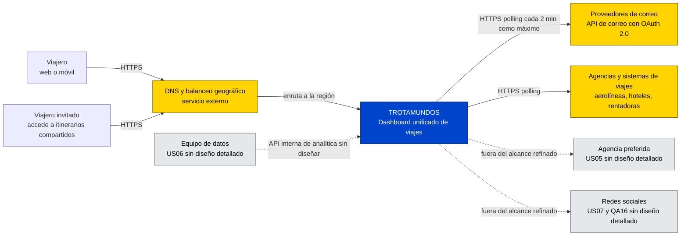

> Azul: sistema propio. Amarillo: sistemas externos con interacción diseñada. Gris: actores o sistemas previstos por las user stories que **no fueron refinados** en las iteraciones. Línea punteada: relación no diseñada.

### 1.3 Alcance

**Dentro del alcance diseñado**

| Tema                                                                       | User stories / QA                        | Iteración |
| -------------------------------------------------------------------------- | ---------------------------------------- | --------- |
| Estructura general, cliente-servidor, monolito modular                     | US01, C1, QA13                           | 1         |
| Integraciones externas, actualizaciones, tolerancia a fallo de proveedores | US01, US02, US04, QA01, QA04, QA14, QA15 | 2         |
| Escalabilidad, rendimiento y persistencia                                  | QA05, QA06, QA07                         | 3         |
| Seguridad y autenticación                                                  | QA08, QA09, QA15, US07 parcial           | 4         |
| Presentación web (SSR, payload, optimistic, preferencias)                  | QA02, QA03, QA11                         | 5         |
| Disponibilidad y despliegue                                                | QA04, QA13                               | 6         |
| Sistema de recomendación                                                   | US08, QA17, QA18                         | 7         |

**Sin refinamiento arquitectónico en las iteraciones** (quedan como backlog de diseño):

| Driver                                             | Estado                                                                                                                                |
| -------------------------------------------------- | ------------------------------------------------------------------------------------------------------------------------------------- |
| US03 Filtros y whitelists                          | Sin iteración. Se refleja en el modelo de dominio como ◇ derivado                                                                     |
| US05 Resolución de problemas con agencia preferida | Sin iteración                                                                                                                         |
| US06 Analítica de datos                            | Sin iteración                                                                                                                         |
| US07 Compartir reservas                            | Solo el flujo de autorización de acceso (ADR13). Interoperar con redes sociales y QA16 sin iteración                                  |
| QA10 Nuevos medios de transporte                   | Sin iteración dedicada. Parcialmente favorecido por Ports & Adapters y monolito modular                                               |
| QA12 Capacidades nativas móviles                   | Sin iteración                                                                                                                         |
| Cliente móvil                                      | La iteración 5 refinó el **cliente web**. El móvil solo está cubierto por la estructura general y la mención de AsyncStorage en ADR19 |

### 1.4 Trazabilidad de drivers a iteraciones y ADRs

| Driver                                 | Iteración | ADRs principales                            |
| -------------------------------------- | --------- | ------------------------------------------- |
| C1 Web y móvil                         | 1         | ADR01                                       |
| QA01 Presentar updates (5 min)         | 2         | ADR04, ADR05 (sondeo máx. 2 min)            |
| QA02 Respuesta web 800 ms              | 5         | ADR17, ADR18, ADR20 (+ ADR08, ADR09, ADR10) |
| QA03 Primer contenido móvil 1.4 s      | 5         | ADR17, ADR18, ADR20                         |
| QA04 Inactividad no planificada        | 2, 6      | ADR04, ADR07, ADR21, ADR22 (+ ADR08, ADR16) |
| QA05 15 M de cuentas                   | 3         | ADR10, ADR11                                |
| QA06 500 req/s                         | 3         | ADR08, ADR09, ADR10, ADR11                  |
| QA07 Picos 2500 req/s                  | 3         | ADR08, ADR11                                |
| QA08 Acceso a email seguro             | 4         | ADR12, ADR15                                |
| QA09 Itinerarios compartidos           | 4         | ADR13, ADR14, ADR16                         |
| QA11 UI simple                         | 5         | ADR17, ADR19                                |
| QA13 Multiregión                       | 1, 6      | ADR02, ADR21                                |
| QA14 APIs estándar                     | 2         | ADR05, ADR06, ADR07                         |
| QA15 Proveedores de email              | 2, 4      | ADR05, ADR06, ADR15                         |
| QA17 Generación de recomendaciones 3 s | 7         | ADR23, ADR24, ADR25                         |
| QA18 Feedback del usuario              | 7         | ADR25                                       |

---

## 2. Modelo de Dominio

> El modelo se **deriva** de las user stories y de los diagramas de secuencia de las iteraciones 2, 4, 5 y 7. Las iteraciones no incluyen un diagrama de clases. La única decisión estructural del dominio que viene de un ADR es la clave de partición `travelerID` (ADR11).

### 2.1 Diagrama de clases

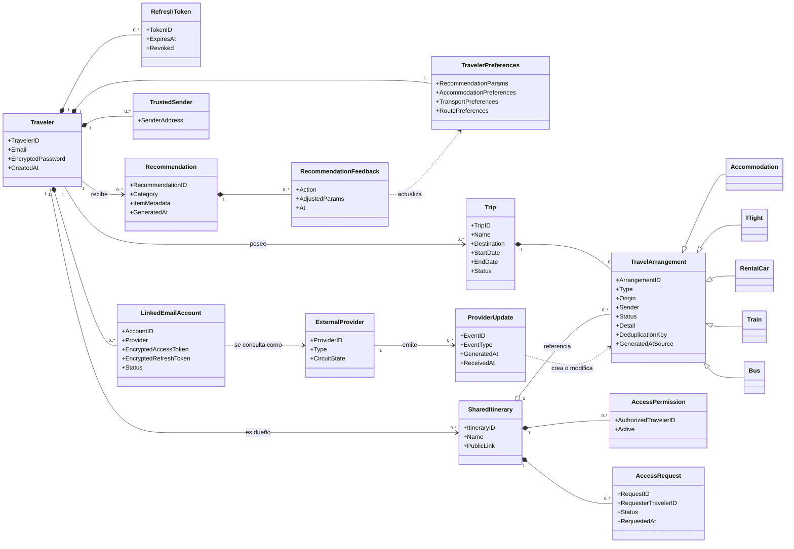

### 2.2 Agregados

| Agregado                       | Raíz                   | Entidades internas                                                          | Invariantes principales                                                                                                                                                                     | Partición               |
| ------------------------------ | ---------------------- | --------------------------------------------------------------------------- | ------------------------------------------------------------------------------------------------------------------------------------------------------------------------------------------- | ----------------------- |
| **Cuenta del viajero**         | Traveler | RefreshToken, TravelerPreferences, LinkedEmailAccount, TrustedSender | Email único. Credenciales cifradas (ADR14). Nunca se guarda usuario y contraseña del correo, solo tokens OAuth (ADR15)                                                                      | `travelerID`             |
| **Viaje**                      | Trip | TravelArrangement y subtipos                                                     | Todo arreglo pertenece a un único viaje. Un arreglo recibido de varias fuentes se **identifica y no se duplica** (US01). Al completarse el viaje se retiran de la vista sus reservas (US03) | `travelerID`             |
| **Itinerario compartido**      | SharedItinerary   | AccessPermission, AccessRequest                                              | Solo ven el itinerario los autorizados (QA09, 0 accesos no autorizados). Todo acceso nuevo requiere decisión del dueño (ADR13)                                                              | `travelerID` del dueño ◇ |
| **Recomendación**              | Recommendation | RecommendationFeedback                                                       | Se genera a partir de historial y preferencias. El feedback se aplica a la **siguiente** recomendación (QA18)                                                                               | `travelerID`             |
| **Actualización de proveedor** | ProviderUpdate | n/a                                                                         | Mensaje transitorio ya normalizado (ADR06). No es agregado persistente                                                                                                                      | n/a                     |

### 2.3 Tabla de responsabilidades del dominio

| Entidad                | Responsabilidad                                                                                                                                          | Origen         |
| ---------------------- | -------------------------------------------------------------------------------------------------------------------------------------------------------- | -------------- |
| Traveler | Identidad, credenciales y dueño de viajes, itinerarios y preferencias                                                                                    | US01, ADR14    |
| RefreshToken           | Permite renovar el access token de vida corta y es revocable en el servicio de identidad                                                                 | ADR16          |
| TravelerPreferences    | Parámetros que alimentan y refinan las recomendaciones. Se almacenan en el perfil. **Distintas** de las preferencias visuales, que viven en LocalStorage | Iter. 7, ADR19 |
| LinkedEmailAccount   | Vínculo OAuth 2.0 revocable con un proveedor de correo para el escaneo automático                                                                        | US02, ADR15    |
| TrustedSender     | Whitelist de remitentes de correo ◇                                                                                                                      | US03           |
| Trip | Agrupa los arreglos del viajero y organiza el dashboard                                                                                                  | US01           |
| TravelArrangement           | Reserva (hotel, auto, vuelo, tren, bus) con origen (manual, correo, agencia o sistema de viajes) y remitente si proviene de correo                       | US01, US03     |
| SharedItinerary   | Grupo de reservas compartido, con link público por defecto                                                                                               | US07           |
| AccessPermission          | Autorización vigente de un viajero sobre un itinerario, revocable                                                                                        | US07, ADR13    |
| AccessRequest        | Solicitud pendiente de un viajero no autorizado que llegó por el link                                                                                    | US07, ADR13    |
| ExternalProvider       | Fuente consultada por sondeo, con estado del circuit breaker                                                                                             | ADR05, ADR07   |
| ProviderUpdate | Evento normalizado que viaja por la cola P2P hacia travelarrangements                                                                                     | ADR04, ADR06   |
| Recommendation | Alternativa de alojamiento, transporte o ruta generada por filtrado basado en contenido                                                                  | US08, ADR25    |
| RecommendationFeedback  | Aceptar, rechazar o ajustar parámetros (human-in-the-loop)                                                                                               | QA18           |

---

## 3. Vista de Contenedores

### 3.1 Diagrama C4 de contenedores (final tras la iteración 7)

Incorpora el patrón de despliegue de la iteración 6: **el sistema completo se replica en cada región** y el DNS reparte entre regiones. Por eso el balanceador y la cola dejan de ser single point of failure global.

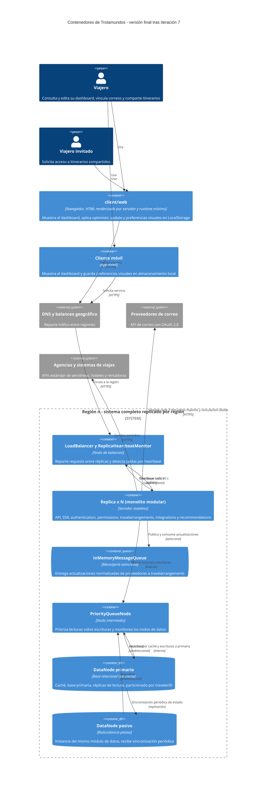

### 3.2 Tabla de responsabilidades de contenedores

| Contenedor                                  | Responsabilidad                                                                                                                                                                                                             | Cantidad                                  | ADRs                  | QA principales   |
| ------------------------------------------- | --------------------------------------------------------------------------------------------------------------------------------------------------------------------------------------------------------------------------- | ----------------------------------------- | --------------------- | ---------------- |
| **client/web**                             | Recibe el dashboard renderizado, muestra solo datos críticos al inicio, refleja cambios manuales al instante (optimistic update), aplica orden y tema desde LocalStorage, pide recomendaciones en una request independiente | 1 por viajero                             | ADR17, 18, 19, 20, 23 | QA02, QA03, QA11 |
| **Cliente móvil**                           | Mismo dashboard para móvil, preferencias visuales en AsyncStorage                                                                                                                                                           | 1 por viajero                             | ADR01, 19             | C1, QA03         |
| **DNS y balanceo geográfico** (externo)     | Reparte tráfico entre regiones                                                                                                                                                                                              | n/a                                       | ADR21                 | QA04, QA13       |
| **LoadBalancer y ReplicaHeartbeatMonitor**          | Punto de entrada de la región. Distribuye requests entre réplicas y las saca de rotación si pierden heartbeats (3 pulsos de 10 s)                                                                                           | 1 por región                              | ADR08, 22             | QA06, QA07, QA04 |
| **Replica (monolito modular)**              | Toda la lógica de negocio, stateless. Valida tokens localmente. Incluye los módulos API, authentication, permissions, travelarrangements, integrations y recommendations, más el renderizado SSR                                 | N por región, según demanda y geografía   | ADR02, 08, 16, 21     | QA06, QA07, QA04 |
| **InMemoryMessageQueue**                    | Desacopla el broker de integraciones del módulo travelarrangements. Si la lógica cae, los mensajes quedan en la cola                                                                                                         | 1 ◇ (ubicación en despliegue sin definir) | ADR04                 | QA01, QA04       |
| **PriorityQueueNode** | Ordena operaciones (lectura primero, escritura después, FIFO dentro de cada tipo). Monitorea heartbeats de los nodos de datos y ejecuta el intercambio de responsabilidades                                                 | 1 por región                              | ADR09, 21, 22         | QA06, QA07, QA04 |
| **DataNode primario**                  | Caché de lecturas, base primaria de escrituras, réplicas de lectura, particionado por `travelerID`. Envía sincronización periódica a la instancia pasiva                                                                     | 1 activo por región                       | ADR10, 11, 21         | QA05, QA06, QA07 |
| **DataNode pasivo**                    | Instancia del mismo módulo de datos. Asume el rol primario ante fallo del activo                                                                                                                                            | 1 por región                              | ADR21, 22             | QA04             |
| **Proveedores de correo** (externo)         | API del correo, acceso por OAuth 2.0                                                                                                                                                                                        | n/a                                       | ADR15                 | QA08, QA15       |
| **Agencias y sistemas de viajes** (externo) | APIs estándar de agencias y sistemas de viajes                                                                                                                                                                              | n/a                                       | ADR05                 | QA14             |

---

## 4. Vistas de Componentes

### 4.1 client/web

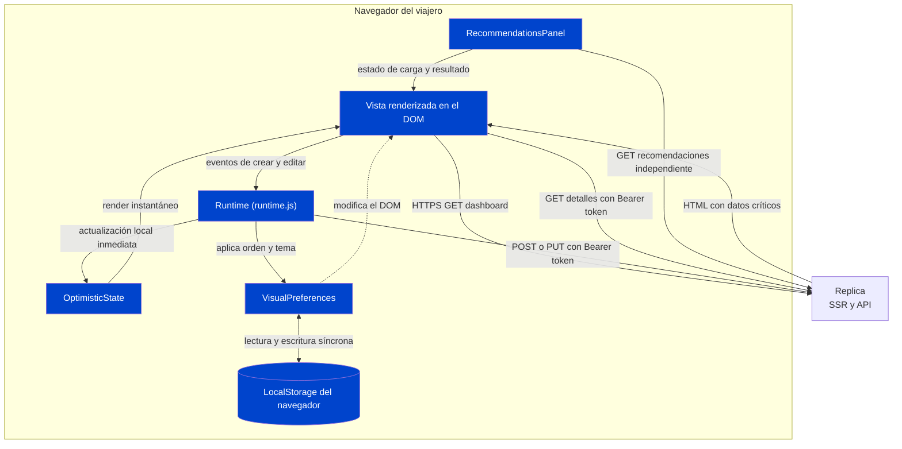

### 4.2 Cliente móvil

> La iteración 5 no refinó el cliente móvil. Se muestra solo lo que ADR01, ADR17, ADR18, ADR19 y ADR23 permiten afirmar, con estructura análoga al cliente web. El SSR (ADR20) aplica únicamente a web.

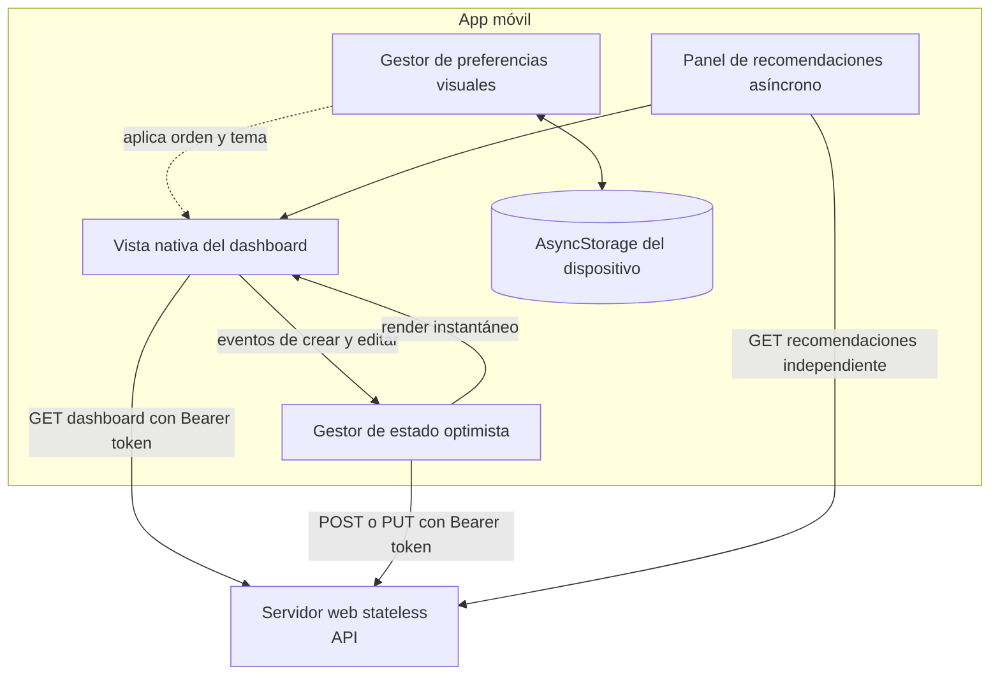

### 4.3 LoadBalancer y ReplicaHeartbeatMonitor

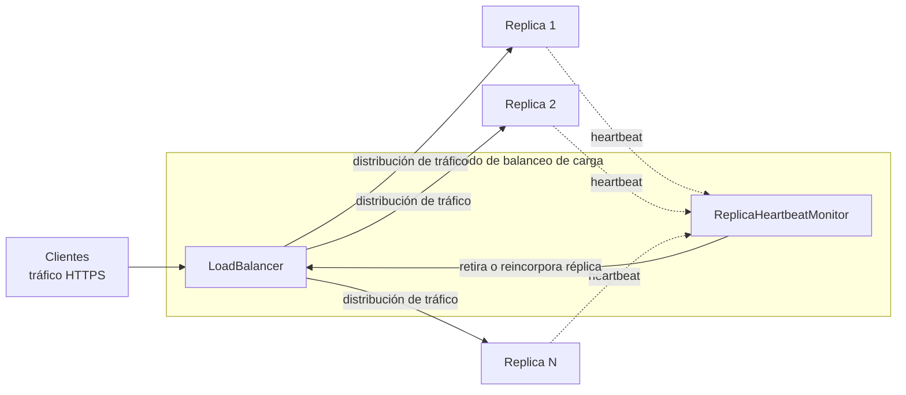

### 4.4 Servidor: réplica del monolito modular

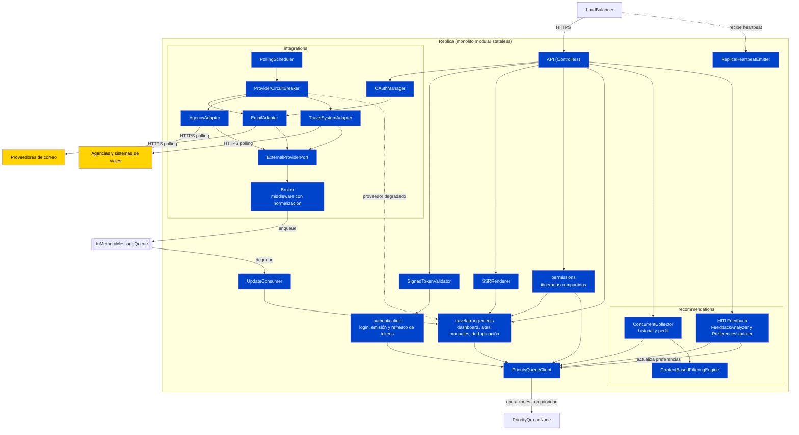

### 4.5 PriorityQueueNode y monitor de BD

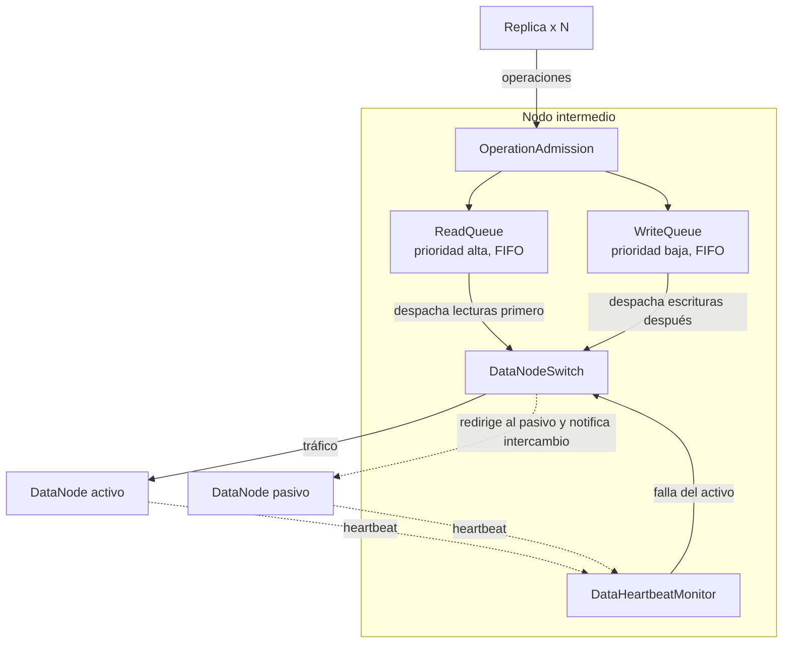

### 4.6 DataNode

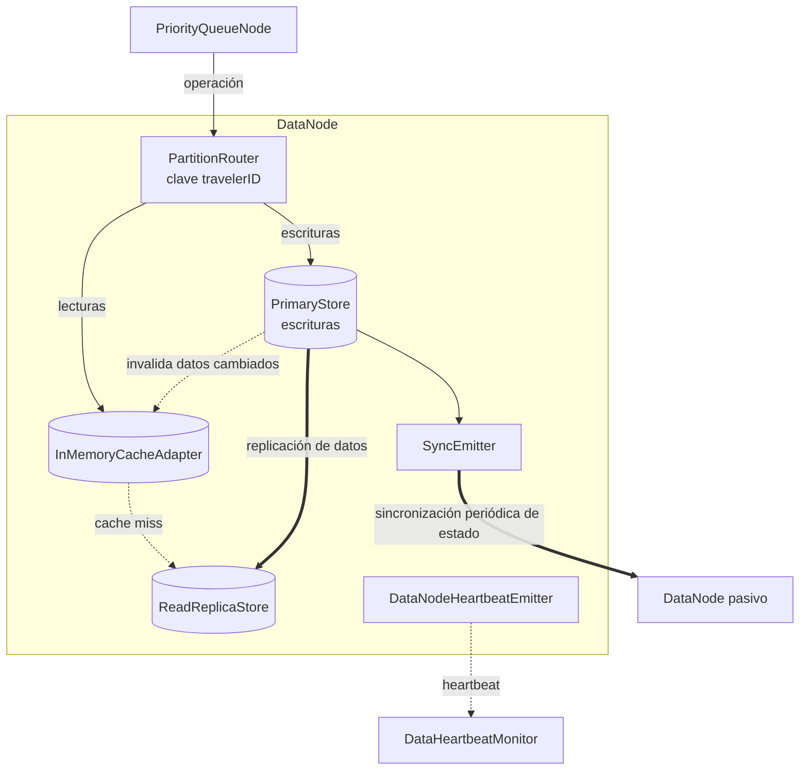

> El nodo pasivo es una instancia del mismo módulo, con la misma estructura interna.

### 4.7 Tabla de componentes

| Componente                                   | Contenedor               | Responsabilidad                                                                                       | Decisión       |
| -------------------------------------------- | ------------------------ | ----------------------------------------------------------------------------------------------------- | -------------- |
| Vista / DOM                                  | client/web              | Renderiza el dashboard con datos críticos y los detalles bajo demanda                                 | ADR17, 20      |
| Runtime (runtime.js)                    | client/web              | Captura eventos de crear y editar, orquesta optimistic update y llamadas con Bearer token             | ADR18          |
| OptimisticState                   | client/web, móvil       | Aplica el cambio local al instante y revierte si el backend responde distinto de 2xx                  | ADR18          |
| VisualPreferences              | client/web, móvil       | Lee y escribe orden y tema en LocalStorage o AsyncStorage antes de pedir datos                        | ADR19          |
| RecommendationsPanel                     | client/web, móvil       | Request independiente, estado de carga y manejo de fallo sin bloquear las reservas                    | ADR23          |
| LoadBalancer                         | LB                       | Reparte requests entre réplicas stateless                                                             | ADR08          |
| ReplicaHeartbeatMonitor            | LB                       | Marca una réplica caída tras 3 pulsos perdidos (frecuencia de 10 s)                                   | ADR22, iter. 6 |
| API (Controllers)                          | Replica | Único punto de entrada de los clientes. Autentica y enruta a módulos                                  | ADR01, 02      |
| SignedTokenValidator                   | Replica | Valida firma y vigencia sin estado compartido                                                         | ADR16          |
| SSRRenderer                             | Replica | Genera el HTML del dashboard con payload reducido                                                     | ADR17, 20      |
| authentication | Replica | Login con email y contraseña, emisión y refresco de tokens, revocación del refresh                    | ADR14, 16      |
| permissions                          | Replica | Verifica acceso a itinerarios, registra solicitudes y decisiones del dueño, notifica                  | ADR13          |
| travelarrangements                            | Replica | Lógica central. Dashboard, altas, bajas y cambios manuales, deduplicación, consumo de actualizaciones | ADR02, 04      |
| UpdateConsumer                | Replica | Consume la cola P2P y registra en travelarrangements                                                   | ADR04          |
| PriorityQueueClient               | Replica | Encola toda operación de datos con su tipo (lectura o escritura)                                      | ADR09          |
| ReplicaHeartbeatEmitter | Replica | Pulso periódico hacia el balanceador                                                                  | ADR22          |
| PollingScheduler                       | Replica, integrations | Dispara sondeos a intervalos cortos (máx. 2 min) para cumplir los 5 min de QA01                       | ADR05          |
| ProviderCircuitBreaker | Replica, integrations | Por proveedor. Reintentos acotados con espera progresiva. Abre el circuito y avisa al usuario         | ADR07          |
| EmailAdapter, AgencyAdapter, TravelSystemAdapter | Replica, integrations | Uno por tipo de proveedor. Traducen al modelo del puerto                                              | ADR05          |
| ExternalProviderPort                  | Replica, integrations | Abstrae al proveedor. Único punto por el que entran datos externos                                    | ADR05          |
| Broker (middleware)                          | Replica, integrations | Normaliza al formato de la lógica y publica en la cola P2P                                            | ADR04, 06      |
| OAuthManager                       | Replica, integrations | Vinculación, almacenamiento y revocación de permisos de correo                                        | ADR15          |
| ConcurrentCollector                       | Replica, recommendations | Consulta en paralelo historial (varias tablas) y perfil                                               | ADR24          |
| ContentBasedFilteringEngine        | Replica, recommendations | Filtra la lista de arreglos de proveedores por metadatos y preferencias                               | ADR25          |
| HITLFeedback                       | Replica, recommendations | Analiza feedback y actualiza preferencias para la próxima recomendación                               | ADR25          |
| ReadQueue y WriteQueue             | PriorityQueueNode | Lecturas antes que escrituras, FIFO por tipo                                                          | ADR09          |
| DataHeartbeatMonitor y DataNodeSwitch  | PriorityQueueNode | Detecta caída del nodo activo y redirige al pasivo                                                    | ADR21, 22      |
| PartitionRouter                       | DataNode            | Dirige cada operación al shard de `travelerID` ◇                                                       | ADR11          |
| InMemoryCacheAdapter | DataNode            | Atiende lecturas frecuentes. Se invalida al escribir                                                  | ADR10          |
| PrimaryStore y ReadReplicaStore | DataNode            | Escrituras en la primaria, replicación hacia las réplicas, lecturas con cache miss                    | ADR10          |
| SyncEmitter                     | DataNode            | Envía estado periódicamente al nodo pasivo                                                            | ADR21          |

---

## 5. Vistas Dinámicas

### 5.1 Carga inicial del dashboard con recomendaciones asíncronas

**QA:** QA02 (800 ms p95), QA03 (1.4 s), QA17 (3 s), QA06. **ADRs:** 08, 09, 10, 11, 16, 17, 19, 20, 23, 24.

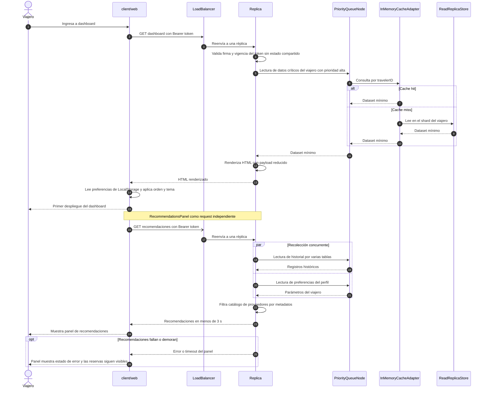

### 5.2 Alta o edición manual con optimistic update

**QA:** QA02, QA03. **ADRs:** 17, 18, 16. _(El diagrama de la iteración 5 repite "Confirmación exitosa" en la rama no 2xx. Aquí se muestra la intención documentada: rollback visual.)_

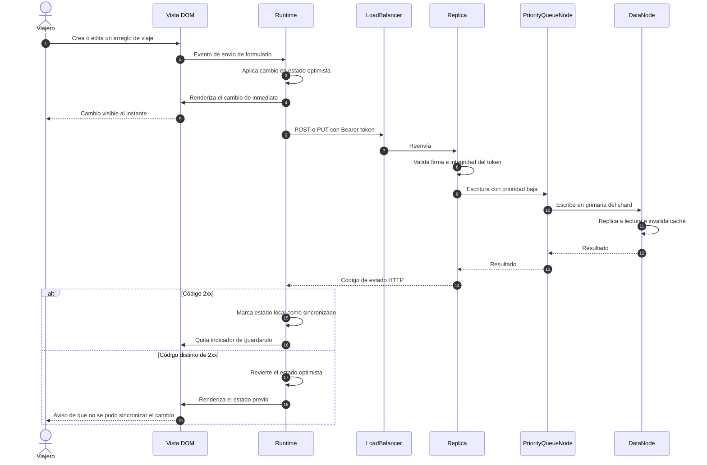

### 5.3 Ingesta de actualizaciones de proveedores con circuit breaker

**QA:** QA01 (5 min), QA04, QA14, QA15. **ADRs:** 04, 05, 06, 07, 09.

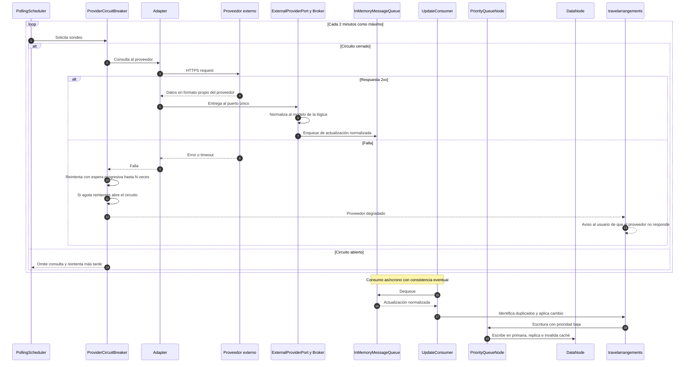

### 5.4 Vinculación de correo con OAuth 2.0

**QA:** QA08, QA15. **ADRs:** 12, 15.

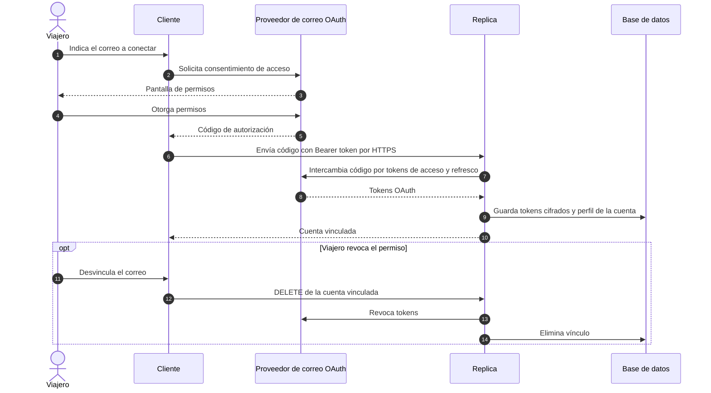

### 5.5 Autenticación con tokens de vida corta

**QA:** QA09, QA04, QA06, QA07. **ADRs:** 14, 16, 12.

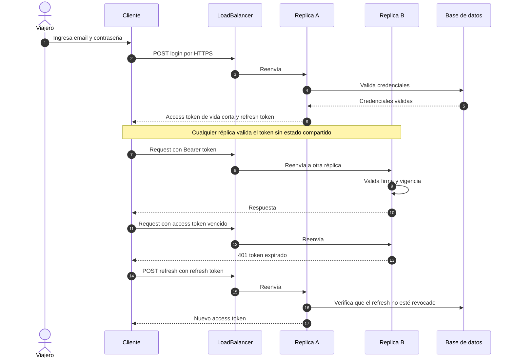

### 5.6 Acceso a un itinerario compartido

**QA:** QA09. **ADRs:** 13, 14, 16.

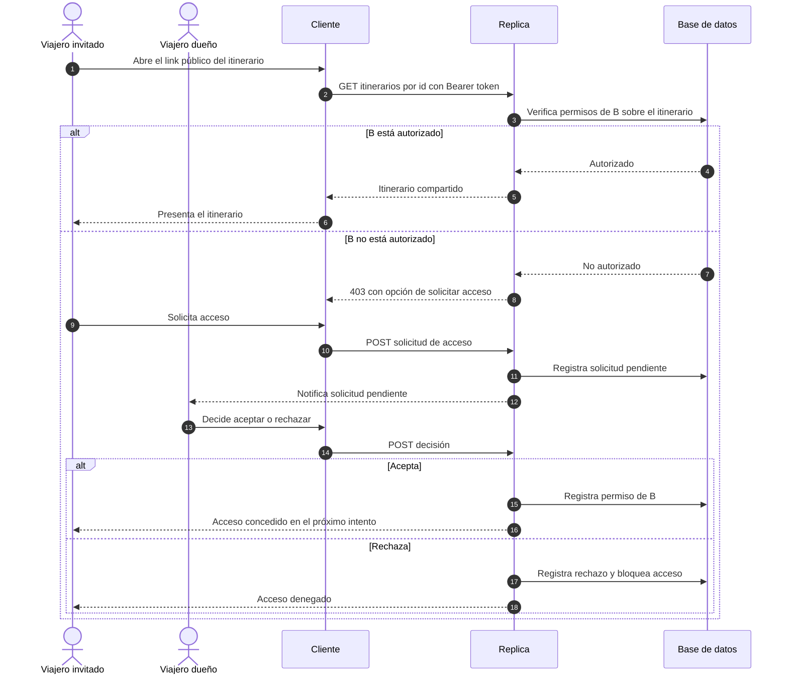

### 5.7 Detección de fallos y conmutación

**QA:** QA04 (detección menor a 1 min, inactividad menor a 5 min por mes). **ADRs:** 08, 21, 22. Parámetros de la iteración 6: pulso cada 10 s y nodo caído tras 3 pulsos perdidos, es decir unos 30 s.

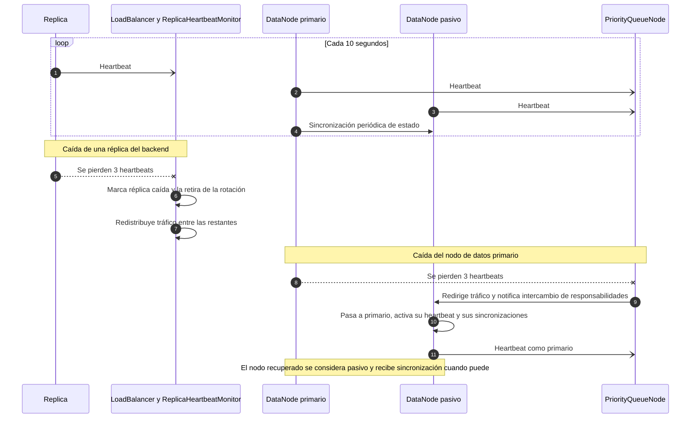

### 5.8 Retroalimentación human-in-the-loop

**QA:** QA18. **ADR:** 25.

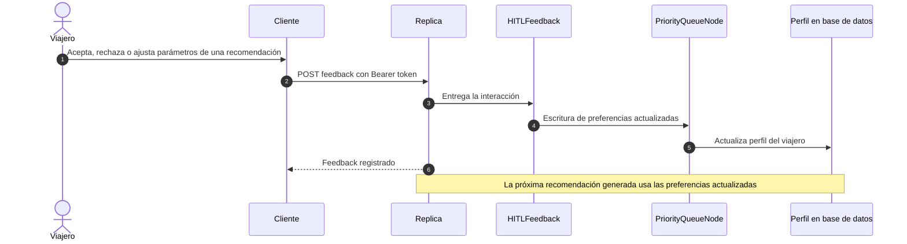

### 5.9 Escenarios de calidad, mecanismo y vista

| QA   | Medida de respuesta                                    | Mecanismo en la arquitectura                                                             | Vista    |
| ---- | ------------------------------------------------------ | ---------------------------------------------------------------------------------------- | -------- |
| QA01 | Update visible en menos de 5 min (p95)                 | Sondeo máx. 2 min + cola P2P asíncrona                                                   | 5.3      |
| QA02 | 800 ms p95 en lectura del dashboard                    | SSR, payload reducido, caché, lecturas con prioridad                                     | 5.1      |
| QA03 | 1.4 s al primer contenido móvil (85%)                  | Payload reducido, optimistic update, preferencias locales                                | 5.1, 5.2 |
| QA04 | Detección menor a 1 min, inactividad menor a 5 min/mes | Réplicas activas, heartbeat, redundancia pasiva, replicación por región, circuit breaker | 5.3, 5.7 |
| QA05 | 300 ms con 15 M de cuentas                             | Base relacional, caché, sharding por `travelerID`                                         | 5.1      |
| QA06 | 800 ms con 500 req/s                                   | Balanceo, cola de prioridad, caché, sharding                                             | 5.1      |
| QA07 | Soporta 2500 req/s                                     | Réplicas escalables detrás del LB, sharding                                              | 5.5, 5.7 |
| QA08 | 100% de conexiones cifradas                            | HTTPS en todo, OAuth sin guardar contraseña de correo                                    | 5.4      |
| QA09 | 0 accesos no autorizados                               | Autenticación por token, aprobación del dueño                                            | 5.5, 5.6 |
| QA13 | Menos de 15 persona-días, 0 cambios en lógica central  | Sistema replicado por región, adapters por proveedor                                     | 3.1      |
| QA14 | 2xx en 90%, parseable                                  | Ports & Adapters, normalización en broker                                                | 5.3      |
| QA15 | Sincronización en 90% de casos                         | OAuth 2.0, EmailAdapter                                                                 | 5.4      |
| QA17 | Menos de 3 s                                           | Carga asíncrona, consultas concurrentes, shard por viajero                               | 5.1      |
| QA18 | Feedback usado en la próxima recomendación             | HITL actualiza el perfil                                                                 | 5.8      |

---

## 6. Contratos e Interfaces (Spec-driven)

### 6.1 Convenciones

| Aspecto         | Contrato                                                                                                                                        | Origen         |
| --------------- | ----------------------------------------------------------------------------------------------------------------------------------------------- | -------------- |
| Transporte      | Solo HTTPS. No se permite HTTP                                                                                                                  | ADR12          |
| Autenticación   | Header `Authorization: Bearer <accessToken>`. Token firmado de vida corta                                                                       | ADR16, iter. 5 |
| Formato         | JSON (`Content-Type: application/json`), salvo `GET /dashboard` en web que devuelve HTML renderizado                                            | ADR20          |
| Errores         | `{ "codigo": "STRING", "mensaje": "STRING" }` ◇                                                                                                 | ◇              |
| Códigos         | 200, 201, 202, 204, 400, 401 (token inválido o expirado), 403 (sin permiso), 404, 409 (conflicto), 422 (validación), 503 (módulo no disponible) | ◇              |
| Identificadores | `travelerID` es la clave de partición. Se extrae del token, nunca del body ◇                                                                     | ADR11          |
| Marca de origen | **✔** definido explícitamente en iteraciones o ADRs. **◇** derivado de user stories o diagramas                                                 | n/a            |

### 6.2 Endpoints HTTP

#### Autenticación (ADR14, ADR16)

**✔ `POST /login`**: autentica con email y contraseña.

```json
// Request
{ "email": "ana@example.com", "password": "********" }
// Response 200
{ "accessToken": "string", "refreshToken": "string", "expiresIn": 900, "tokenType": "Bearer" }
// Response 401
{ "codigo": "CREDENCIALES_INVALIDAS", "mensaje": "..." }
```

**◇ `POST /token/refresh`**: renueva el access token.

```json
// Request
{ "refreshToken": "string" }
// Response 200
{ "accessToken": "string", "expiresIn": 900, "tokenType": "Bearer" }
// Response 401
{ "codigo": "REFRESH_REVOCADO_O_EXPIRADO", "mensaje": "..." }
```

**◇ `POST /logout`**: revoca el refresh token (única vía de revocación, ADR16). Request `{ "refreshToken": "string" }`, response `204`.

**◇ `POST /registro`** (QA05): request `{ "email", "password" }`, response `201 { "idViajero": "string" }`.

#### Dashboard y arreglos (US01, ADR17, ADR18, ADR20)

**✔ `GET /dashboard`**: dashboard con **solo datos críticos**.

- Web: responde **HTML renderizado** (SSR), no JSON.
- Móvil: **◇** mismo recurso con `Accept: application/json`
- Objetivo: 800 ms p95 en web, primer contenido en 1.4 s en móvil.

```json
// Response 200 (representación JSON ◇)
{
  "viajes": [
    {
      "idViaje": "string",
      "nombre": "string",
      "destino": "string",
      "fechaInicio": "2026-12-01",
      "fechaFin": "2026-12-15",
      "arreglos": [
        {
          "idArreglo": "string",
          "tipo": "VUELO|ALOJAMIENTO|AUTO|TREN|BUS",
          "titulo": "string",
          "fechaInicio": "2026-12-01T10:00:00Z",
          "estado": "CONFIRMADO|CANCELADO|MODIFICADO",
          "origen": "MANUAL|EMAIL|AGENCIA|VIAJES"
        }
      ]
    }
  ],
  "avisosProveedores": [
    { "proveedor": "string", "mensaje": "No se pudo conectar con el proveedor" }
  ]
}
```

**✔ `GET /arreglos/{idArreglo}`**: detalle completo bajo demanda. Respuesta JSON o fragmento HTML para recarga parcial.

```json
// Response 200
{
  "idArreglo": "string",
  "idViaje": "string",
  "tipo": "string",
  "estado": "string",
  "origen": "string",
  "remitente": "string|null",
  "detalle": {},
  "actualizadoEn": "ISO-8601"
}
```

**✔ `POST /arreglos`** (alta manual, **◇** ruta exacta): response `201 { "idArreglo": "string" }`.

```json
{
  "idViaje": "string",
  "tipo": "VUELO",
  "titulo": "string",
  "fechaInicio": "ISO-8601",
  "fechaFin": "ISO-8601",
  "detalle": {}
}
```

**✔ `PUT /arreglos/{idArreglo}`** (edición manual, **◇** ruta exacta): mismo body que POST, response `200`. **◇ `DELETE /arreglos/{idArreglo}`**: baja manual, response `204`.

Las tres operaciones pasan por la cola de prioridades como escritura. El cliente aplica el cambio de forma optimista y revierte si el código es distinto de 2xx.

#### Recomendaciones (US08, ADR23, ADR25)

**◇ `GET /recomendaciones`**: request **independiente** del dashboard. Límite de generación 3 s (QA17).

```json
// Response 200
{
  "recomendaciones": [
    {
      "idRecomendacion": "string",
      "categoria": "ALOJAMIENTO|TRANSPORTE|RUTA",
      "titulo": "string",
      "metadatos": {},
      "proveedor": "string"
    }
  ]
}
```

**◇ `POST /recomendaciones/{idRecomendacion}/feedback`**: human-in-the-loop (QA18).

```json
// Request
{ "accion": "ACEPTAR|RECHAZAR|AJUSTAR", "parametrosAjustados": { "presupuestoMax": 120 } }
// Response 200
{ "registrado": true }
```

**◇ `PUT /perfil/preferencias`**: preferencias de recomendación almacenadas en el perfil. Request `{ "parametros": { } }`, response `200`.

#### Vinculación de correo (ADR15)

**✔ flujo, ◇ ruta: `POST /correos`**: el cliente envía el código OAuth obtenido del proveedor.

```json
// Request
{ "proveedor": "string", "authorizationCode": "string", "redirectUri": "string" }
// Response 201
{ "idCuenta": "string", "proveedor": "string", "estado": "VINCULADA" }
```

**◇ `DELETE /correos/{idCuenta}`**: revoca los tokens OAuth, response `204`.

#### Itinerarios compartidos (US07, ADR13)

| Ruta                                                        | Descripción                                                      | Request                            | Response                                                                                                                 | Origen                     |
| ----------------------------------------------------------- | ---------------------------------------------------------------- | ---------------------------------- | ------------------------------------------------------------------------------------------------------------------------ | -------------------------- | ------------- | ------- |
| `GET /itinerarios/{idItinerario}`                           | Ver itinerario. Si no hay permiso, informa que puede solicitarlo | n/a                                | `200 { "idItinerario", "nombre", "arreglos": [ ] }` o `403 { "codigo": "ACCESO_NO_AUTORIZADO", "puedeSolicitar": true }` | ✔                          |
| `POST /itinerarios`                                         | Crear itinerario compartido                                      | `{ "nombre", "idsArreglos": [ ] }` | `201 { "idItinerario", "linkPublico" }`                                                                                  | ◇                          |
| `DELETE /itinerarios/{id}`                                  | Eliminar itinerario                                              | n/a                                | `204`                                                                                                                    | ◇                          |
| `POST /itinerarios/{id}/arreglos`                           | Agregar reserva                                                  | `{ "idArreglo" }`                  | `204`                                                                                                                    | ◇                          |
| `DELETE /itinerarios/{id}/arreglos/{idArreglo}`             | Quitar reserva                                                   | n/a                                | `204`                                                                                                                    | ◇                          |
| `POST /itinerarios/{id}/solicitudes`                        | Solicitar acceso (queda pendiente)                               | n/a                                | `201 { "idSolicitud", "estado": "PENDIENTE" }`                                                                           | ◇                          |
| `GET /itinerarios/{id}/solicitudes`                         | Dueño lista pendientes                                           | n/a                                | `200 { "solicitudes": [ { "idSolicitud", "idViajero", "estado" } ] }`                                                    | ◇                          |
| `POST /itinerarios/{id}/solicitudes/{idSolicitud}/decision` | Dueño acepta o rechaza                                           | `{ "decision": "ACEPTAR            | RECHAZAR" }`                                                                                                             | `200 { "estado": "ACEPTADA | RECHAZADA" }` | ✔ flujo |
| `DELETE /itinerarios/{id}/accesos/{idViajero}`              | Desautorizar                                                     | n/a                                | `204`                                                                                                                    | ◇                          |

Cuando se crea una solicitud se genera la notificación al dueño (ADR13). El canal de entrega de esa notificación **no está definido**

### 6.3 Eventos asíncronos

#### E1 `ProviderUpdateNormalized` ✔ flujo, ◇ payload

| Campo      | Valor                                                                                           |
| ---------- | ----------------------------------------------------------------------------------------------- |
| Canal      | InMemoryMessageQueue (ADR04)                                                          |
| Productor  | Broker (middleware de integrations), tras normalizar (ADR06)                          |
| Consumidor | UpdateConsumer, en travelarrangements (único consumidor)                          |
| Semántica  | Asíncrona, consistencia eventual. Los mensajes persisten en la cola si el consumidor está caído |

```json
{
  "eventId": "uuid",
  "tipoEvento": "ARREGLO_CREADO|ARREGLO_MODIFICADO|ARREGLO_CANCELADO",
  "idViajero": "string",
  "proveedor": { "tipo": "EMAIL|AGENCIA|VIAJES", "idProveedor": "string" },
  "origenRemitente": "string|null",
  "arreglo": {
    "tipo": "VUELO|ALOJAMIENTO|AUTO|TREN|BUS",
    "claveDeduplicacion": "string",
    "estado": "CONFIRMADO|MODIFICADO|CANCELADO",
    "fechaInicio": "ISO-8601",
    "fechaFin": "ISO-8601",
    "detalle": {}
  },
  "generadoEnFuente": "ISO-8601",
  "recibidoEn": "ISO-8601"
}
```

`generadoEnFuente` y `recibidoEn` permiten medir QA01 (5 min p95). `claveDeduplicacion` soporta la regla de US01 de no duplicar reservas provenientes de varias fuentes.

#### E2 `ProviderDegraded` ◇

| Campo      | Valor                                                                     |
| ---------- | ------------------------------------------------------------------------- |
| Productor  | ProviderCircuitBreaker (ADR07) al agotar reintentos                              |
| Consumidor | travelarrangements, que lo expone como `avisosProveedores` en el dashboard |

```json
{
  "idProveedor": "string",
  "tipo": "EMAIL|AGENCIA|VIAJES",
  "idViajero": "string|null",
  "estadoCircuito": "ABIERTO|CERRADO",
  "reintentos": 3,
  "proximoIntento": "ISO-8601"
}
```

#### E3 `Heartbeat` ✔ flujo, ◇ payload

| Campo        | Valor                                                                                                              |
| ------------ | ------------------------------------------------------------------------------------------------------------------ |
| Productores  | Replica x N hacia el balanceador. Nodos de datos (primario y pasivo) hacia el PriorityQueueNode |
| Consumidores | LoadBalancer y ReplicaHeartbeatMonitor. DataHeartbeatMonitor                                                                      |
| Parámetros   | Pulso cada 10 s. Caído tras 3 pulsos perdidos (iter. 6)                                                            |

```json
{
  "nodoId": "string",
  "tipoNodo": "BACKEND|DATOS",
  "rol": "ACTIVO|PASIVO|N/A",
  "secuencia": 1024,
  "emitidoEn": "ISO-8601"
}
```

#### E4 `ResponsibilitySwap` ✔ flujo, ◇ payload

| Campo      | Valor                                                                                                           |
| ---------- | --------------------------------------------------------------------------------------------------------------- |
| Productor  | DataHeartbeatMonitor en el PriorityQueueNode (ADR22)                                                         |
| Consumidor | DataNode pasivo, que pasa a primario y activa heartbeat y sincronizaciones. El nodo anterior pasa a pasivo |

```json
{
  "regionId": "string",
  "nuevoPrimario": "string",
  "nuevoPasivo": "string",
  "motivo": "HEARTBEAT_PERDIDO",
  "ocurridoEn": "ISO-8601"
}
```

#### E5 `StateSync` ✔ flujo, ◇ payload

Productor: nodo de datos primario. Consumidor: nodo de datos pasivo. Frecuencia periódica a definir (tradeoff costo y datos expuestos, ADR21).

```json
{
  "origen": "string",
  "destino": "string",
  "versionEstado": 42,
  "emitidoEn": "ISO-8601"
}
```

#### E6 `DataWritten` ✔ flujo, ◇ nombre

Productor: base primaria. Consumidores: réplicas de lectura (sobreescritura) y caché (invalidación). Ver ADR10.

```json
{
  "idViajero": "string",
  "entidad": "ARREGLO|VIAJE|PERFIL|PERMISO",
  "claves": ["string"],
  "version": 123
}
```

#### E7 `AccessRequestCreated` ◇

Productor: permissions. Consumidor: canal de notificación al dueño (ADR13). Mecanismo de entrega no definido.

```json
{
  "idItinerario": "string",
  "idDueno": "string",
  "idSolicitante": "string",
  "idSolicitud": "string",
  "creadaEn": "ISO-8601"
}
```

#### E8 `QueuedOperation` ✔ flujo (ADR09), ◇ payload

Productor: PriorityQueueClient en cada réplica. Consumidor: PriorityQueueNode. Los mensajes se ordenan por prioridad y luego FIFO.

```json
{
  "operacionId": "uuid",
  "tipo": "LECTURA|ESCRITURA",
  "prioridad": 1,
  "idViajero": "string",
  "recurso": "string",
  "payload": {},
  "encoladaEn": "ISO-8601"
}
```

### 6.4 Interfaces de puertos clave

Interfaces en pseudo-notación agnóstica de tecnología (Concern del proyecto). Solo describen el contrato, no su implementación.

```text
// Puerto único de proveedores externos (ADR05, ADR06). Código: src/ports/external_provider_port.go
interface ExternalProviderPort {
    ProviderType(): EMAIL | AGENCIA | VIAJES
    Poll(ref: ProviderReference, since: Timestamp): List<ProviderUpdateNormalized>
    // Un Adapter por tipo (EmailAdapter, AgencyAdapter, TravelSystemAdapter) implementa este puerto y traduce
    // el formato del proveedor al modelo interno.
    // Errores: ProveedorNoDisponible, CredencialInvalida, RespuestaNoParseable
}

// Circuit breaker por proveedor (ADR07). Implementa: ProviderCircuitBreaker
interface CircuitBreakerPort {
    Execute(providerID, operation): Result
    State(providerID): CLOSED | OPEN | HALF_OPEN       // valores del contrato: CERRADO | ABIERTO | SEMIABIERTO
    // Reintentos acotados con espera progresiva. Al abrir publica ProviderDegraded
}

// Cola de mensajes punto a punto (ADR04). Implementa: InMemoryMessageQueue
interface MessageQueuePort {
    Publish(event: ProviderUpdateNormalized): Confirmation
    Consume(): ProviderUpdateNormalized
    Ack(eventID): void
    // Un único consumidor. Sin invocación directa entre integrations y travelarrangements
}

// Cola de prioridades (ADR09). Implementa: PriorityQueueClient (réplica) → PriorityQueueNode
interface PriorityQueuePort {
    Enqueue(op: QueuedOperation): Future<Result>
    // Lectura con prioridad mayor que escritura. FIFO dentro de cada tipo
}

// Acceso a datos tras la cola (ADR10, ADR11). Implementa: DataNode
interface DataPort {
    Read(travelerID, query): Result      // caché primero, réplica de lectura si hay miss
    Write(travelerID, command): Result   // primaria, replica e invalida caché
    // Enrutado al shard por travelerID (PartitionRouter)
}

// Tokens (ADR16)
interface TokenServicePort {
    Issue(travelerID): { accessToken, refreshToken }
    Validate(accessToken): Claims | TokenInvalid | TokenExpired   // local, sin estado compartido
    Refresh(refreshToken): accessToken
    RevokeRefresh(refreshToken): void
}

// Autorización delegada de correo (ADR15). Implementa: MockOAuth2AuthAdapter (stub del prototipo)
interface OAuthEmailPort {
    ExchangeCode(provider, authorizationCode, redirectURI): OAuthTokens
    Refresh(accountID): OAuthTokens
    Revoke(accountID): void
}

// Permisos de itinerarios (ADR13)
interface ItineraryPermissionsPort {
    CanView(travelerID, itineraryID): boolean
    RequestAccess(travelerID, itineraryID): AccessRequest
    Decide(ownerID, requestID, decision): void
    Revoke(ownerID, itineraryID, travelerID): void
}

// Recomendaciones (ADR23, ADR24, ADR25)
interface RecommenderPort {
    Generate(travelerID): List<Recommendation>             // máx. 3 s, invocado de forma asíncrona
    RegisterFeedback(travelerID, recommendationID, action, params): void
}

interface HistoryPort {
    Get(travelerID): TravelerHistory                       // consultas concurrentes por tabla, luego se unifican
}

// Salud (ADR22)
interface HeartbeatPort {
    Emit(heartbeat): void
    Observe(nodeID): ALIVE | DEAD                          // DEAD tras 3 pulsos perdidos; valores del contrato: VIVO | CAIDO
}
```

---

## 7. Catálogo de Decisiones (ADRs)

### 7.1 Tabla resumen

| ID    | Título                                                                              | Decisión tomada                                                                                                                                   | Componentes y módulos impactados                                                                                                 | Estado                    |
| ----- | ----------------------------------------------------------------------------------- | ------------------------------------------------------------------------------------------------------------------------------------------------- | -------------------------------------------------------------------------------------------------------------------------------- | ------------------------- |
| ADR01 | Elección de una arquitectura general para el sistema                                | **Cliente-Servidor**. Lógica centralizada y reutilizable por web y móvil, único punto de verdad                                                   | client/web, Cliente móvil, Servidor, API                                                                                         | Aceptada                  |
| ADR02 | Monolito modular como organización interna del servidor                             | **Monolito modular** con despliegue único y límites claros entre módulos                                                                          | Servidor: API, authentication, travelarrangements, integrations                                                                  | Aceptada                  |
| ADR03 | Elección de herramienta asíncrona para presentación de actualizaciones              | Publisher-Subscriber                                                                                                                              | Buffer de integraciones                                                                                                          | **Reemplazada por ADR04** |
| ADR04 | Uso de Cola de mensajes P2P para la integración asíncrona                           | **Cola punto a punto** entre el broker y la lógica central. Desacopla y tolera caída de la lógica                                                 | Broker, InMemoryMessageQueue, UpdateConsumer, travelarrangements                                                                 | Aceptada                  |
| ADR05 | Uso de Ports & Adapters para la obtención de información de terceros                | **Ports & Adapters** con puerto único y un adapter por tipo de proveedor. Sondeo en intervalos cortos (máx. 2 min)                                | integrations: Adapters, Puerto, PollingScheduler                                                                                 | Aceptada                  |
| ADR06 | Normalizar las entradas de proveedores dentro del broker                            | **Normalizar en el broker** antes de encolar. La lógica no recibe datos sin formatear                                                             | Broker, Puerto, InMemoryMessageQueue                                                                                             | Aceptada                  |
| ADR07 | Circuit breaker por proveedor con reintentos acotados                               | **Circuit breaker** con reintentos acotados y espera progresiva. Avisa al usuario cuando un proveedor falla                                       | ProviderCircuitBreaker, Adapters, travelarrangements (aviso)                                                                     | Aceptada (fuente LLM)     |
| ADR08 | Atacando el rendimiento del sistema en uso normal y picos                           | **Load Balancer** de usuarios sobre réplicas del monolito                                                                                         | LoadBalancer, Réplicas del monolito                                                                                              | Aceptada                  |
| ADR09 | Tratamiento de consultas y escrituras                                               | **Cola de prioridad**: lecturas antes que escrituras, FIFO dentro de cada tipo. Riesgo de starvation de escrituras                                | PriorityQueueNode, PriorityQueueClient                                                                                           | Aceptada                  |
| ADR10 | DB Relacional y Caché para consultas frecuentes                                     | **Base relacional + caché**. Lectura: caché y luego réplica. Escritura: primaria, replicación e invalidación                                      | DataNode: InMemoryCacheAdapter, PrimaryStore, ReadReplicaStore                                                                   | Aceptada                  |
| ADR11 | Dividir los datos (sharding) por idViajero                                          | **Sharding por `travelerID`**: las consultas de un usuario van a una sola partición                                                               | DataNode, PartitionRouter, ConcurrentCollector                                                                                   | Aceptada (fuente LLM)     |
| ADR12 | Conexiones seguras                                                                  | **Encriptar datos con HTTPS** en todas las conexiones. Descarta integridad de mensaje                                                             | Todas las conexiones Cliente-LB-Réplica y con proveedores                                                                        | Aceptada                  |
| ADR13 | Informar al usuario de la solicitud de admisión de otro usuario                     | **Informar al dueño** y que decida aceptar o rechazar cada acceso a su itinerario                                                                 | permissions, Cliente, Itinerarios compartidos                                                                                    | Aceptada                  |
| ADR14 | Autenticación del usuario mediante email y contraseña con manejo de Sesiones/Tokens | **Autenticar con email y contraseña**. Descarta detección de intrusos                                                                             | authentication, API, Base de datos de usuarios                                                                                   | Aceptada                  |
| ADR15 | Autorización delegada OAuth 2.0                                                     | **OAuth 2.0** para vincular el correo. No se guarda la contraseña del correo. Permisos revocables                                                 | OAuthManager, EmailAdapter, LinkedEmailAccount                                                                                   | Aceptada (Grupo + LLM)    |
| ADR16 | Tokens de vida corta para autenticar viajeros                                       | **Access token de vida corta + refresh token**, validación local en cualquier réplica. Revocación inmediata no posible                            | authentication, SignedTokenValidator, Réplicas, LoadBalancer                                                                     | Aceptada (fuente LLM)     |
| ADR17 | Transferencia de información crítica                                                | **Reducir payload**: solo datos críticos al inicio, detalle bajo demanda                                                                          | SSR, API de dashboard, Cliente                                                                                                   | Aceptada                  |
| ADR18 | Reflejo automático de actualizaciones manuales                                      | **Optimistic update** con rollback visual si el backend falla                                                                                     | Runtime, OptimisticState                                                                                                         | Aceptada                  |
| ADR19 | Personalización de interfaz mediante almacenamiento en cliente                      | **Preferencias visuales en LocalStorage o AsyncStorage**. Mantiene el servidor stateless                                                          | VisualPreferences, client/web y móvil                                                                                            | Aceptada                  |
| ADR20 | Renderizado al cliente centrado en SSR                                              | **Server Side Rendering con templates** para el cliente web                                                                                       | SSRRenderer, client/web                                                                                                          | Aceptada                  |
| ADR21 | Patrón de despliegue                                                                | **Redundancia pasiva** para datos. Backend con redundancia activa. Cola en nodo intermedio. **Sistema completo replicado por región** con DNS     | LoadBalancer, Réplicas, PriorityQueueNode, DataNode primario y pasivo, DNS                                                       | Aceptada                  |
| ADR22 | Healthchecks para réplicas del backend y base de datos                              | **Heartbeat** en backend (hacia el LB) y en datos (hacia el nodo de cola). Intercambio de responsabilidades. Pulso de 10 s, caído tras 3 perdidos | LoadBalancer y ReplicaHeartbeatMonitor, ReplicaHeartbeatEmitter y DataNodeHeartbeatEmitter, DataHeartbeatMonitor, Nodos de datos | Aceptada                  |
| ADR23 | Asincronismo en la carga del panel de recomendaciones del Dashboard                 | **Carga asíncrona** del panel como request independiente                                                                                          | client/web y móvil, Endpoint de recomendaciones                                                                                  | Aceptada                  |
| ADR24 | Concurrencia en la consulta del historial del usuario                               | **Consultas concurrentes** del historial por tabla, que luego se unifican                                                                         | ConcurrentCollector, PriorityQueueNode, Shard del viajero                                                                        | Aceptada                  |
| ADR25 | Recomendación basada en contenido                                                   | **Filtrado basado en contenido** sobre metadatos de proveedores y perfil. Feedback HITL                                                           | ContentBasedFilteringEngine, HITLFeedback, Perfil                                                                                | Aceptada                  |

### 7.2 Dependencias entre decisiones

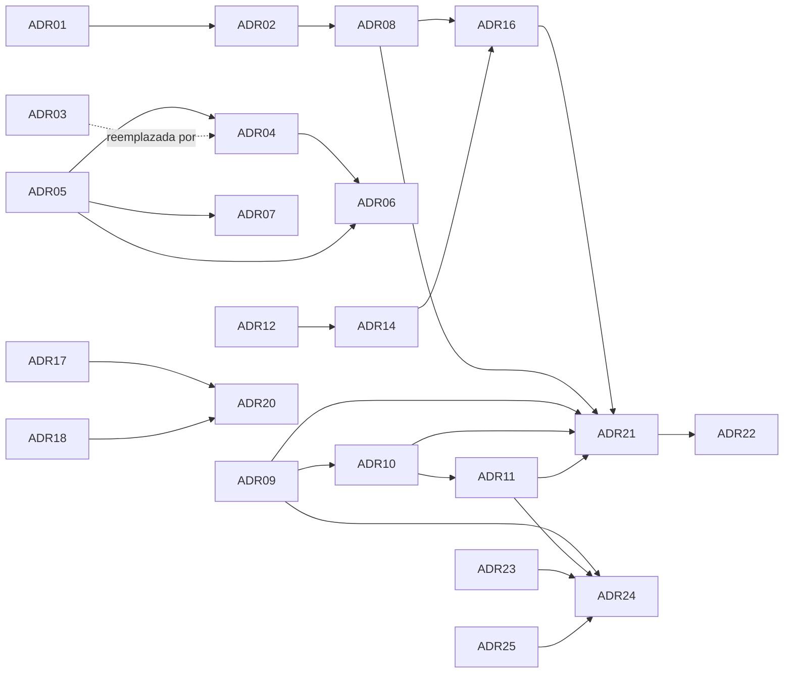
