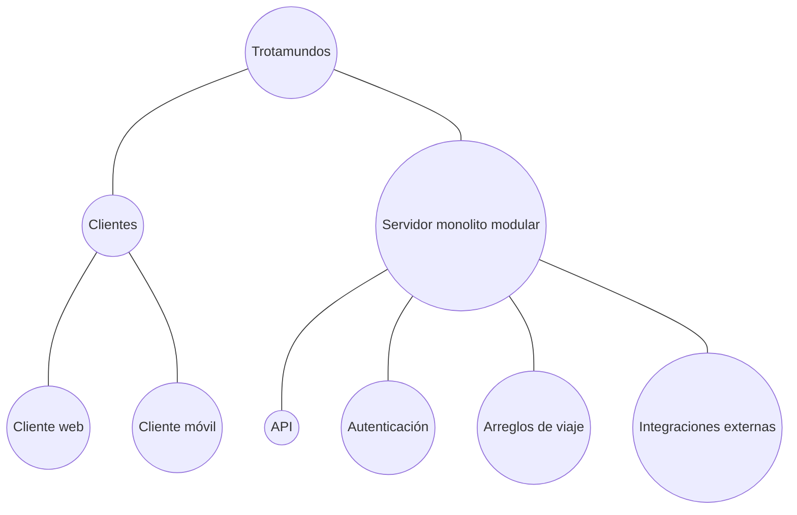
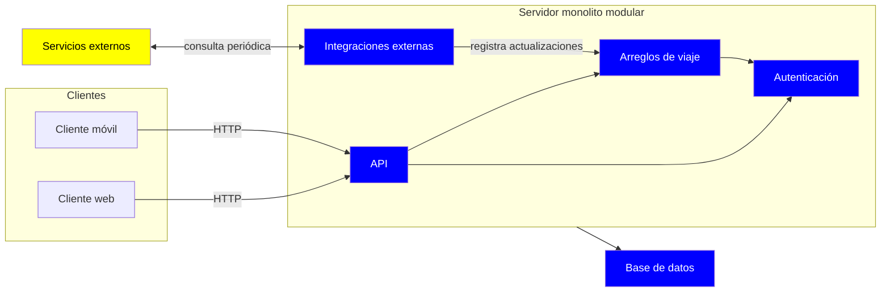

# Iteración 1 - Estructura general de "Trotamundos"

## PASO 2 - Objetivo de la Iteración

Definir la estructura general del sistema Trotamundos: Descomponer el sistema Trotamundos en sí mismo. Definir Aspectos básicos de la arquitectra como estilo arquitectónico general.

**Drivers a desarrollar en la iteración:**

- US01 - Dashboard
- Constraint 1 - Uso desde web o dispositivo móvil
- QA13 - Multiregión

Estos drivers no se abordan concretamente pero son importantes a tener en cuenta para pensar la estructura general: QA04 (Inactividad no planificada), Concern 1 (Tecnologias e interfaces genéricas)

## PASO 3 - Descomposición

Como estamos diseñando un sistema greenfield, el elemento a descomponer es el sistema entero.

## PASO 4 - Aplicando conceptos de diseño a los drivers seleccionados

### 4.1 - Estilo general del sistema

**Alternativas propuestas:**

| Alternativa                             | Pros                                                        | Contras                                                  | Drivers relacionados           |
| --------------------------------------- | ----------------------------------------------------------- | -------------------------------------------------------- | ------------------------------ |
| Cliente-Servidor                        | Lógica centralizada, reutilización para diferentes clientes | Cuello de botella, single-point-of-failure               | US01, C1, QA04 (Negativo)      |
| Cliente que consulta directo a terceros | Menor costo en construccion                                 | No tiene sentido, falta una interfaz para unificar datos | US01 (Negativo), C1 (Negativo) |

C1 impone web y móvil, y US01 exige un único punto de verdad que combine fuentes y elimine duplicados. Un servidor central es la forma más directa de cumplir ambas. Su contra principal es como soportar una caída, se debe abordar mas adelante.

### 4.2 - Organización del servidor

**Alternativas propuestas:**

| Alternativa      | Pros                                                            | Contras                                                                   | Drivers relacionados |
| ---------------- | --------------------------------------------------------------- | ------------------------------------------------------------------------- | -------------------- |
| Monolito modular | Despliegue unico, facil de operar, limites claros entre modulos | Escala horizontal implica escalar todo                                    | QA13                 |
| Microservicios   | Escalado y despliegue independiente por servicio                | Costo operativo alto, innecesario para el prototipo que se busca realizar | QA13                 |

Se combinan los estilos de "cliente-servidor" y "monolito modular", dando una combinación jerarquica de estilos. El primer estilo define la relación que tendrán los usuarios finales con el sistema, y la estructura interna del servidor sera monolito modular.

## PASO 5 - Instanciar elementos, asignar responsabilidades y definir interfaces

El sistema se divide en clientes (web y móvil) y un servidor monolito modular. Los clientes solo se comunican con el servidor a través de una API, que es el único punto de entrada, debe autenticar y enrutar a los módulos necesarios.

El servidor se organiza en módulos con distintas funcionalidades para el negocio:

- API, punto de comunicacion para los usuarios
- Autenticación, control de cuentas de viajero
- Arreglos de viaje, lógica central
- Integraciones externas, comunicación con agencias, sistemas de viajes, emails

Es una primera aproximación a como se divide, mas adelante podrian generarse nuevos modulos o submodulos.

## PASO 6 - Documentación

### Vistas
**Descomposición actual del sistema (Diagrama de Módulos):**

**Vista de Arquitectura (Diagrama C&C):**

- Azul: Sistema propio
- Amarillo: Sistemas externos

En esta vista estática se muestra claramente la división de lógica entre clientes y servidor. Además se proyectan módulos internos del monolito, que se desarrollarán más adelante en la descomposición.

### ADRs generados
Las decisiones de esta iteración se documentan en los siguientes Registros:
- ADR01 - Elección de arquitectura general (client-server)
- ADR02 - Elección de estilos internos para el servidor (monolito modular)

## PASO 7 - Revisar la aplicación del método

Como primera iteración en un sistema greenfield, se fijó el esqueleto del sistema antes de entrar en cualquier mecanismo particular. Se abordó correctamente como es la vista de alto nivel, falta abordar donde hay mas incertidumbre, que es la comunicación con los servicios externos.