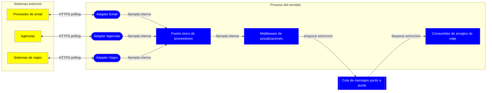
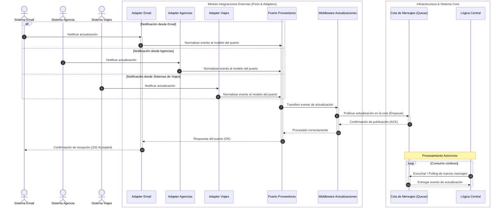

# Iteración 2 - Integraciones externas de "Trotamundos"

## PASO 2 - Objetivo de la Iteración
Diseñar el módulo de las integraciones externas definido en la iteración 1, como se obtendrá informacion de terceros y como entregarla al nucleo central.

**Drivers a desarrollar en la iteración:**
- US01 - Dashboard
- QA01 - Presentar actualizaciones
- QA04 - Inactividad no planificada
- QA14 - APIs estándar
- QA15 - Proveedor email

## PASO 3 - Descomposición
Hay que refinar es el módulo Integraciones externas. Actualmente, es el modulo que se comunica con el exterior y presenta mas incertidumbre y dificultad para el equipo.

## PASO 4 - Aplicando conceptos de diseño a los drivers seleccionados

**Alternativas propuestas:**

| Alternativa | Pros | Contras | Drivers relacionados
|---|---|---|---|
| Ports and Adapters | Independencia de la tecnología, modificabilidad, interoperabilidad | Complejidad de diseño (muchas abstracciones e indirecciones) | QA14, QA15
| Pub-Sub | Bajo acoplamiento, notificación a varios consumidores | Pérdida de consistencia, baja trazabilidad, buffer como punto único de falla. Con un solo consumidor no aporta nada | QA01, QA04 (Negativo)
| Cola de mensajes punto a punto | Desacopla productor y consumidor | Agrega un componente y consistencia eventual (Asincronismo) | QA01 |
| Pipes and filters  | Modular y modificable, reultilización, bajo acoplamiento | Bajo rendimiento (overhead latencia), degrada la interactividad con el usuario | QA14, QA15, QA01(negativo)

### 4.1 - Presentación y tolerancia a fallo
El asincronismo permite una mejor disponibilidad en el dashboard, este mecanismo lo proveé la cola y Pub-Sub, aunque este segundo es un estilo que no aplica al contexto ya que el subscriber será unicamente el sistema. (Se elige cola de mensajes punto a punto).

### 4.2 - Trabajo con proveedores externos
Necesitamos un mecanismo ligero pero robusto que permita foratear las entradas según un modelo unificado para que la lógica lo consuma sin depender del exterior. Ports&Adapters es la mejor alternativa considerada para cumplir con la independencia tecnologica de trabajar con distintos proveedores.

## PASO 5 - Instanciar elementos, asignar responsabilidades y definir interfaces
El módulo integraciones externas se estructura con Ports and Adapters que expone un único puerto de proveedores externos y un adapter por tipo de proveedor (email, agencias, sistemas de viajes).
En el módulo del puerto se incluye un middleware que recibe las actualizaciones de los sistemas externos y coloca estas actualizaciones en la cola para luego ser consumidos por la lógica central del sistema de forma asíncrona.

## PASO 6 - Documentación

### Vistas
**Diagrama de Componentes y Conectores:**

**Leyenda (vista C&C):**
- Cajas azules: componentes del sistema en ejecución.
- Píldoras azules: adapters, un componente por tipo de proveedor.
- Caja con doble borde: cola de mensajes, componente de infraestructura.
- Cajas amarillas: sistemas externos.
- Flechas: se rotulan con el tipo de conector. "HTTPS polling" es una consulta periódica de ida y vuelta, "llamada interna" es una invocación dentro del proceso, y "enqueue" y "dequeue" son mensajes asíncronos.

La vista busca mostrar los módulos involucrados en la implementación de "ports and adapters" y "cola asíncrona" dentro del servidor.

**Diagrama de secuencias:**

En este diagrama buscamos dar una vista dinámica del consumo de servicios externos y posterior formateo y publicación interna hasta llegar a la lógica central.

### ADRs generados
Las decisiones de esta iteración se documentan en los siguientes Registros:
- [ADR03 - Uso de Publisher-Subscriber (reemplazado por ADR04)](../adr/03-PubSub.md)
- [ADR04 - Uso de "cola asíncrona punto a punto" para actualizaciones](../adr/04-ColaMensajesP2P.md)
- [ADR05 - Uso de estilo Ports & Adapters](../adr/05-PortsAdapters.md)
- [ADR06 - La normalización se hace en el Broker](../adr/06-NormalizarEnBroker.md)
- [ADR07 - Circuit breaker con reintentos acotados](../adr/07-CircuitBreaker.md)

## PASO 7 - Revisar la aplicación del método

Se refinó el módulo más crítico en performance e interoperabilidad con terceros. Se concentra toda la comunicación en este modulo, aislando el resto del sistema de los mismos. Falta definir con qué intervalo de tiempo hará las consultas el middleware para asegurar los tiempos requeridos por los escenarios. Consideramos que lo mas critico próximo es el ámbito de la escalabilidad del sistema.

# Contraste LLM - Iteración 2 (Fuera del método)

El paso 4 tuvo las mismas movilizacion que nos hicieron pensar durante la discusión sobre que estilos elegir
- Fuentes externas a diferentes tiempos que nuestro sistema
- Si se cae una fuente externa no debe caerse el dashboard
- Los datos vienen en formatos distintos segun el proveedor

La idea del estilo Publisher-Subscriber es la misma que tomamos nosotros. Desacoplar los 3ros con el dashboard. El LLM uso la palabra "broker" a lo que nosotros dijimos que es el middleware que hace requests a los 3ros y alimenta el bus, ademas de hacer la normalizacion de datos.

El estilo service-based no lo consideramos como servicios aun al resto del componentes, aun no pensamos en el despliegue del sistema. Pero la idea de abstract common services nosotros la imaginamos dentro de el estilo ports&adapters, donde cada proovedor está detras de una interfaz comun, evitando que toquen al logica.

La tactica circuit breaker se puede adaptar con un timer, ante una falla de un proveedor se prueba con tiempos incrementales, si tras varios errores sigue fallando el proveedor se informa al usuario que no se puede establecer la conexion con ese proveedor.

La tactica detect and recover, habla sobre el disponibilidad en despliegue, que aun no había sido considerada por el grupo.

Los riegos que indica el LLM son correctos, el correo se debe sondear en intervalos cortos para asegurar los 5 minutos de tope final (El LLM sugiere 2 minutos como maximo). EL dashbord puede tener retraso con los datos en los distintos proveedores, pero el QA pide que se mantenga actualizado con 5 minutos, ya está contemplado. El broker reuqiere redundancia para que no caiga la principal funcionalidad del sistema.

Las vistas del LLM, especialmente V1 intenta mostrar todo el sistema en una misma, nosotros optamos por vistas mas reducidas en el objetivo de la iteración

DECISIONES A INCORPORAR:
ADR-004, ADR-005
Las ADRs sobre deployment se excluyen de esta iteración, no era el foco principal de esta iteracion.