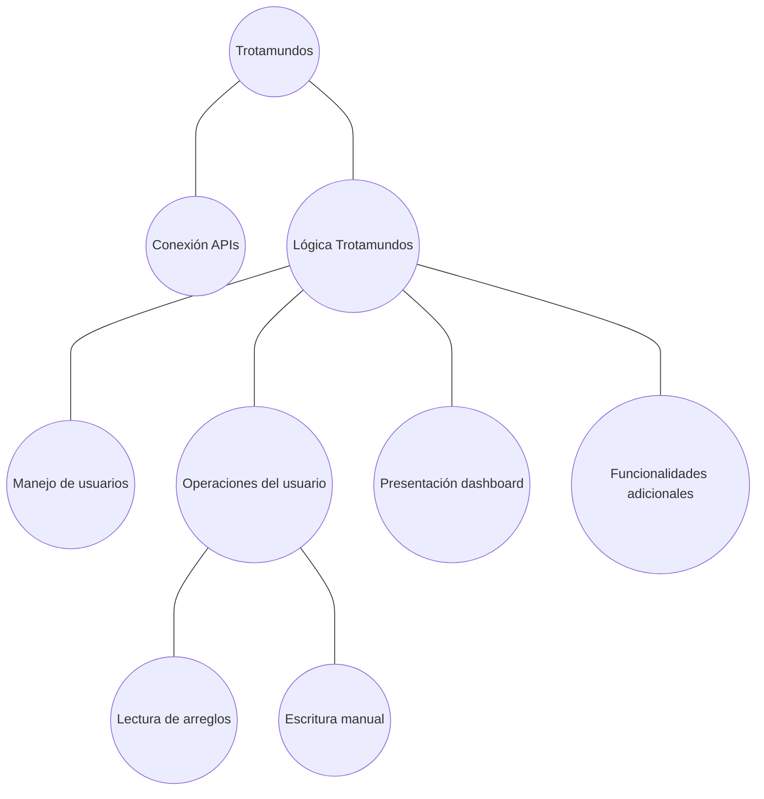
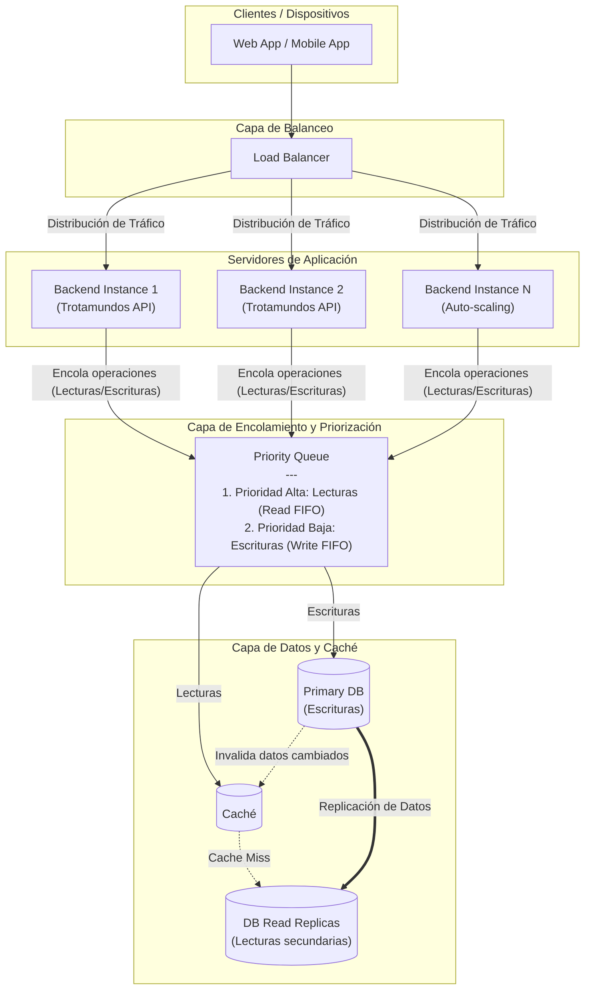

# Iteración 3 - Escalabilidad, Rendimiento y Persistencia en "Trotamundos"

## PASO 2 - Objetivo de la Iteración

Escalar la arquitectura del sistema Trotamundos para soportar una alta concurrencia de usuarios y un volumen proyectado de 15 millones de cuentas, garantizando disponibilidad, escalabilidad y rendimiento de operaciones.

**Drivers a desarrollar en la iteración:**

* QA05 - Cantidad de cuentas
* QA06 - Actividad semanal
* QA07 - Picos de trafico
* ADR2 - Centralidad del Server (concern iteración-1)

## PASO 3 - Descomposición

La lógica de trotamundos es lo que está con mayor incertidumbre. Se decomponen los componentes internos del mismo sobre como realizar las operaciones (consultas y escrituras manuales) de los usuarios.

## PASO 4 - Aplicando conceptos de diseño a los drivers seleccionados

**Alternativas propuestas**

| Alternativa | Pros | Contras | Drivers relacionados |
| --- | --- | --- | --- |
| Load Balancer de usuarios | Ante una sobrecarga de un servidor, se puede mantener la disponibilidad y performance estable | Complejidad en la sincronizacion de sesiones | QA06, QA07 |
| Cola de Prioridad | Mejores tiempos de respuesta ante consultas al dashboard | Introduce intermediarios, puede retrasar las escrituras demasiado (starvation) | QA06, QA07 |
| Procesamiento secuencial sin colas | Sin capas intermedias, mejor performance en casos generales | No permite agregar concurrencia, bloqueo de mucho tiempo ante grandes escrituras | QA07 |
| Base de Datos Relacional + Caché | Soporta lecturas masivas, simplicidad en el modelo de datos (vs NoSQL) | Costo en replicación y almacenamiento de grandes volumenes de datos | QA05 |
| Base de Datos NoSQL | Flexibilidad y mejor escalamiento horizontal, soporte nativo de grandes volumenes de datos | Mayor curva de aprendizaje para el equipo, dificil realizar referencias | QA05 |

Para satisfacer tanto los QA sobre las operaciones de usuarios como los de escalabilidad en usuarios y en pos de dinamizar la arquitectura Cliente-Servidor descentralizando la lógica, se opta por un diseño que combina balanceo de carga y priorización de operaciones. Además se toma una base relacional para aprovechar su simplicidad y uso general y se lo combina con una caché.

Elegidos: "Load balancer de usuarios", "Cola de prioridad", "Base de datos relacional + Caché"

## PASO 5 - Instanciar elementos, asignar responsabilidades y definir interfaces

El load balancer actua como gateway al trafico de usuarios, distribuyendo dinamicamente en distintas instancias de servidores.

El servidor que trate los usuarios debe procesar su solicitud y encolarla en la cola de prioridad la cual clasifica como prioritarias las lecturas (son mas rápidas) y luego las escrituras manuales.

Para aprovechar la separación de lecturas y escrituras se coloca una cache para almacenar datos de consultas frecuentes, evitando acceder a la base en cada lectura. Para que esto funcione, las escrituras deben realizarse sobre una base primaria que mantenga consistente las replicas (Sobreescribiendo) y la caché (invalidando)

## PASO 6 - Documentación:

### Vistas
**Descomposición del sistema (D. Módulos):**

Seguimos definiendo paso a paso la descomposición de este sistema.

**Arquitectura tratada en la iteracion (C&C):**

Se muestran los cambios arquitectónicos realizados en la iteración (distribución de tráfico, encolamiento con priorización y estrategia de persistencia)

### ADRs generados

- ADR06 - La normalización se hace en el Broker
- ADR08 - Balanceo de carga
- ADR09 - Cola priorizada de requests a la BBDD
- ADR10 - Uso de BBDD relacional cacheada

## PASO 7 - Revisar la aplicación del método

En esta segunda iteración, se trataron temas de escalabilidad como prioritarios. Los tacticas seleccionadas ayudan a satisfacer los 3 QA seleccionados, cada tactica se adapta para poder cumplir con el QA que beneficia sin perjudicar fuertemente al resto.

En el diagrama de descomposicion se ve abordado la parte principal de operaciones que puede hacer el usuario sobre la base de datos. Para tener en cuenta, aun no se trató como asegurar la latencia tanto a web como mobile, aunque las decisiones de esta iteración afecten positivamente los requerimientos de performance de estos escenarios.