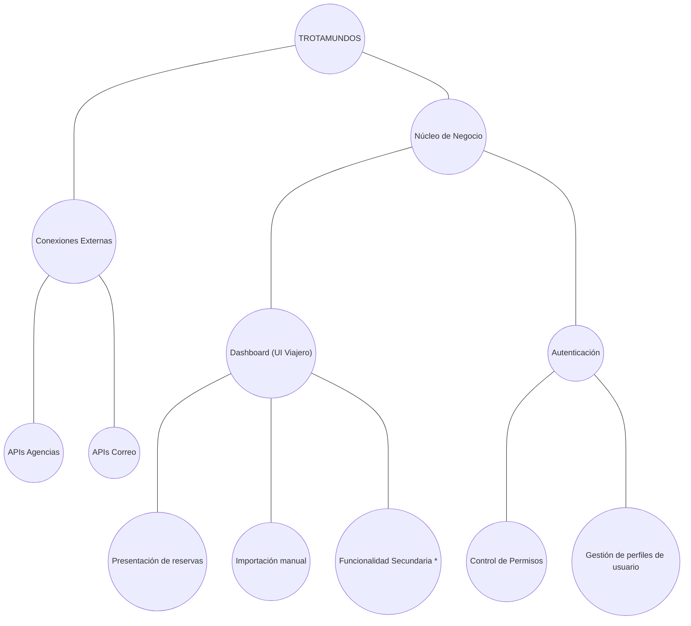
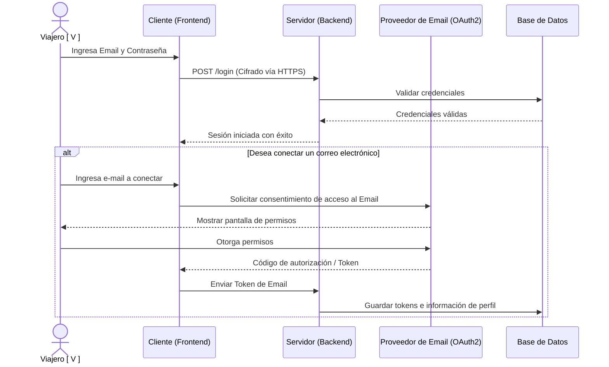
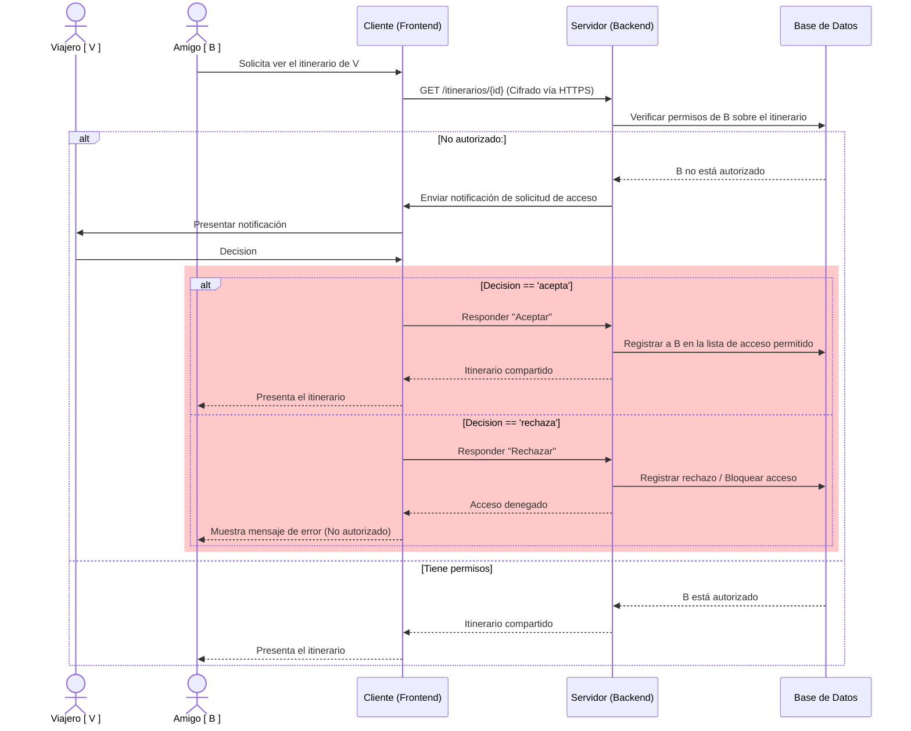

# Iteración 4 - Tratamiento de seguridad

## PASO 2 - Objetivo de la Iteración

A estas alturas del diseño del sistema, nos parece acorde abordar la confianza y seguridad del usuario en el uso de nuestra aplicación web.

**Drivers a desarrollar en la iteración:**

- QA08 - Security: Acceso email
- QA09 - Security: Itinerarios compartidos
- QA15 - Interoperability: Proveedores email

## PASO 3 - Descomposición

Con una buena base de la lógica ya abordada, es fundamental tener un control de que datos se muestran o tranfieren entre usuarios, por lo que controlaremos las situaciones de riesgo que puedan llegar a crearse.

Los principales modulos a desarollar es el de autenticación, conexion con integraciones externas (especificamente con mails) y una idea de como será el "compartir itinerarios".

## PASO 4 - Aplicando conceptos de diseño a los drivers seleccionados

**Alternativas propuestas:**

| Alternativa                                                | Pros                                                                                                    | Contras                                                                                                                  | Drivers relacionados |
| ---------------------------------------------------------- | ------------------------------------------------------------------------------------------------------- | ------------------------------------------------------------------------------------------------------------------------ | -------------------- |
| Encriptar datos                                            | Protege la información en la base de datos, protege los datos en tránsito                               | Sobrecosto computacional por cifrado/descifrado, requiere gestión de claves                                              | QA08, QA09           |
| Detectar intruso                                           | Permite rechazar amenazas a tiempo                                                                      | Overhead por chequeo ante cada acceso, agrega necesidad de una base de datos con información de comportamiento malicioso | QA08                 |
| Integridad de mensaje                                      | Asegura que los mensajes e itinerarios no sean alterados en tránsito                                    | Aumenta la latencia en la integridad del mensaje, complejidad en gestión de firmas/claves                                | QA08, QA09           |
| Informar al usuario del posible intruso                    | El usuario tiene consciencia de la situación, la decisión es ajena al sistema pero fácil de implementar | Depende de la respuesta activa del usuario, posible fatiga de notificaciones                                             | QA08, QA09           |
| Autenticar usuario                                         | Rápido de validar, asegura la identidad antes de otorgar acceso                                         | Requiere gestión segura de sesiones/tokens                                                                               | QA08                 |
| Solicitar autorización del usuario para acceder a su email | Decisión del usuario, control de los mensajes recibidos                                                 | El usuario puede perder funcionalidades si rechaza el permiso                                                            | QA08, QA15           |

Para satisfacer los requerimientos del sistema, creemos conveniente optar por las siguientes opciones:
"Encriptar datos", "Informar al usuario del posible intruso", "Autenticar usuario" y "Solicitar autorización del usuario para acceder a su email".

Creemos que las opciones "Detectar intruso" e "Integridad de mensaje" no las creemos las mejores opciones debido a que sus contras agregan demasiada funcionalidad, lo que empeora el funcionamiento general del sistema.

## PASO 5 - Instanciar elementos, asignar responsabilidades y definir interfaces
Para iniciar sesión, los usuarios deben acceder con email y contraseña.
Cuando el Viajero quiera añadir un correo electrónico para ser escaneado, se le solicitará permisos para usar dicha plataforma. Esto será gestionado mediante la utilización de OAuth.
Todas las conexiones se harán a través de protocolo HTTPS.
Ante un intento de ingreso a itinerario compartido no autorizado se notificará al usuario, dándole opción de aceptar o rechazar la solicitud. Esto define los próximos accesos del potencial intruso.

## PASO 6 - Documentación

### Vistas
**Descomposición actual del sistema (D. Módulos):**

*) _Funcionalidad secundaria_ hace referencia al sistema de recomendación que será añadido al diseño e implementación en la segunda entrega.

**Vistas comportamentales:**

1. Autenticación y Autorización de Email

En esta vista dinámica se muestra el procedimiento para vincular una cuenta de correo (para escaneo automático).

2. Intento de acceso a itinerario no autorizado y proceso de autorización

Se muestran en un diagrama de secuencias las posibles alternativas de un usuario logeado intentando ver un itinerario compartido (con o sin autorización) e involucra el sistema de autorización en sí mismo.

### ADRs generados

- ADR12 - Encriptación HTTPS
- ADR13 - Detección de Viajero no habilitados a ver itinerario
- ADR14 - Autenticación de Viajero
- ADR15 - Solicitar autorización para conectar correo electrónico

## PASO 7 - Revisar la aplicación del método

En esta iteración, se abordaron las qa08 y qa09 referidas al escenario de seguridad, y la qa15 refererida al escenario de interoperabilidad. Tratamos de dar un soporte seguro y de confianza al usuario que se adentra en los servicios del sistema, siendo transparentes con las decisiones. En estos casos, el usuario toma un rol participativo, con lo cual se requiere la interacción entre la capa de cliente y la capa de servidor. Para próximas iteraciones, queda pendiente la parte de presentación.