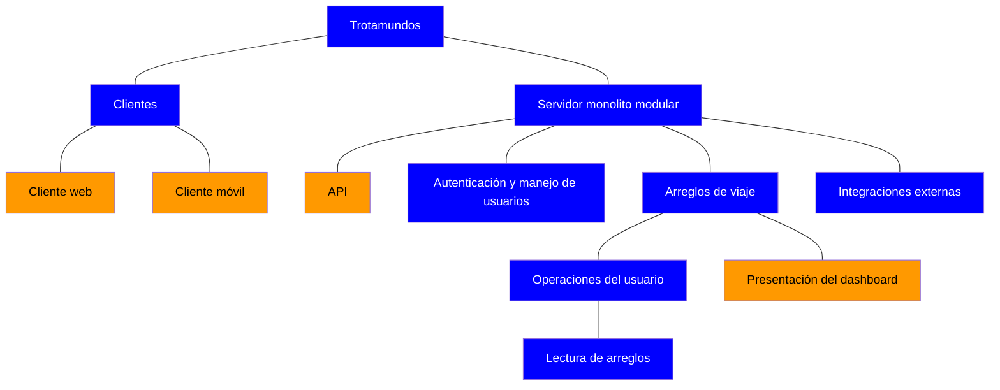
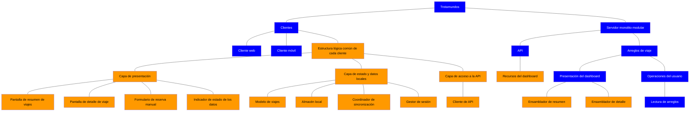
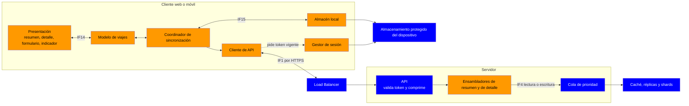
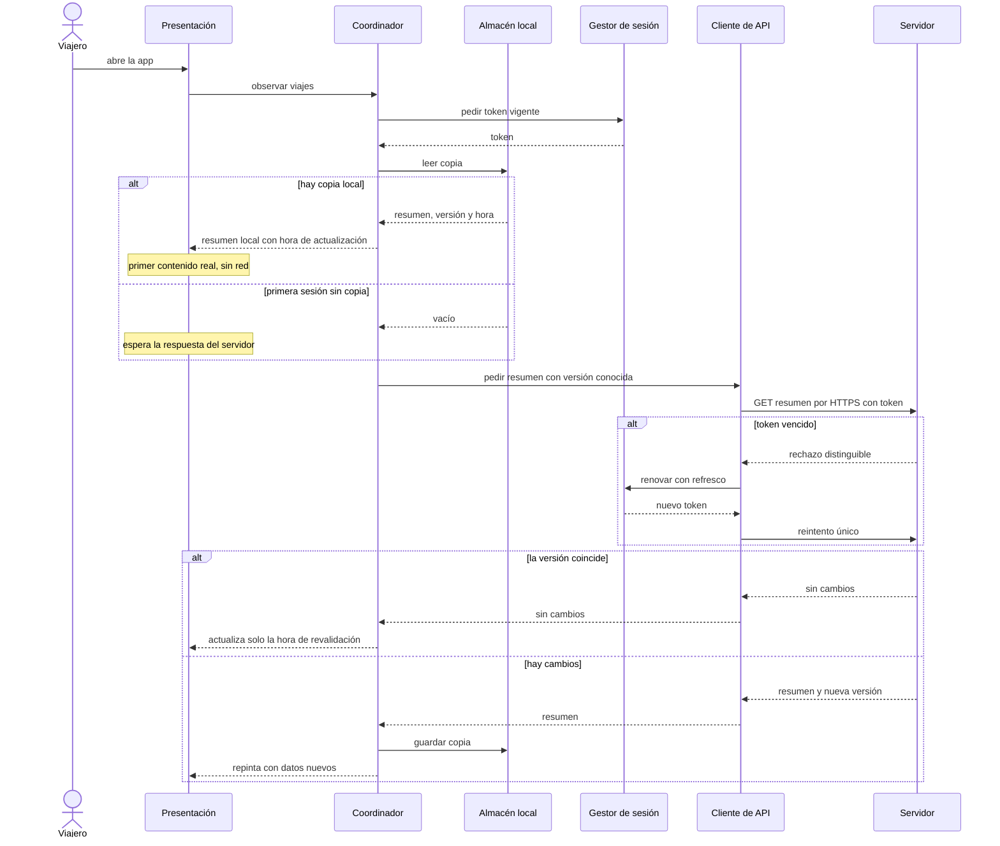
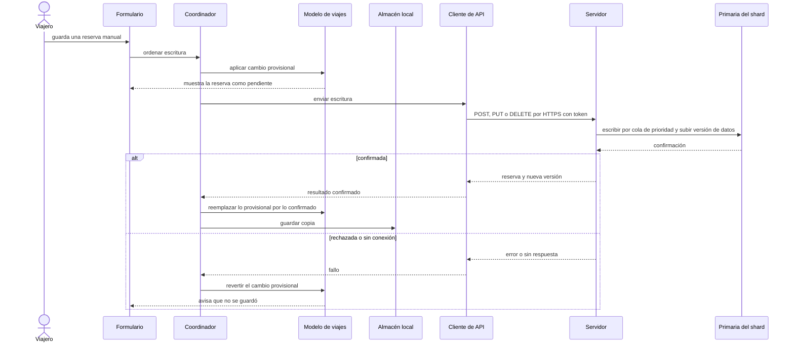
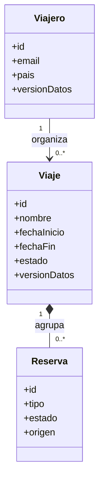

# Iteración 5 — Paso 2: Establecer la meta de la iteración seleccionando drivers

## Contexto de partida

Las iteraciones 1 a 4 cubrieron estructura, integraciones, escalabilidad y seguridad. Los escenarios que siguen **Pendientes** son QA03, QA02, QA11, QA16 y QA12, todos de prioridad media o baja. Esta iteración ataca el frente de **experiencia del usuario en cliente**, que hasta ahora solo mejoró de forma indirecta por la caché y el balanceo.

## Drivers seleccionados

| Driver | Atributo | Escenario | Medida de respuesta | Prioridad (Imp., Dif.) | Estado previo |
| ------ | -------- | --------- | ------------------- | ---------------------- | ------------- |
| QA03 | Performance | Primer contenido mobile | Primer despliegue en menos de 1.4 s en el 85% de los casos (red estable) | M, M | Pendiente, mejora indirecta por caché y balanceo |
| QA02 | Performance | Tiempo de respuesta web | 800 ms de lectura del dashboard en el 95% de los casos | M, L | Pendiente, mejora indirecta por caché y balanceo |
| QA11 | Usability | UI simple centrada en viaje | Menos de 10 s para obtener un dato, al menos 90% de tareas sin salir de la app | M, L | Pendiente |

**User story principal asociada:** US01 (Dashboard). QA11 refuerza además el criterio "UI simple centrado en el viaje".

**Constraint y concern que aplican:** C1 (web y móvil con una API única) y CN1 (tecnologías genéricas, sin dependencia de un servicio específico).

## Meta de la iteración

> **Diseñar la estructura de los clientes web y móvil, y el contrato de lectura del dashboard entre cliente y servidor, de modo que el primer contenido móvil se muestre en menos de 1.4 s, la lectura web responda en 800 ms y el viajero obtenga el dato buscado en menos de 10 s sin salir de la aplicación.**

## Justificación de la selección

- **Coherencia de agrupación:** los tres drivers convergen en un mismo artefacto, el **cliente y su interacción con la API de lectura del dashboard**. Resolverlos juntos evita decisiones contradictorias, por ejemplo una carga rápida pero con una UI que obliga a navegar mucho.
- **Brecha real:** las iteraciones previas optimizaron el *backend* (caché, réplicas, cola de prioridad). Los 800 ms de QA02 y los 1.4 s de QA03 se miden **de extremo a extremo**, incluyendo red, payload, renderizado y arranque de la app, tramos que el diseño actual no trata.
- **Dependencia entre drivers:** QA11 influye en QA02/QA03, porque una UI centrada en el viaje define qué datos se necesitan en la primera pantalla y, por lo tanto, cuánto hay que transferir y renderizar.
- **Costo/beneficio para el prototipo:** son drivers de dificultad técnica baja a media, adecuados para validar con el mercado la propuesta de valor del dashboard.

## Alcance y exclusiones

| Dentro de la iteración | Fuera de la iteración |
| ---------------------- | --------------------- |
| Estructura de clientes web y móvil | QA12 (capacidades nativas), prioridad baja, se aborda aparte |
| Contrato de lectura del dashboard (forma y tamaño de la respuesta) | QA16 y redes sociales |
| Estrategia de carga inicial y de datos en el cliente | Rediseño del backend ya resuelto (ADR08 a ADR11) |
| Presupuesto de latencia de extremo a extremo | Diseño visual detallado (maquetas, identidad gráfica) |

# Iteración 5 - Paso 3: Elegir los elementos del sistema a refinar

## Punto de partida

El sistema ya no es greenfield. Las iteraciones 1 a 4 dejaron una estructura, así que los elementos candidatos son los que existen hoy en la vista 5.1. Se aplica un enfoque **top-down**: se toman elementos existentes y se descomponen en elementos más finos.

Los tiempos de QA02 y QA03 son de extremo a extremo desde el cliente, como confirmaste. Por eso conviene ver qué tramos del camino de lectura ya tienen decisiones y cuáles no.

## Camino de lectura de extremo a extremo

| Tramo | Elemento involucrado | Decisiones previas | ¿Candidato a refinar? |
| ----- | -------------------- | ------------------ | --------------------- |
| Arranque de la app o carga de la página | Cliente web, Cliente móvil | Ninguna (solo existen como cajas) | **Sí** |
| Red cliente a servidor | HTTPS | ADR12 (cifrado), sin decisiones sobre forma ni tamaño del payload | **Sí** |
| Balanceo y validación de token | Load Balancer, Autenticación | ADR08, ADR16 | No |
| Armado de la respuesta del dashboard | API, Presentación del dashboard | Ninguna (módulo nombrado en la iteración 3, sin diseño interno) | **Sí** |
| Cola de prioridad, caché, réplica y shard | Lectura de arreglos y capa de datos | ADR09, ADR10, ADR11 | No |
| Render en el cliente | Cliente web, Cliente móvil | Ninguna | **Sí** |

## Elementos seleccionados

# Iteración 5 - Paso 4: Elegir conceptos de diseño que satisfacen los drivers

## Qué ataca cada tramo del camino

| Tramo (Paso 3) | Concepto que lo ataca | Drivers |
| -------------- | --------------------- | ------- |
| Arranque de la app o carga de la página | D1 Cliente en capas, D4 Copia local con revalidación, D6 Tecnología de clientes | QA03, QA02 |
| Red cliente a servidor | D2 REST agregado, D3 Resumen primero | QA02, QA03 |
| Armado de la respuesta | D2 REST agregado, D3 Resumen primero | QA02 |
| Render en el cliente | D1 Cliente en capas, D5 Navegación por viaje | QA03, QA11 |

## Decisión D1 y D2: estilos arquitectónicos

### D1. Cliente en capas

Cada cliente (web y móvil) se organiza en tres capas:
- **Presentación:** pantallas.
- **Estado y datos locales:** modelo del viaje y copia local.
- **Acceso a la API:** consume IF1.

La UI solo habla con la capa de estado, nunca directo con la red. Eso permite pintar desde datos locales sin esperar al servidor (D4).

### D2. API de recursos agregados centrados en el viaje

Se extiende IF1 con recursos orientados al viaje, por ejemplo un resumen de viajes y el detalle de un viaje. Así el dashboard se arma con **una sola petición** en vez de una por entidad.

**Matriz de decisión para D2**

| Propiedad (driver) | REST agregado | REST granular por entidad | GraphQL | BFF por cliente |
| ------------------ | ------------- | ------------------------- | ------- | --------------- |
| QA02: lectura web en 800 ms | + | - (varias idas y vueltas) | + | + |
| QA03: primer contenido móvil | + | - | + | ++ |
| QA11: datos justos para la vista por viaje | + | 0 | ++ | + |
| C1 e IF1: API única para web y móvil | ++ | ++ | ++ | -- |
| CN1: estándares genéricos | ++ | ++ | + | + |
| Prototipo con equipo reducido | + | ++ | - | -- |

- **BFF queda eliminado.** Contradice la API única ya fijada en ADR01 e IF1, y duplica módulos.
- **REST granular** es el más simple, pero obliga a encadenar peticiones. Eso pesa sobre todo en móvil, donde cada ida y vuelta de red cuenta en los 1.4 s.
- **GraphQL** encaja bien con QA11 y es un estándar abierto. Lo descarto por costo, no por CN1: el control del costo de las consultas sobre la cola de prioridad y los shards, y la caché HTTP más difícil, suman complejidad que un prototipo no necesita. Se reconsidera si aparecen más clientes o vistas.

## Decisión D3 a D5: tácticas

| ID | Táctica | Atributo | Qué hace |
| -- | ------- | -------- | -------- |
| D3 | **Resumen primero, detalle bajo demanda** (reducir el volumen de la respuesta) | Performance | La primera pantalla pide solo viajes próximos o activos con un resumen de sus reservas. El detalle se pide al entrar a un viaje. Incluye paginación por viaje y compresión de respuestas |
| D4 | **Mantener copias de datos en el cliente, con revalidación** (mostrar lo local y refrescar en segundo plano) | Performance | Al abrir, se pinta el último estado guardado y se actualiza desde la API. Con esto, el primer contenido deja de depender de red y backend para quien ya usó la app |
| D5 | **Modelo de tarea centrado en el viaje** (usabilidad) | Usabilidad | El **Viaje** es la unidad de navegación. Todas sus reservas (vuelo, hotel, auto) se ven juntas, sin pestañas por tipo |

## Decisión D6: tecnología de los clientes

Decido solo la **categoría**. El framework concreto se difiere por CN1 y por el principio de ambigüedad de Keeling.

**Matriz de decisión para D6**

| Propiedad (driver) | Nativo por plataforma | Multiplataforma | Web progresiva (PWA) |
| ------------------ | --------------------- | --------------- | -------------------- |
| QA03: primer contenido móvil en 1.4 s | ++ (control total del arranque) | + (runtime extra, mitigado con D4) | 0 (depende del caché del navegador y de la primera visita) |
| QA02: lectura web en 800 ms | 0 (la web se hace aparte) | + | + |
| QA11: UI simple y consistente | + | ++ (una sola UI compartida) | ++ |
| C1 y US01: web y app móvil | ++ | ++ | - (la app móvil se cumple solo parcialmente) |
| CN1: sin dependencia de un servicio específico | 0 | 0 (depende de un framework opinado) | ++ (estándares web abiertos) |
| Prototipo con equipo reducido | -- (tres bases de código) | + | ++ (una sola base) |

Nada queda eliminado, pero la opción nativa sale cara para un prototipo.

**Selecciono multiplataforma para móvil y una aplicación web de página única para web.** Comparten el contrato de la API y la estructura en capas de D1.

**Por qué no PWA:** es la alternativa más cercana y la más barata. Pesa en contra que US01 pide explícitamente una app para dispositivos móviles, y que el control del arranque, que es lo crítico en QA03, es menor.

## Registro de decisiones (formato del Paso 4)

| ID | Concepto elegido | Tipo | Alternativas descartadas | Justificación |
| -- | ---------------- | ---- | ------------------------ | ------------- |
| D1 | Cliente en capas | Estilo | Cliente sin capas, con la UI llamando directo a la API | Separa la copia local de la presentación y permite pintar sin esperar a la red. Costo: algo más de indirección |
| D2 | REST con recursos agregados por viaje | Estilo | REST granular, GraphQL, BFF por cliente | Una petición por pantalla, sin romper la API única ni sumar complejidad al backend ya diseñado |
| D3 | Resumen primero, detalle bajo demanda | Táctica | Dashboard completo en una respuesta, precarga de todo el detalle | La primera pantalla necesita pocos datos. Menos bytes y menos render. Costo: una segunda petición al abrir un viaje |
| D4 | Copia local con revalidación | Táctica | Sin caché en el cliente, solo caché HTTP del navegador | Desacopla el primer contenido de la red para usuarios recurrentes. Costo: datos posiblemente viejos y datos personales guardados en el dispositivo |
| D5 | Navegación centrada en el viaje | Táctica | Navegación por tipo de reserva | Reproduce el modelo mental del viajero y evita saltar entre apps, que es la frustración que QA11 quiere mitigar |
| D6 | Móvil multiplataforma y web de página única | Tecnología (categoría) | Nativo por plataforma, PWA única | Mejor balance entre rendimiento de arranque y costo para el prototipo. Framework concreto diferido por CN1 |

## Riesgos que introducen estas decisiones

| # | Riesgo (condición; podría consecuencia) | Cómo se maneja |
| - | --------------------------------------- | -------------- |
| 1 | El runtime multiplataforma no está medido en un móvil de gama media; podría no alcanzar 1.4 s en el 85% | Medir con un prototipo del arranque temprano. Si falla, pasar solo el camino crítico a nativo |
| 2 | La primera apertura tras instalar o iniciar sesión no tiene copia local; podría consumir el margen del 15% de QA03 | Pantalla inicial mínima y petición de resumen liviana (D3). Falta saber qué proporción de aperturas son en frío |
| 3 | La copia local puede mostrar datos viejos; podría contradecir el "único punto de verdad" de US01 | Mostrar la hora de última actualización y revalidar siempre al abrir |
| 4 | Los datos de viaje quedan en el dispositivo; podrían exponerse ante pérdida o robo | Guardarlos en almacenamiento protegido y borrarlos al cerrar sesión, ligado a la revocación del refresco de ADR16 |

# Iteración 5 - Paso 5: Instanciar elementos, asignar responsabilidades y definir interfaces

## 1. Instanciación de elementos

Los cuatro elementos del Paso 3 se descomponen según las decisiones D1 a D6. Mantengo la estructura mínima (Keeling): no creo un elemento que no tenga una responsabilidad propia.

| Elemento padre | Elemento instanciado | Decisión que lo origina |
| -------------- | -------------------- | ----------------------- |
| Cliente web y Cliente móvil (capa de **Presentación**) | Pantalla de resumen de viajes | D3, D5 |
| | Pantalla de detalle de viaje | D3, D5 |
| | Formulario de reserva manual | US01 |
| | Indicador de estado de los datos | D4 |
| Cliente web y Cliente móvil (capa de **Estado y datos locales**) | Modelo de viajes | D1 |
| | Almacén local | D4 |
| | Coordinador de sincronización | D4 |
| | Gestor de sesión | ADR16 |
| Cliente web y Cliente móvil (capa de **Acceso a la API**) | Cliente de API | D1, D2 |
| API | Recursos de lectura del dashboard | D2 |
| Presentación del dashboard (servidor) | Ensamblador de resumen | D3 |
| | Ensamblador de detalle | D3 |

**Alcance de la estructura en capas:** web y móvil tienen las mismas capas y los mismos elementos lógicos. Si la tecnología elegida permite compartir el código de las capas de estado y de acceso a la API entre ambos clientes, queda como decisión diferida.

## 2. Asignación de responsabilidades

Cada responsabilidad tiene **un único dueño**.

### Cliente (web y móvil)

| Elemento | Responsabilidades |
| -------- | ----------------- |
| Pantalla de resumen de viajes | Mostrar los viajes próximos o activos, cada uno con su resumen y su próxima reserva. Es la primera pantalla. Navega al detalle con una interacción |
| Pantalla de detalle de viaje | Mostrar todas las reservas del viaje juntas, sin separarlas por tipo |
| Formulario de reserva manual | Capturar y validar el alta, la modificación y la baja de reservas manuales |
| Indicador de estado de los datos | Mostrar la hora de última actualización y el aviso de proveedor degradado (IF6, IF13) |
| Modelo de viajes | Mantener en memoria el estado vigente de viajes y reservas, y notificar a la presentación cuando cambia |
| Almacén local | Persistir una copia del resumen y del detalle consultado, y devolverla al arrancar. Se vacía al cerrar sesión |
| Coordinador de sincronización | Al abrir, pedir los datos al servidor en paralelo con el pintado de la copia local. Reemplazar la copia si cambió. Aplicar una escritura manual de forma provisional y reconciliarla con la respuesta. No hay escritura sin conexión en esta iteración |
| Gestor de sesión | Guardar los tokens en almacenamiento protegido del dispositivo. Entregar el token vigente y renovarlo con el refresco antes de que falle una petición (IF8) |
| Cliente de API | Armar y enviar las peticiones por HTTPS con el token. Reintentar de forma transparente una vez si el token venció. Pedir respuestas comprimidas. Traducir errores a eventos del modelo |

### Servidor

| Elemento | Responsabilidades |
| -------- | ----------------- |
| API (módulo existente) | Exponer los recursos de IF1. Validar el token (IF9), los parámetros y la paginación. Comprimir las respuestas. Mantener la versión del contrato |
| Ensamblador de resumen | Pedir a Lectura de arreglos (por IF4, clase lectura) los viajes del viajero y construir un resumen por viaje con la cantidad de reservas por tipo, la próxima reserva y los indicadores de estado |
| Ensamblador de detalle | Pedir las reservas de un viaje y devolverlas ordenadas cronológicamente |
| Lectura de arreglos (existente) | Sin cambios. Resuelve la consulta en caché o en la réplica del shard del viajero |

**Dos reglas de reparto:**
- **La UI nunca habla con la red.** La capa de estado es la única que sabe si el dato salió de la copia local o de la API.
- **El servidor decide qué se resume, y el cliente decide qué muestra primero.** Así los dos clientes consumen el mismo contrato sin que el servidor conozca a cada uno, lo que respeta C1 e IF1.

## 3. Definición de interfaces

Se refina **IF1**, que antes no definía la forma ni el tamaño de la respuesta, y se agregan dos interfaces internas del cliente.

### IF1 refinada: API de clientes (HTTPS, síncrona)

| Operación | Entrada | Salida (contrato resumido) | Drivers |
| --------- | ------- | -------------------------- | ------- |
| **Resumen de viajes** | Filtro de estado (por defecto próximos y activos), cursor de paginación, versión conocida (opcional) | Lista paginada. Por viaje: id, nombre, fechas, estado, cantidad de reservas por tipo, próxima reserva (tipo, fecha, destino, estado) e indicador de proveedor degradado. Incluye la **versión de datos**. Si la versión conocida coincide, responde "sin cambios" y sin cuerpo | QA02, QA03, QA11 |
| **Detalle de viaje** | idViaje, versión conocida (opcional) | Todas las reservas del viaje, ordenadas cronológicamente. Por reserva: id, tipo, fechas, destino, estado y origen (manual, correo o proveedor). Incluye la versión de datos | QA02, QA11 |
| **Escritura de reserva manual** | idViaje y datos de la reserva (alta), o idReserva con los datos (modificación o baja) | Reserva resultante y nueva versión de datos. La operación entra a la cola de prioridad como escritura (IF4) | US01 |

**Reglas comunes del contrato:**
- Toda operación exige el token de acceso, como ya definía IF1.
- Las respuestas van comprimidas.
- El resumen nunca incluye el detalle de las reservas.
- Una respuesta de token vencido tiene un formato distinguible, para que el Cliente de API renueve y reintente sin que el viajero lo note.

### IF14: Estado del cliente (interna, entre Presentación y Estado)

| Operación | Contrato |
| --------- | -------- |
| Observar viajes | La presentación se suscribe al modelo y recibe el estado vigente cada vez que cambia, indicando si proviene de la copia local o está actualizado |
| Solicitar refresco | Pide una revalidación explícita (por ejemplo, el viajero desliza para actualizar) |
| Ordenar escritura manual | Entrega los datos de la reserva y recibe el resultado provisional y luego el confirmado o el rechazo |

### IF15: Almacén local (interna, entre Estado y Almacenamiento del dispositivo)

| Operación | Contrato |
| --------- | -------- |
| Leer copia | Devuelve el último resumen y los detalles guardados, junto con su versión y hora de actualización |
| Guardar copia | Reemplaza la copia del viajero con la nueva versión |
| Vaciar | Elimina todo. Se invoca al cerrar sesión o cuando se revoca el refresco |

## 4. Secuencia de arranque (la que sostiene QA03)

| # | Paso | Quién |
| - | ---- | ----- |
| 1 | Arranca la app y se muestra la estructura de la pantalla | Presentación |
| 2 | Se obtiene el token vigente del almacenamiento protegido | Gestor de sesión |
| 3 | Se lee la copia local y se pinta el resumen: **primer contenido real** | Estado, Almacén local, Presentación |
| 4 | En paralelo, se pide el resumen a la API con la versión conocida | Coordinador, Cliente de API |
| 5 | Si hay cambios, se reemplaza la copia y se repinta. Si no, solo se actualiza la hora de actualización | Coordinador, Presentación |

El primer contenido de los pasos 1 a 3 **no depende de la red ni del backend**. Solo cuando no hay copia local (primera sesión tras instalar) el primer contenido queda sujeto al camino completo, con una sola petición liviana gracias a D2 y D3.

## 5. Justificación

| Aspecto | Justificación |
| ------- | ------------- |
| **Instanciación** | Cada elemento nuevo corresponde a una decisión del Paso 4 y a un tramo del camino de lectura. No se separan elementos que no tengan una razón propia para cambiar |
| **Responsabilidades** | La separación entre estado local, red y presentación permite pintar desde la copia sin esperar al servidor (QA03). Que el servidor entregue la vista ya agrupada por viaje y el cliente solo la ordene sostiene QA11 y evita que cada cliente reconstruya el dashboard |
| **Interfaces** | Una operación por pantalla evita encadenar peticiones y reduce el tamaño de la primera respuesta (QA02, QA03). La **versión de datos** permite revalidar de forma barata y le da al cliente un criterio claro para saber si lo que muestra está vigente |

# Iteración 5 - Paso 6: Esbozar vistas y registrar las decisiones de diseño

## 1. Vistas

| Vista | Tipo | Por qué se eligió | Drivers |
| ----- | ---- | ----------------- | ------- |
| 5.1 (actualizada) | Módulos | Muestra las nuevas responsabilidades en cliente y servidor | QA03, QA02, QA11 |
| 5.9 Cliente y camino de lectura | C&C | Muestra cómo se conectan las capas del cliente y su salida por IF1 | QA03, QA02 |
| 5.10 Arranque del cliente | Secuencia | Evidencia el camino crítico de QA03: primer contenido desde la copia local | QA03, QA02 |
| 5.11 Escritura manual de una reserva | Secuencia | Muestra la escritura provisional y su reconciliación | QA11, US01 |

### 5.1 Vista de descomposición (actualizada)

Se amplía la vista de la iteración 4. Se omiten los módulos sin cambios (Autenticación, Integraciones).

- Naranja: elementos nuevos de la iteración 5
- Azul: elementos existentes

Web y móvil son dos instancias de la misma estructura lógica común. Si la tecnología lo permite, parte del código de las capas de estado y de acceso podrá compartirse. Esa decisión sigue diferida.

### 5.9 Vista C&C: cliente y camino de lectura

- Naranja: nuevo en la iteración 5
- Azul: existente o infraestructura del dispositivo

La UI solo conoce al Modelo de viajes. Solo el Coordinador decide si un dato sale de la copia local o de la API. Del lado del servidor, el camino desde el Load Balancer hacia abajo no cambia respecto de la vista 5.5.

### 5.10 Secuencia: arranque del cliente

### 5.11 Secuencia: escritura manual de una reserva

### Cambio en el modelo de dominio

La versión de datos vive en dos niveles y se incrementa **en la misma transacción** que escribe en el shard del viajero:
- **Viajero:** cubre el resumen de viajes.
- **Viaje:** cubre el detalle de ese viaje.

Esto aprovecha que Viajero es la raíz de partición (ADR11). Toda escritura que cambie una reserva debe subir ambas versiones, incluidas las novedades de proveedores que llegan por la cola de integración, porque si no el cliente no detectaría esos cambios.

## 2. Registro de decisiones en formato MADR

Estado de los seis ADR: **Propuesta**. Pasan a Aceptada al cerrar la iteración en el Paso 7.

### ADR17: Clientes organizados en capas con estado y copia local separados de la presentación

* Estado: Propuesta
* Fecha: 2026-10-29
* Iteración: 5
* Drivers: QA03, QA02, QA11

**Contexto y planteamiento del problema**
El Cliente web y el Cliente móvil existían solo como cajas sin estructura. Para que el primer contenido no dependa de la red, hace falta un lugar propio para el estado y los datos locales, independiente de las pantallas.

**Opciones consideradas**
* Cliente en tres capas: presentación, estado y datos locales, acceso a la API
* Cliente sin capas, con la UI llamando directo a la API

**Resultado de la decisión**
Se elige el cliente en tres capas, porque permite pintar desde los datos locales sin esperar a la red y deja la lógica de sincronización fuera de las pantallas.

**Consecuencias**
* Bien: la UI se puede probar sin red. Las mismas capas sirven a web y móvil.
* Mal: más indirección y más elementos para un prototipo.

**Pros y contras de las opciones**
* Tres capas: aísla la caché y el estado, a costa de más código estructural.
* Sin capas: es lo más simple, pero ata cada pantalla a la red y repite la lógica de datos.

**Más información:** ver D1 en el Paso 4 y la vista 5.9.

### ADR18: API de recursos agregados centrados en el viaje

* Estado: Propuesta
* Fecha: 2026-10-29
* Iteración: 5
* Drivers: QA02, QA03, QA11, C1
* Refina: ADR01 e IF1

**Contexto y planteamiento del problema**
IF1 definía operaciones pero no la forma ni el tamaño de la respuesta. Un dashboard armado con una petición por entidad suma idas y vueltas de red que cuentan en los 800 ms de QA02 y los 1.4 s de QA03.

**Opciones consideradas**
* REST con recursos agregados por viaje
* REST granular por entidad
* GraphQL
* BFF por cliente

**Resultado de la decisión**
Se elige REST con recursos agregados por viaje, porque permite armar cada pantalla con una sola petición, mantiene la API única de C1 e IF1 y no suma complejidad al backend ya diseñado.

**Consecuencias**
* Bien: menos peticiones por pantalla. Estándar abierto (CN1). Compatible con caché HTTP.
* Mal: el servidor decide la forma de cada vista. Si aparecen vistas muy distintas, el contrato podría crecer.

**Pros y contras de las opciones**
* REST agregado: simple y alineado con IF1.
* REST granular: es el más simple, pero obliga a encadenar peticiones.
* GraphQL: flexible para el cliente, pero agrega costo de consultas sobre la cola de prioridad y los shards, y dificulta la caché HTTP. Se reconsidera si aparecen más clientes o vistas.
* BFF: se descarta porque contradice la API única y duplica módulos.

**Más información:** matriz de decisión de D2 en el Paso 4. Contrato detallado en la sección 6 de Architecture.md.

### ADR19: Resumen primero y detalle bajo demanda

* Estado: Propuesta
* Fecha: 2026-10-29
* Iteración: 5
* Drivers: QA02, QA03, QA11

**Contexto y planteamiento del problema**
La primera pantalla necesita pocos datos. Traer todas las reservas de todos los viajes aumenta los bytes transferidos y el trabajo de render.

**Opciones consideradas**
* Resumen por viaje en la primera pantalla y detalle al abrir un viaje
* Dashboard completo en una sola respuesta
* Precarga de todo el detalle en segundo plano

**Resultado de la decisión**
Se elige resumen primero y detalle bajo demanda, con paginación por viaje y respuestas comprimidas.

**Consecuencias**
* Bien: respuesta inicial pequeña y rápida de armar.
* Mal: una segunda petición al abrir un viaje. El ensamblado del resumen cuesta CPU en el servidor, a validar en el Paso 7.

**Pros y contras de las opciones**
* Resumen y detalle: respuesta mínima en la primera pantalla.
* Dashboard completo: una sola petición, pero el peso crece con el historial del viajero.
* Precarga total: consume datos y batería sin garantía de uso.

### ADR20: Copia local en el cliente con revalidación por versión de datos

* Estado: Propuesta
* Fecha: 2026-10-29
* Iteración: 5
* Drivers: QA03, QA02
* Se relaciona con: ADR16 y ADR11

**Contexto y planteamiento del problema**
Con red y backend en el camino, el primer despliegue móvil queda expuesto a todas las latencias. Los viajeros recurrentes ya vieron esos datos antes.

**Opciones consideradas**
* Copia local con revalidación por versión de datos
* Sin caché en el cliente, siempre desde la red
* Solo caché HTTP del navegador o del sistema

**Resultado de la decisión**
Se elige la copia local con revalidación por versión de datos, porque desacopla el primer contenido de la red para quien ya usó la app. El cliente muestra lo guardado y pide los datos con la versión conocida. Si no hubo cambios, el servidor responde sin cuerpo.

**Consecuencias**
* Bien: primer contenido sin red. Revalidación barata.
* Mal: se puede mostrar un dato viejo hasta que llegue la respuesta, lo que se mitiga mostrando la hora de actualización. Los datos de viaje quedan en el dispositivo y deben guardarse en almacenamiento protegido y borrarse al cerrar sesión o al revocarse el refresco (ADR16). Se agrega un atributo de versión en Viajero y en Viaje que toda escritura debe incrementar.

**Pros y contras de las opciones**
* Copia con versión: mejor para QA03, con datos personales en el dispositivo.
* Sin caché: sin riesgo de datos viejos, pero no ayuda a QA03.
* Solo caché HTTP: no cubre bien una app móvil ni el control de vencimiento.

**Más información:** secuencia 5.10.

### ADR21: Navegación centrada en el viaje

* Estado: Propuesta
* Fecha: 2026-10-29
* Iteración: 5
* Drivers: QA11, US01

**Contexto y planteamiento del problema**
QA11 busca mitigar la frustración de rastrear varias aplicaciones y correos. El viajero piensa en viajes, no en tipos de reserva.

**Opciones consideradas**
* El viaje como unidad principal de navegación, con todas sus reservas juntas
* Navegación por tipo de reserva (vuelos, hoteles, autos)

**Resultado de la decisión**
Se elige la navegación centrada en el viaje, porque reproduce el modelo mental del viajero y reduce los pasos hasta el dato buscado.

**Consecuencias**
* Bien: encaja con el contrato agregado por viaje (ADR18).
* Mal: consultar todos los vuelos de golpe requerirá otra vista, que queda fuera de esta iteración. La medida de QA11 solo se valida con usuarios reales.

### ADR22: Cliente móvil multiplataforma y cliente web de página única

* Estado: Propuesta
* Fecha: 2026-10-29
* Iteración: 5
* Drivers: QA03, QA02, QA11, C1, CN1

**Contexto y planteamiento del problema**
Hay que elegir cómo construir los clientes con un equipo reducido y un prototipo como objetivo, sin atarse a un proveedor (CN1).

**Opciones consideradas**
* Móvil multiplataforma y web de página única
* Nativo por plataforma
* Web progresiva (PWA) única

**Resultado de la decisión**
Se elige móvil multiplataforma y web de página única. Se decide solo la categoría. El framework concreto queda diferido.

**Consecuencias**
* Bien: menos bases de código y UI consistente entre plataformas.
* Mal: el runtime podría penalizar el arranque en gama media, riesgo a medir con un prototipo. Dependencia de un framework opinado, mitigada por CN1 y las capas del ADR17.

**Pros y contras de las opciones**
* Multiplataforma: mejor balance entre costo y rendimiento de arranque.
* Nativo: máximo control del arranque, con tres bases de código.
* PWA: la más barata y con estándares abiertos, pero US01 pide una app móvil y el control del arranque es menor.

**Más información:** matriz de decisión de D6 en el Paso 4.
# Iteración 5 - Paso 7: Analizar el diseño actual y revisar la meta y el propósito del diseño

## 1. Análisis de cada decisión

| ADR | Qué aporta | Debilidad que queda | Veredicto |
| --- | ---------- | ------------------- | --------- |
| ADR17 Clientes en capas | Habilita que el primer contenido salga de datos locales y que la UI no dependa de la red | Más estructura para un prototipo. Depende de que ninguna pantalla salte la capa de estado | Sólida |
| ADR18 API agregada por viaje | Reduce el camino de red a una petición por pantalla y mantiene la API única de IF1 | El contrato puede crecer si aparecen vistas distintas | Sólida |
| ADR19 Resumen primero | Reduce bytes y render en la primera pantalla | Suma una petición al abrir un viaje y CPU en los ensambladores, aún sin medir contra 2500 req/s | Sólida, con costo a medir |
| ADR20 Copia local con versión | Es la decisión que más pesa en QA03: el primer contenido no depende de red ni backend | Datos posiblemente viejos, datos sensibles en el dispositivo y una fila de versión que cada escritura toca (punto abierto 20) | Sólida, con riesgos abiertos |
| ADR21 Navegación por viaje | Alinea la UI con el contrato agregado y con la meta de QA11 | El análisis no puede verificar la medida de QA11, que requiere usuarios | Plausible, sin verificar |
| ADR22 Multiplataforma y SPA | Equilibra costo y control del arranque | El costo del runtime en gama media no está medido (punto abierto 18) | Hipótesis a validar |

## 2. Análisis del conjunto

| Interacción | Efecto | Estado |
| ----------- | ------ | ------ |
| ADR17, ADR20 y ADR22 | La capa de estado absorbe parte del costo del runtime multiplataforma: lo que se pinta no espera la red | Positivo |
| ADR18, ADR19 y ADR20 | Resumen liviano, respuesta "sin cambios" sin cuerpo y copia local reducen la carga de lectura sobre el backend. Esto ayuda también a QA07 | Positivo |
| ADR20 y ADR16 | Los datos locales se vacían al cerrar sesión. Pero un token de acceso robado sigue siendo válido hasta que vence (punto abierto 12) | Riesgo heredado, sin empeorar |
| ADR20 y ADR10 | La versión de datos debe leerse de caché para que revalidar sea barato, y debe invalidarse junto con los datos | Hay que verificar en el diseño de datos |
| ADR20 y la cola de integración | Si una novedad de proveedor no sube la versión, el cliente no la ve (punto abierto 19) | Riesgo abierto, con una regla ya definida |
| ADR19 y ADR09 | El ensamblado se hace sobre lecturas que ya pasan por la cola de prioridad, así que no abre un camino nuevo. Sí suma trabajo de CPU en cada petición | A medir |
| ADR22 y ADR17 | Si el framework resulta inadecuado, las capas acotan el costo de migrar el camino crítico a nativo | Mitigación válida |

No encuentro contradicciones entre decisiones. Los riesgos están en lo que aún no se mide.

## 3. Cumplimiento de los drivers de la meta

| Driver | Medida de respuesta | Qué lo respalda | Qué falta | Estado |
| ------ | ------------------- | --------------- | --------- | ------ |
| QA03 | Primer contenido móvil en menos de 1.4 s, 85% | Con copia local, el primer contenido sale sin red (ADR20). Depende del arranque del runtime (ADR22) | Medir en un móvil de gama media. Fijar el dispositivo y la red de referencia. Cuantificar la proporción de arranques en frío | **Parcial** |
| QA02 | Lectura del dashboard en 800 ms, 95% | Una petición liviana y comprimida (ADR18, ADR19), caché, réplicas y balanceo (ADR08 a ADR11) | Medir de extremo a extremo con carga. El tiempo del backend a 500 y 2500 req/s no está validado todavía. En la web, la carga inicial de la aplicación (código y recursos estáticos) no tiene decisión propia | **Parcial** |
| QA11 | Menos de 10 s para el dato y 90% de tareas sin salir de la app | El viaje como unidad de navegación y una vista agregada (ADR21, ADR18) | Validación con usuarios. Que el dashboard tenga reservas completas depende de las integraciones (QA14 y QA15), que la arquitectura habilita pero no garantiza | **Parcial** |

**Sobre la web y QA02:** la medida habla de la lectura del dashboard. Asumo que la descarga inicial de la aplicación queda fuera, porque se mide con la aplicación ya cargada. Si no es así, hay una brecha en esta iteración. La distribución de estáticos (CDN) quedó diferida en el Paso 4 justamente para este caso.

## 4. Respuestas a las preguntas del paso

| Pregunta | Respuesta |
| -------- | --------- |
| **¿Cuánto diseño llevamos hecho?** | Para los tres drivers, el diseño estructural está completo: elementos, responsabilidades, contratos y vistas. Faltan mediciones, no decisiones de estructura |
| **¿Se cumplió el objetivo de la iteración?** | A nivel de diseño, sí: cada tramo del camino de lectura sin decisiones previas (Paso 3) ahora tiene una. A nivel de medidas de respuesta, no se puede afirmar todavía, por eso los tres drivers quedan en **Parcial** |
| **¿Hace falta otra iteración?** | Para los tres drivers de esta iteración, no. Lo que falta se resuelve con un prototipo medido, no con más diseño. Para el diseño general, sí, por lo que queda abierto de las iteraciones anteriores |

## 5. Validaciones que cierran los drivers de esta iteración

Se desprenden de los puntos abiertos 18 a 21 y de la sección 3. No amplían el alcance.

| # | Validación | Driver | Criterio de cierre |
| - | ---------- | ------ | ------------------ |
| 1 | Prototipo del arranque móvil con copia local, medido en un dispositivo de gama media | QA03 | Primer contenido real en menos de 1.4 s en el 85% de los arranques con sesión iniciada |
| 2 | Prueba de carga de la lectura del dashboard de extremo a extremo, a 500 y 2500 req/s | QA02 | 800 ms en el 95% de las lecturas |
| 3 | Revisión de que todos los caminos de escritura (usuario y proveedores) incrementen la versión de datos | QA03, QA02 | Ningún camino la omite |
| 4 | Prueba de contención sobre la fila de versión en la primaria del shard | QA02 | Sin degradación de la escritura bajo ráfagas de un mismo viajero |
| 5 | Prueba de uso del dashboard con viajeros reales | QA11 | Menos de 10 s para el dato, en al menos 90% de las tareas sin salir de la app |
