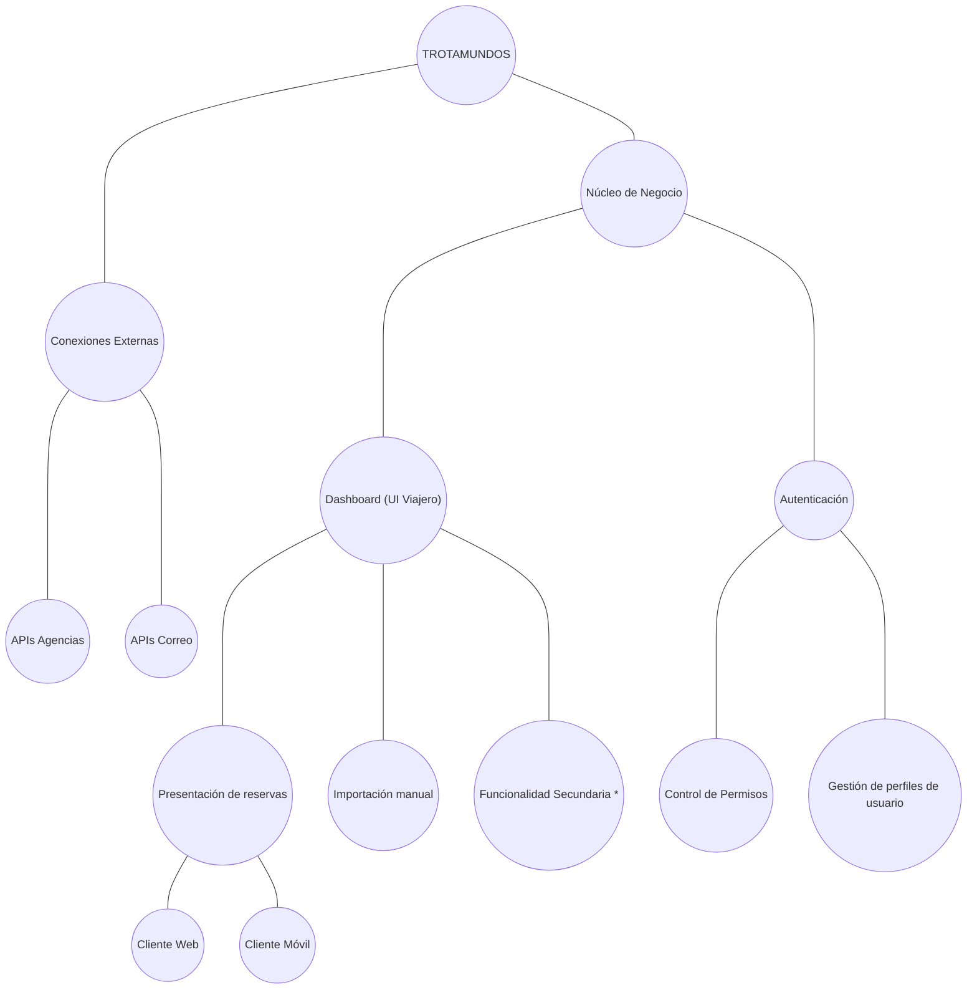
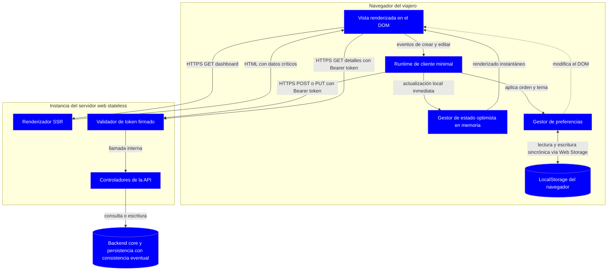
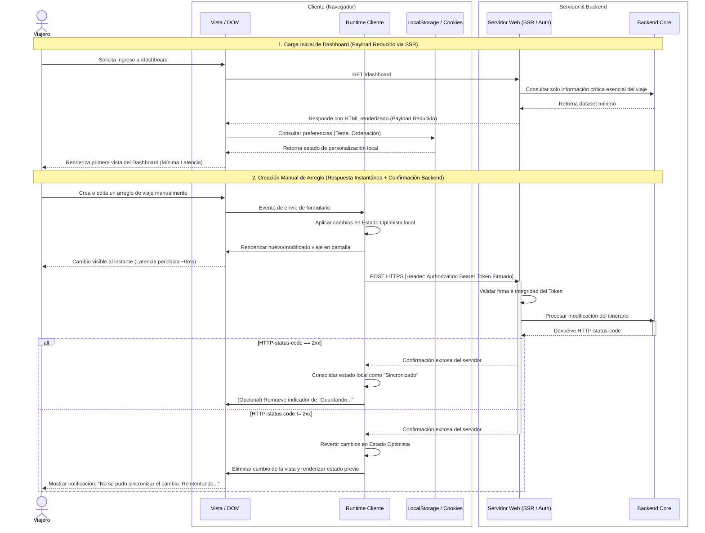

# Iteración 5 - Presentación del sistema "Trotamundos"

## PASO 2 - Objetivo de la Iteración

Diseñar el módulo presentación, asegurando una usabilidad apta para centralizar información y garantizando tiempos de respuesta óptimos. Tiene que seguir la arquitectura stateless planteado en el ADR16 y aprovechar los mecanismos optimizados del backend.

**Drivers a desarrollar en la iteración:**

- QA03 - Primer contenido mobile
- QA02 - Tiempo respuesta Web
- QA11 - UI Simple centrada en el viaje

## PASO 3 - Descomposición

Hay que refinar el módulo de presentación. Se debe considerar que los clientes enviarán el token firmado en cada request y el esquema previamente planteado de backend genera consistencia eventual en el dashboard, pero los cambios locales se presentarán en el momento para acortar el tiempo de respuesta.

## PASO 4 - Aplicando conceptos de diseño a los drivers seleccionados

**Alternativas propuestas:**

| Alternativa                                                                       | Pros                                                                                    | Contras                                                                               | Drivers relacionados        |
| --------------------------------------------------------------------------------- | --------------------------------------------------------------------------------------- | ------------------------------------------------------------------------------------- | --------------------------- |
| Cliente SPA                                                                       | Compatibilidad con server stateless, alivia lógica del servidor, añade responsividad    | Aumenta tiempo de carga inicial                                                       | QA02, QA03 (Negativo)       |
| Server Side Rendering basado en templates                                         | Carga inicial rápida, menor complejidad en cliente                                      | Reduce responsividad, delega lógica al servidor                                       | QA03, QA02                  |
| Solo reflejar en el dashboard lo que hay en la base de datos                      | Consistencia clara                                                                      | El usuario ve el dashboard con delay mientras la base se actualiza                    | QA02, QA03 (Negativo), QA11 |
| Enviar solo la informacion critica que mostrará en el dashboard (Reducir payload) | Reduce el trafico de red, acelera el renderizado                                        | Posteriormente, el usuario tendrá que realizar llamadas adicionales para los detalles | QA02, QA03, QA11            |
| Reflejar cambios manuales automáticamente (Optimistic Update)                     | Experiencia mas fluida, evita que el cliente piense que su operación no funcionó        | Complejidad para manejar rollbacks ante falla en el backend                           | QA02, QA03                  |
| Enviar toda la información completa de cada arreglo de viaje                      | No requiere recargar la pagina para ver detalles                                        | Aumenta el tamaño del payload                                                         | QA02, QA03 (Negativo)       |
| Maintain user model                                                               | El sistema muestra una experiencia mas personalizada en base a sus preferencias previas | Requiere permisos del cliente para almacenar sus preferencias                         | QA11                        |

### 4.1 - Tiempos de respuesta

Elegimos las alternativas "Reflejar los cambios manuales automáticamente" y "Enviar solo la información crítica" para atacar el tiempo de respuesta en el cliente web y la primera visualización de contenido en el cliente. Ambas tácticas apuntan a no depender de todos los datos que contiene el backend. Las otras opciones quedan descartadas por degradar el performance del sistema en el cliente.

### 4.2 - UI Amigable

Elegimos la táctica "Maintain user model" para lograr una UI adaptada al usuario, centrada en el viaje. Se implementa con lógica client-side

### 4.3 - Diseño del cliente
Elegimos Server Side Rendering basado en templates para el cliente web. A esto lo complementamos con funcionalidad mínima en el cliente que permita implementar la táctica de (4.1 y 4.2)

## PASO 5 - Instanciar elementos, asignar responsabilidades y definir interfaces

El cliente web recibe el dashboard renderizado por el servidor. El cual mostrará, inicialmente, solo los datos esenciales para la interfaz principal. Posteriormente se podrá interactuar con la interfaz para ver más detalles (via request al servidor y recarga parcial)

Además, si el usuario crea o actualiza un arreglo de viaje manualmente, se debe ver reflejado instantaneamente sin esperar la latencia del backend/base de datos. Esto se logrará gracias a lógica interna del cliente (Optimistic Update)

Como el servidor planteado es stateless, la interfaz personalizada al usuario (Como orden de elementos, modo claro/oscuro, etc.) son almacenadas como cookies del lado del cliente (Tipo LocalStorage).

## PASO 6 - Documentación

### Vistas

**Descomposición del sistema (D. Módulos):**

**Leyenda:** cada círculo es un módulo del sistema. Una línea indica "contiene a" (descomposición), el módulo de arriba contiene al de abajo. El asterisco marca la funcionalidad secundaria (sistema de recomendación), prevista para la segunda entrega.

**Vista estructural (C&C)** - Componentes involucrados en el renderizado y presentación:

**Leyenda:**
- Cajas azules: componentes en ejecución.
- Cilindros: almacenes de datos.
- Recuadro "Navegador del viajero": componentes que corren en el dispositivo.
- Recuadro "Instancia del servidor web": componentes que corren en cada instancia del servidor.
- Línea continua con flecha: request, response o llamada.
- Línea de doble sentido: lectura y escritura.
- Línea punteada: efecto sobre el DOM.

**Vista comportamental (Secuencia)** - Flujo de datos entre el cliente y servidor:

En esta vista mostramos la carga inicial del sitio sumado al camino crítico de modificar/crear una reserva manualmente. Por último se muestran algunos elementos de cómo implementar la actualización optimista y posibles soluciones a rollbacks por fallo de esta.

**Leyenda:** cada columna es un participante y el tiempo avanza hacia abajo. Las cajas agrupan los participantes del navegador (Vista, Runtime de cliente, LocalStorage) y los del servidor (Servidor web SSR y Backend core). Flecha continua: request o llamada. Flecha punteada: respuesta. Las notas separan los dos escenarios (carga inicial y alta manual con actualización optimista). El bloque `alt` distingue el caso exitoso del caso de fallo con rollback.

### ADRs generados

Las decisiones de esta iteración se documentan en los siguientes Registros:

- [ADR17 - Payload reducido en la interfaz](../adr/17-PayloadReducido.md)
- [ADR18 - Reflejar actualizaciones manuales](../adr/18-ReflejoAutomatico.md)
- [ADR19 - Personalización en LocalStorage](../adr/19-PersonalizacionLocalStorage.md)
- [ADR20 - Renderizado SSR](../adr/20-SSR.md)

## PASO 7 - Revisar la aplicación del método

Se refinó el módulo de presentación para cliente web, asegurando la compatibilidad con decisiones previas como el server stateless y las tácticas de optimizacion de consultas a la base de datos. Se cubrieron correctamente los drivers de usabilidad y respuesta al cliente.

Queda pendiente definir como tratar rollbacks si falla en red o backend (El cliente ya vió su cambio, pero no persistió).

El diseño actual ya aborda los drivers prioritarios de negocio, consideramos que no son necesarias más iteraciones para descomponer, podría realizarse una iteración extra para definir puntos sueltos centrados en elementos específicos.

# Contraste LLM - Iteración 5 (Fuera del método)

El objetivo de la iteración y la justificación de atacarla se consideraron en ambos casos, aunque el LLM hizo una mayor separación entre los clientes web y móvil.

El LLM aplicó estilos que nosotros consideramos innecesarios, creemos que agrega más complejidad a la arquitectura de lo que aporta.

Sobre las tácticas, se apuntó a lo mismo, reducir el volumen de la respuesta, mostrar las actualizaciones en local aunque no estén aún en el backend. El LLM sugirió "Modelo de tarea centrado en el viaje", nosotros tomamos eso como diseño de interfaz, no como algo arquitectónico.

Además, prefirió tener una copia del resumen como cookie, creemos que eso podría interferir en la seguridad de los itinerarios de los usuarios, por lo que preferimos no tener una caché del usuario

Para la tecnología a tratar clientes, el LLM optó por diseñar un cliente móvil multiplataforma y un SPA para el cliente web. Por conocimientos previos del equipo a arquitecturas orientadas al SSR, se prefirió esta opción, que a su vez tiene una carga inicial mejor que un SPA

Ambos consideramos el riesgo de hacer rollback y cómo mostrarlo al cliente en ese caso

En este caso, creemos que nuestras decisiones bastan para abordar la iteración correctamente. No tomamos nuevos ADRs.

