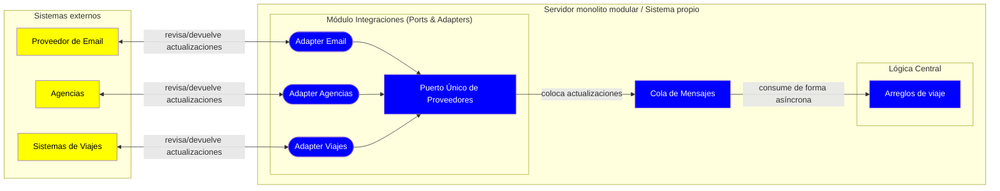
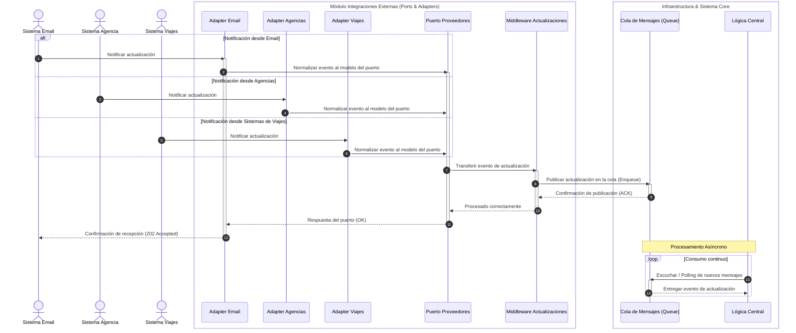

# Iteración 5 - Presentación del sistema "Trotamundos"

## PASO 2 - Objetivo de la Iteración
Diseñar el módulo presentación al usuario (Web y móvil), asegurando una usabilidad apta para centralizar información y garantizando tiempos de respuesta óptimos. Tiene que seguir la arquitectura stateless planteado en el ADR16 y aprovechar los mecanismos optimizados del backend.

**Drivers a desarrollar en la iteración:**
- QA03 - Primer contenido mobile
- QA02 - Tiempo respuesta Web
- QA11 - UI Simple centrada en el viaje

## PASO 3 - Descomposición
Hay que refinar el módulo de presentación, los clientes Web y clientes Mobile. Se debe considerar que los clientes enviarán el token firmado en cada request y el esquema previamente planteado de backend genera consistencia eventual en el dashboard, pero los cambios locales se tendrán que presentar en el momento.

## PASO 4 - Aplicando conceptos de diseño a los drivers seleccionados

**Alternativas propuestas:**

| ALTERNATIVAS                                                    | PROS | CONTRAS |   |   |   |   |   |   |   |
|-----------------------------------------------------------------|------|---------|---|---|---|---|---|---|---|
| Reflejar los cambios manuales automáticamente                   |      |         |   |   |   |   |   |   |   |
| Solo reflejar en el dashboard lo que hay en la base de datos    |      |         |   |   |   |   |   |   |   |
| Enviar solo la informacion critica que mostrará en el dashboard |      |         |   |   |   |   |   |   |   |
| Enviar toda la información completa de cada arreglo de viaje    |      |         |   |   |   |   |   |   |   |
|                                                                 |      |         |   |   |   |   |   |   |   |
|                                                                 |      |         |   |   |   |   |   |   |   |
|                                                                 |      |         |   |   |   |   |   |   |   |
|                                                                 |      |         |   |   |   |   |   |   |   |
|                                                                 |      |         |   |   |   |   |   |   |   |

### 4.1 - Tiempos de respuesta

### 4.2 - UI Amigable

## PASO 5 - Instanciar elementos, asignar responsabilidades y definir interfaces
El módulo integraciones externas se estructura con Ports and Adapters que expone un único puerto de proveedores externos y un adapter por tipo de proveedor (email, agencias, sistemas de viajes).
En el módulo del puerto se incluye un middleware que recibe las actualizaciones de los sistemas externos y coloca estas actualizaciones en la cola para luego ser consumidos por la lógica central del sistema de forma asíncrona.

## PASO 6 - Documentación

### Vistas
**Diagrama de Componentes y Conectores:**

- Amarillo: Sistemas externos
- Rectángulos azules: Módulos del sistema
- Píldoras azules: Adaptadores de puertos de nuestro sistema

La vista busca mostrar los módulos involucrados en la implementación de "ports and adapters" y "cola asíncrona" dentro del servidor.

**Diagrama de secuencias:**

En este diagrama buscamos dar una vista dinámica del consumo de servicios externos y posterior formateo y publicación interna hasta llegar a la lógica central.

### ADRs generados
Las decisiones de esta iteración se documentan en los siguientes Registros:
- ADR03 - Uso de Publisher-Subscriber (rechazado)
- ADR04 - Uso de "cola asincrona punto a punto" para actualizaciones
- ADR05 - Uso de estilo Ports & Adapters

## PASO 7 - Revisar la aplicación del método

Se refinó el módulo más crítico en performance e interoperabilidad con terceros. Se concentra toda la comunicación en este modulo, aislando el resto del sistema de los mismos. Falta definir con qué intervalo de tiempo hará las consultas el middleware para asegurar los tiempos requeridos por los escenarios. Consideramos que lo mas critico próximo es el ámbito de la escalabilidad del sistema.
