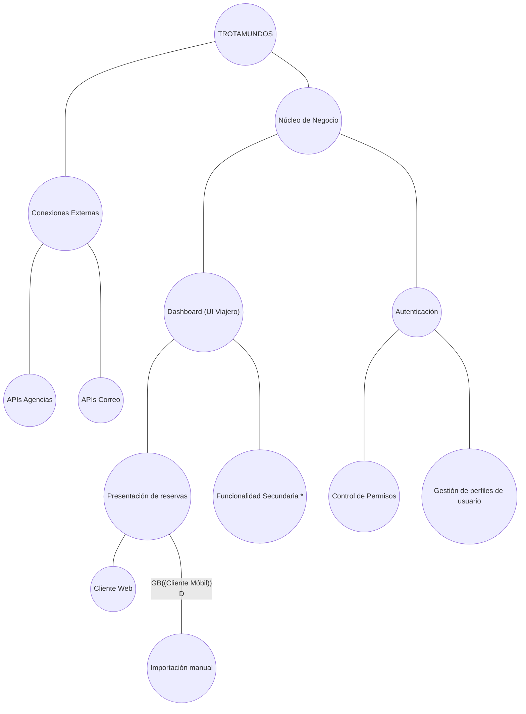

# Iteración 5 - Presentación del sistema "Trotamundos"

## PASO 2 - Objetivo de la Iteración

Diseñar el módulo presentación al usuario (Web y móvil), asegurando una usabilidad apta para centralizar información y garantizando tiempos de respuesta óptimos. Tiene que seguir la arquitectura stateless planteado en el ADR16 y aprovechar los mecanismos optimizados del backend.

**Drivers a desarrollar en la iteración:**

- QA03 - Primer contenido mobile
- QA02 - Tiempo respuesta Web
- QA11 - UI Simple centrada en el viaje

## PASO 3 - Descomposición

Hay que refinar el módulo de presentación, los clientes Web y clientes Mobile. Se debe considerar que los clientes enviarán el token firmado en cada request y el esquema previamente planteado de backend genera consistencia eventual en el dashboard, pero los cambios locales se presentarán en el momento para acortar el tiempo de respuesta.

## PASO 4 - Aplicando conceptos de diseño a los drivers seleccionados

**Alternativas propuestas:**

| Alternativa                                                                       | Pros                                                                                    | Contras                                                                               | Drivers relacionados        |
| --------------------------------------------------------------------------------- | --------------------------------------------------------------------------------------- | ------------------------------------------------------------------------------------- | --------------------------- |
| Solo reflejar en el dashboard lo que hay en la base de datos                      | Consistencia clara                                                                      | El usuario ve el dashboard con delay mientras la base se actualiza                    | QA02, QA03 (Negativo), QA11 |
| Enviar solo la informacion critica que mostrará en el dashboard (Reducir payload) | Reduce el trafico de red, acelera el renderizado                                        | Posteriormente, el usuario tendrá que realizar llamadas adicionales para los detalles | QA02, QA03, QA11            |
| Reflejar los cambios manuales automáticamente                                     | Experiencia mas fluida, evita que el cliente piense que su operación no funcionó        | Complejidad para manejar rollbacks ante falla en el backend                           | QA02, QA03                  |
| Enviar toda la información completa de cada arreglo de viaje                      | No requiere recargar la pagina para ver detalles                                        | Aumenta el tamaño del payload                                                         | QA02, QA03 (Negativo)       |
| Maintain user model                                                               | El sistema muestra una experiencia mas personalizada en base a sus preferencias previas | Requiere permisos del cliente para almacenar sus preferencias                         | QA11                        |

### 4.1 - Tiempos de respuesta

Elegimos las alternativas "Reflejar los cambios manuales automáticamente" y "Enviar solo la información critica" para atacar el tiempo de respuesta en el cliente web y la primera visualizacion de contenido en el cliente mobile. Ambas tácticas apuntan a no depender de todos los datos que contiene el backend. Las otras opciones quedan descartadas por degradar el performance del sistema en el cliente.

### 4.2 - UI Amigable

Elegimos la táctica "Maintain user model" para lograr una UI adaptada al usuario, centrada en el viaje

## PASO 5 - Instanciar elementos, asignar responsabilidades y definir interfaces

Tanto el cliente web como movil, deben renderizar el dashboard realizando requests al servidor, el cual le deberá proveer una response con unicamente los datos esenciales para mostrar en la interfaz principal.

Además, si el usuario crea o actualiza un arreglo de viaje manualmente, se debe ver reflejado instantaneamente sin esperar la latencia del backend/base de datos

Como el servidor planteado es stateless, la interfaz personalizada al usuario (Como orden de elementos, modo claro/oscuro, etc.) son almacenadas como cookies del lado del cliente (Tipo LocalStorage)

## PASO 6 - Documentación

### Vistas

**Descomposición del sistema (D. Módulos):**

**Vista estructural (C&C):**
Mostrar cliente web, movil y el localstorage, como se manejan las preferencias y como se obtienen los datos

**Vista comportamental (Secuencia):**
Como las request reciben un payload reducido y como interactuan con la creacion manual (se muestra intantaneo), y tambien se mandan al backend para que lo confirme posteriormente

### ADRs generados

Las decisiones de esta iteración se documentan en los siguientes Registros:

- ADR17 - Payload reducido en la interfaz
- ADR18 - Reflejar actualizaciones manuales
- ADR19 - Personalizacion en LocalStorage

## PASO 7 - Revisar la aplicación del método

Se refinó el módulo de presentación (clientes Web y Móvil), asegurando la compatibilidad con decisiones previas como el server stateless y las tácticas de optimizacion de consultas a la base de datos. Se cubrieron correctamente los drivers de usabilidad y respuesta al cliente.

Queda pendiente definir como tratar rollbacks si falla en red o backend (El cliente ya vió su cambio, pero no persistió).

El diseño actual ya aborda los drivers prioritarios de negocio, consideramos que no son necesarias más iteraciones para descomponer, podria realizarse una iteracion extra para definir puntos sueltos centrados en elementos especificos.
