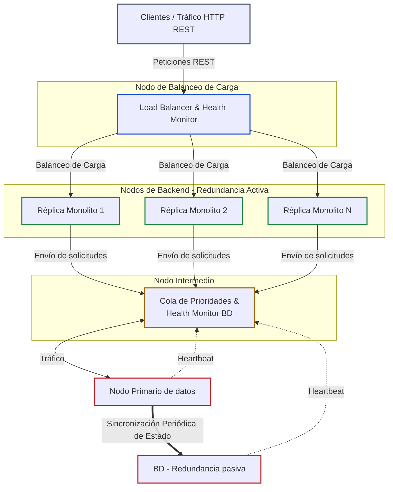
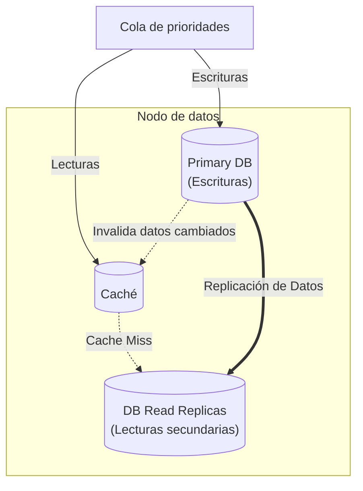

# Iteración 2 - Integraciones externas de "Trotamundos"

## PASO 2 - Objetivo de la Iteración
Definir soluciones de disponibilidad para el sistema entero. Organizar el despliegue de los móduos del sistema.

**Drivers a desarrollar en la iteración:**
- QA04 - Inactividad no planificada

## PASO 3 - Descomposición
En iteraciones anteriores se tomaron decisiones que dejan cuestiones sin resolver acerca de como se garantiza la disponibilidad del sistema. Se despeja incertidumbre, por separado, sobre los módulos de lógica (backend) y datos.

## PASO 4 - Aplicando conceptos de diseño a los drivers seleccionados

**Alternativas propuestas:**

| Alternativa             | Pros                                               | Contras |
|---|---|---|
| Táctica Heartbeat       | Proactividad de la réplica, tráfico unidireccional | tiempo de reconocimiento de caida variable, Riesgo de saturación por falta de sincronización |
| Táctica ping/echo       | Control centralizado en load balancer, fácil integración con load balancer | tráfico bidireccional, sensible a la latencia |
| Redundancia activa (BD) | Mantiene mayor confianza para el sistema, recuperación rápida | Perdida de eficiencia, mayor costo de ejecución (consistencia) |
| Redundancia pasiva (BD) | Menor costo de utilización, recuperación rápida | Agrega lógica de healthcheck, activación y actualización |
| Repuesto en frío (BD)   | Cero costo de CPU por mantenimiento | Recuperación más lenta, Agrega lógica de healthcheck y activación. Pierde datos no actualizados |

Para las n réplicas del backend (redundancia activa ADR08), se decide usar heartbeat. Esto permite controlar el tiempo de detección de una caída mediante la configuración del timeout en el balanceador de carga (de forma centralizada). Además aliviana el uso de red intermedio en contraste con ping-echo.

Para el health check del módulo de datos, se elige también heartbeat, en conjunto con un esquema de redundancia pasiva para contingencia ante fallos.

## PASO 5 - Instanciar elementos, asignar responsabilidades y definir interfaces

### 5.1 - Patrón de despliegue
Respetando la redundancia activa (n réplicas según disponibilidad geográfica) definida en ADR08 tiene un balanceo de carga para los monolitos modulares que contienen la lógica replicada del negocio.
El módulo de base de datos se despliega aparte con una instancia de redundancia pasiva. La instancia primaria envía actualizaciones de forma periódica.
La cola de prioridades (ADR09) se despliega como nodo intermedio entre la lógica y los datos. En ese midmo nodo, se implementan el healthcheck de la base de datos.

### 5.2 - Healthchecks
El load Balancer de los monolitos se encarga de monitorear los heartbeats producidos por las replicas. Los mismos se setean a una frecuencia menor a un minuto para garantizar la detección de fallo pedida en QA04. Ante una caida, solo se redistribuye la carga a las demás réplicas hasta recuperar la caída (responsabilidad del clúster).
El nodo de la cola de prioridad monitorea heartbeats de los nodos de datos y ante un fallo del entonces considerado primario, se intercambian responsabilidades mutuamente.

## PASO 6 - Documentación

### Vistas
**Deployment (despliegue):**

Donde "Nodo primario de datos" y su redundancia pasiva son réplicas del nodo definido en iteración 3:

Este esquema describe el despliegue de los diferentes módulos del sistema en cualquier instante de tiempo. Ante una caída de nodo de datos o un mal funcionamiento (detectado en respuesta a consultas), el monitor efectúa un switch: el nodo spare pasa a ser primario mientras se mantenga saludable y se intercambian responsabilidades mutuamente (siguen respetando lo descrito en la vista).

### ADRs generados
Las decisiones de esta iteración se documentan en los siguientes Registros:
- [ADR21 - Patrón de despliegue](../adr/21-Deployment.md)
- [ADR22 - Healtchecks](../adr/22-Heartbeat.md)

## PASO 7 - Revisar la aplicación del método

Se definió cómo serán desplegados los módulos del sistema y como se abordarán las revisiones de salud de cada uno. Todo en pos de eliminar incertidumbre y mejorar la disponibilidad en torno a las medidas de respuesta en QA04.

# Contraste LLM
El LLM optó por elegir replicas en idferentes zonas con dos nodos (lider-seguidor) para que uno acepte escrituras y el otro lo reemplace ante una caida.

Como tacticas usó helathcheck con hearthbeat, degradacion controlada para permitir solo lectura si no se puede escribir y resincronizacion antes de reintroducir.

Al igual que el grupo, se descartó spare frio por el arranque lento. 