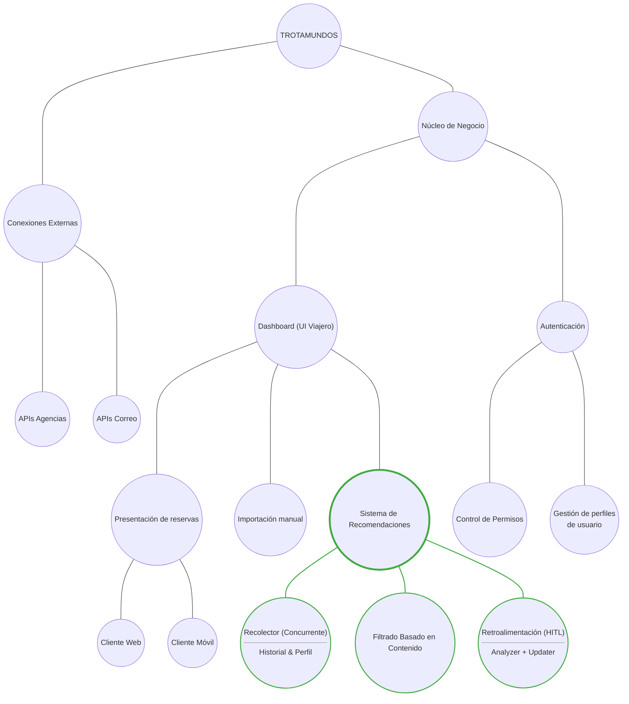
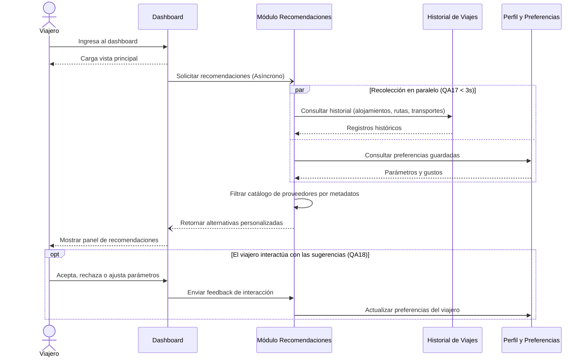

# Iteración 7 - Sistema de recomendación

## PASO 1 - Revisar el input

Como la user story del sistema de recomendación no tiene medidas claras para poder diseñar sobre ella, se construyen QAs para el mismo. Esto se debería hacer al inicio de una round, pero por simplicidad, ya que solo es un unico driver, se hace previo a esta iteración.

**QA17 - Performance: Generacion de recomendaciones**

El sistema de recomendación debe generarlas en un tiempo apropiado

- Fuente: Viajero con historial
- Estimulo: Solicitud de recomendacion al cargar el dashboard
- Artefacto: Modulo de recomendaciones, historial
- Entorno: Tiempo de ejecucion, en modo normal
- Respuesta: El sistema devuelve en el dashboard las alternativas personalizadas de alojamiento, transporte y rutas
- Medida de respuesta: El tiempo de generacion de respuestas maximo es de 3 segundos

**QA18 - Evolvability: Retroalimentacion del usuario**

El sistema de recomendacion debe utilizar una optimizacion human-in-the-loop para ajustar los parametros

- Fuente: Viajero
- Estimulo: Acepta, rechaza o ajusta parametros de una recomendacion
- Artefacto: Modulo de recomendaciones, parametros y preferencias
- Entorno: Funcionamiento normal, en ejecucion
- Respuesta: El sistema utiliza el feedback del usuario para refinar futuras recomendaciones
- Medida de respuesta: El feedback debe usarse para la proxima recomendacion que se realice

## PASO 2 - Objetivo de la Iteración

Diseñar la arquitectura del modulo de recomendaciones para cumplir los requisitos de performance y retroalimentacion

**Drivers a desarrollar en la iteración:**

- US08 - Sistema de recomendacion
- QA17 - Performance: Generación de recomendaciones
- QA18 - Evolvability: Retroalimentacion del usuario

## PASO 3 - Descomposición

El principal elemento a descomponer es el sistema de recomendaciones el cual debe interactuar y tener un buen flujo con el dashboard y el historial de usuario

## PASO 4 - Aplicando conceptos de diseño a los drivers seleccionados

| Alternativa                                                  | Pros                                                                                                                                                                        | Contras                                                                                                  |
| ------------------------------------------------------------ | --------------------------------------------------------------------------------------------------------------------------------------------------------------------------- | -------------------------------------------------------------------------------------------------------- |
| Carga asíncrona del panel de recomendaciones en el Dashboard | La carga del dashboard no depende de las recomendaciones que son mas lentas que el resto de elementos                                                                       | El usuario ve que parte del dashboard está cargado y una parte falta                                     |
| Consultas concurrentes del historial y preferencias          | Las consultas para obtener el historial del usuario se realiza en simultaneo, reduciendo la latencia                                                                        | Mayor carga en los servidores y base de datos                                                            |
| Sistema de recomendacion por filtrado colaborativo           | Descubre preferencias emergentes y genera mayor diversidad en las sugerencias                                                                                               | Tiene cold start, depende de contar con un gran volumen de actividad de otros usuarios                   |
| Sistema de recomendacion basado en contenido                 | No depende de la actividad del resto de los usuarios, el input son metadatos del item sencillos de leer y preferencias del viajero, lo que lo hace mas facil de implementar | Poca diversidad en las recomendaciones y para que funcione bien los metadatos deben ser de buena calidad |

Se eligen las alternativas de asincronismo y concurrencia para asegurar el performance. El sistema de recomendacion se elige el basado en contenido por la simplicidad en la implementacion.

## PASO 5 - Instanciar elementos, asignar responsabilidades y definir interfaces

El dashboard muestra las recomendaciones en un panel aparte al resto de arreglos del viajero. A diferencia del resto, esta puede tardar mas en generarse, al ser asincrono.  
El modulo de recomendaciones utiliza un algoritmo basado en contenido y se alimenta de las preferencias del usuario y el historial del mismo, para obtener la informacion se realizan consultas concurrentes para recolectar la misma en menos tiempo.  
Las preferencias se deben almacenar en el perfil del usuario para personalizar las recomendaciones.  
El modulo de recomendaciones posee una lista de arreglos provista por distintos proveedores, cada elemento tiene los metadatos suficientes para poder filtrar a los gustos de cada viajero.

## PASO 6 - Documentación

### Vistas

**Descomposición del sistema (Diagrama de Módulos):**

Se añade al último diagrama de módulos la descomposición del `Sistema de Recomendaciones` y sus componentes. Se destacan en color verde los cambios.

**Diagrama de Secuencia**

> `Perfil y Preferencias` e `Historial de Viajes` pertenecen a la Base de Datos. NO son módulos ni almacences separados, solo se muestra en la vista una diferencia semántica.
Flechas abiertas simbolizan mensajes de llamadas asíncronas.
Líneas punteadas simbolizan retornos de llamadas.

En esta última vista describimos el flujo básico del **Sistema de Recomendaciones**. Se muestra la interacción del viajero con el dashboard, de qué manera se procesan las recomendaciones y como le llegan. Finalmente, se muestra la opción de dar feedback para mejorar las recomendaciones en función de sus gustos (HITL).

### ADRs generados

Las decisiones de esta iteración se documentan en los siguientes Registros:

- [ADR23 - Asíncronismo en las recomendaciones](../adr/23-AsincronismoRecomendaciones.md)
- [ADR24 - Concurrencia en la consulta del historial](../adr/24-ConcurrenciaConsultaHistorial.md)
- [ADR25 - Recomendacion basado en contenido](../adr/25-RecomendacionBasadaEnContenido.md)

## PASO 7 - Revisar la aplicación del método

La descomposición del sistema de recomendación y las alternativas planteadas fue suficiente para cumplir los atributos de calidad planteados. 

# Contraste LLM
