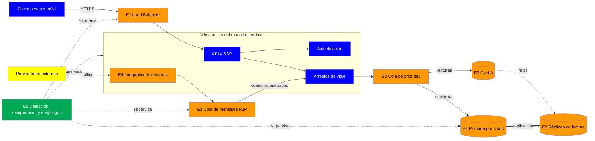
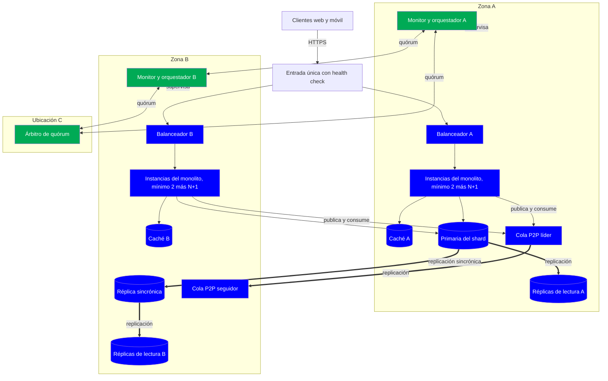
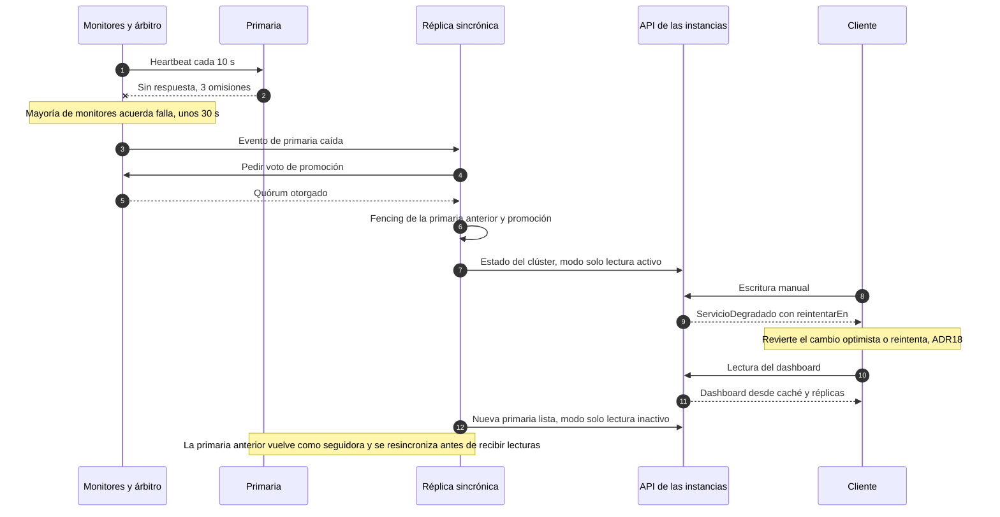
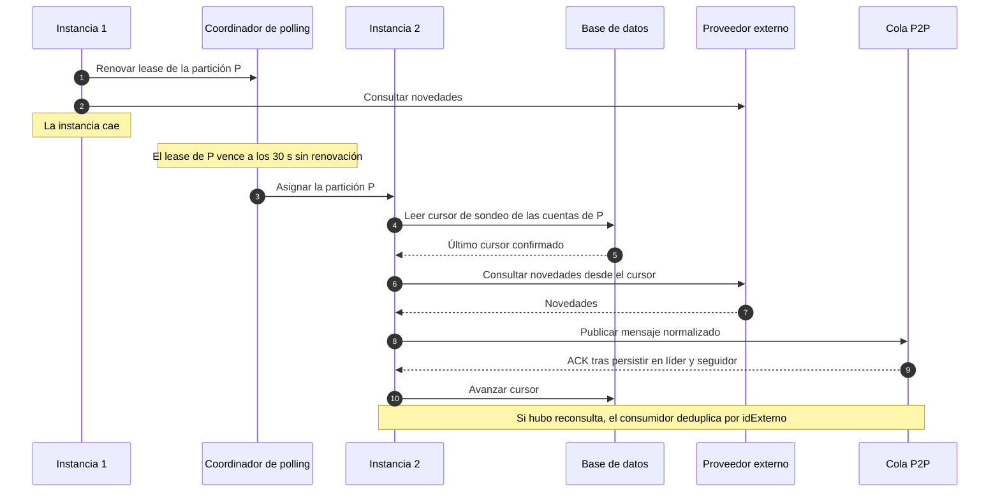

# Iteración 6: Disponibilidad del sistema propio

## PASO 2: Objetivo de la iteración

### Punto de partida

La iteración 2 y el ADR07 cubrieron la parte de QA04 que dice _"si la falla proviene del servicio de tercero, solo dar aviso al usuario"_. Falta la otra mitad del escenario: **una caída no planificada de nuestro propio software o hardware**, con detección en menos de 1 minuto y menos de 5 minutos de inactividad por mes.

Las iteraciones 1 a 5 agregaron piezas (balanceador, cola P2P, cola de prioridad, primaria con réplicas, shards, caché) sin definir cómo sobreviven a una falla. El README ya lo lista como pendiente: _"falta un sistema claro de detección y recuperación"_ y _"puntos únicos de falla: balanceador, cola, primaria"_.

### Qué exige la medida de respuesta

Un mes tiene 43.200 minutos. Cinco minutos de caída equivalen a una disponibilidad de **≈ 99,988 %**. Esto condiciona el diseño:

| Hecho                                                             | Consecuencia arquitectónica                                                                   |
| ----------------------------------------------------------------- | --------------------------------------------------------------------------------------------- |
| Un solo failover de 2 min consume el 40 % del presupuesto mensual | La recuperación debe ser **automática**. Una intervención humana no entra en el presupuesto.  |
| Detección en menos de 1 min                                       | Hace falta monitoreo activo. Los usuarios no pueden ser el mecanismo de detección.            |
| Un incidente de 5 min agota el mes                                | La redundancia debe cubrir todo el camino crítico. Una sola pieza sin réplica anula el resto. |

### Drivers seleccionados

| Driver                                         | Tipo                 | Prioridad | Rol en la iteración                                                             |
| ---------------------------------------------- | -------------------- | --------- | ------------------------------------------------------------------------------- |
| **QA04** Inactividad no planificada            | Availability         | H, H      | **Principal**                                                                   |
| **CN2** Centralidad del servidor (ADR01)       | Concern              | n/a       | Declarado en la iteración 1 y nunca tratado en disponibilidad. Se cierra aquí.  |
| **Puntos únicos de falla**                     | Riesgo identificado  | n/a       | Balanceador, cola P2P y primaria de la BD (ver README)                          |
| QA07 Picos de tráfico y QA06 Actividad semanal | Scalability          | H         | **A no degradar.** La redundancia no puede romper los 800 ms ni los 2500 req/s. |
| CN1 Tecnologías genéricas y C2 (MADR)          | Concern y constraint | n/a       | Transversales. Se eligen categorías y no productos.                             |

### Meta de la iteración

> **Diseñar cómo el sistema propio detecta fallas en menos de 1 minuto y se recupera sin intervención humana, eliminando los puntos únicos de falla del camino crítico (entrada, procesamiento, mensajería y datos), de modo que la inactividad no planificada quede por debajo de 5 minutos al mes sin degradar QA06 y QA07.**

### Justificación de la selección

- **Cohesión:** la disponibilidad se decide en el conjunto, no en un módulo. Trabajarla en una sola iteración evita redundancias parciales, como una primaria replicada detrás de un balanceador único.
- **Riesgo acumulado:** ya hay cuatro decisiones que introducen piezas centrales (ADR04, 08, 09, 10). Cada iteración posterior agregaría más sin resolver esto.
- **Costo de postergarlo:** varias decisiones de redundancia son difíciles de cambiar después. Entre ellas están el modelo de failover de la BD, la durabilidad de la cola y la estructura de despliegue. El README ya dice que apuntamos a estas decisiones estructurales.
- **Alcance para el prototipo:** el objetivo es el **diseño** que habilite cumplir QA04. Los valores finales (umbrales, tiempos de failover) se calibran con health checks y fault injection sobre el prototipo, como indica el README.

---

## PASO 3: Elección de elementos a refinar

### Enfoque

El sistema ya no es greenfield. Se aplica un enfoque **top-down**

### Análisis de los elementos existentes

| Elemento                                                | ADR     | Efecto si cae                                                                                               | Redundancia definida hoy                                                                                                                                    | ¿Refinar?                      |
| ------------------------------------------------------- | ------- | ----------------------------------------------------------------------------------------------------------- | ----------------------------------------------------------------------------------------------------------------------------------------------------------- | ------------------------------ |
| **Load Balancer**                                       | 08      | Nadie accede al sistema                                                                                     | Ninguna. Balancea las instancias, pero él mismo es único.                                                                                                   | **Sí, alta**                   |
| **Capa de datos** (primaria por shard, réplicas, caché) | 10, 11  | Sin primaria no hay escrituras. Sin réplicas ni caché cae la lectura.                                       | Hay réplicas de lectura. **No hay failover de la primaria** ni se definió el arranque en frío de la caché.                                                  | **Sí, alta**                   |
| **Cola de mensajes P2P**                                | 04      | La ingesta se detiene. El dashboard sigue sirviendo datos, pero se rompe QA01.                              | No se definió durabilidad ni réplica.                                                                                                                       | **Sí, alta**                   |
| **Cola de prioridad**                                   | 09      | Si es externa, frena lecturas y escrituras. Si vive en cada instancia, se pierden las solicitudes en vuelo. | Su ubicación no está definida.                                                                                                                              | **Sí, acotado**                |
| **Integraciones externas** (polling)                    | 05, 07  | Las actualizaciones dejan de llegar                                                                         | El módulo corre dentro de las N instancias. **No está definido quién sondea cada cuenta.** Podría haber consultas duplicadas o huecos si una instancia cae. | **Sí, acotado**                |
| Instancias del monolito                                 | 02, 16  | Se reemplazan por otra instancia.                                                                           | N instancias sin estado (ADR16).                                                                                                                            | No. Ya está cubierto.          |
| Autenticación                                           | 14, 16  | La validación de tokens es local en cada instancia.                                                         | Hereda la de las instancias.                                                                                                                                | No                             |
| Clientes web y móvil                                    | 17 a 20 | n/a                                                                                                         | n/a                                                                                                                                                         | No. QA03 móvil está pendiente. |

### Elementos seleccionados

| #      | Elemento                                                                    | Prioridad | Qué se refinará                                                                      | Drivers           |
| ------ | --------------------------------------------------------------------------- | --------- | ------------------------------------------------------------------------------------ | ----------------- |
| **E1** | Punto de entrada (Load Balancer)                                            | Alta      | Eliminarlo como punto único de falla                                                 | QA04, CN2         |
| **E2** | Capa de datos                                                               | Alta      | Failover de la primaria por shard, comportamiento de réplicas y caché ante fallas    | QA04, QA05 a QA07 |
| **E3** | Mensajería asíncrona (cola P2P y, de forma acotada, cola de prioridad)      | Alta      | Durabilidad, redundancia y ubicación de las colas                                    | QA04, QA01        |
| **E4** | Integraciones externas, acotado al **reparto del polling** entre instancias | Media     | Que la caída de una instancia no deje cuentas sin sondear ni duplique consultas      | QA04, QA01        |
| **E5** | Detección, recuperación y despliegue (**elemento transversal nuevo**)       | Alta      | Cómo se detectan fallas, quién recupera y cómo se distribuyen los elementos en zonas | QA04              |

- Naranja: elementos existentes a refinar
- Azul: elementos existentes sin cambios
- Verde: elemento nuevo
- Amarillo: sistemas externos
- Línea punteada: supervisión

### Qué implica esta selección

- **Se mantiene el estilo base.** No se descompone el monolito ni se pasa a microservicios. La disponibilidad se obtiene replicando y supervisando lo existente, lo cual es coherente con ADR02 y con el costo de un equipo de startup.
- **E1, E2, E3 y E5 son el camino crítico.** El sistema solo cumple QA04 si los cuatro tienen un mecanismo de recuperación automática. Una cadena es tan disponible como su eslabón más débil.
- **E4 se limita al polling.** Su refinamiento completo (intervalo adaptativo, límites de proveedores) pertenece a otra iteración.
- **Se tratan como diferidos** dos puntos que ya existen en los documentos: la revocación de tokens (ADR16) y el rollback optimista (ADR18). Ninguno afecta QA04.

# Iteración 6: Disponibilidad del sistema propio

## PASO 4: Elección de conceptos de diseño

### Qué problema resuelve cada concepto

Se parte del análisis del Paso 3. La disponibilidad del camino crítico es el producto de la de sus eslabones, así que hay que cubrir los cuatro con un mecanismo automático.

| Eslabón                 | Falla a cubrir                                                 | Qué hay que lograr                                                     |
| ----------------------- | -------------------------------------------------------------- | ---------------------------------------------------------------------- |
| E1 Entrada              | Caída del balanceador o de su zona                             | Que no sea único y que el cliente no lo note                           |
| Instancias del monolito | Caída de instancia o nodo                                      | Retirarla del tráfico rápido y reemplazarla                            |
| E2 Datos                | Caída de la primaria de un shard, de una réplica o de la caché | Promover una réplica automáticamente sin perder escrituras confirmadas |
| E3 Mensajería           | Caída del nodo de la cola P2P                                  | Que los mensajes no se pierdan y la ingesta continúe                   |
| E4 Polling              | Caída de la instancia que sondea una cuenta                    | Que otra instancia tome el trabajo sin duplicar ni dejar huecos        |
| E5 Detección            | Falla del propio monitor                                       | Que no sea otro punto único de falla                                   |

### Conceptos considerados

Selecciono **2 estilos** y **3 tácticas**. No aplican arquitecturas de referencia, porque ninguna cubre este conjunto sin agregar infraestructura que el prototipo no necesita. Los patrones de diseño quedan fuera por granularidad.

**Estilos**

| #   | Estilo                                                                                                                   | Elementos                                                         | Drivers               |
| --- | ------------------------------------------------------------------------------------------------------------------------ | ----------------------------------------------------------------- | --------------------- |
| S1  | **Réplicas activas multi-zona**, con todas las copias sirviendo tráfico detrás de un punto de entrada redundante         | E1, instancias, caché, E4                                         | QA04, QA06, QA07, CN2 |
| S2  | **Líder-seguidor con elección automática**, con un líder que acepta escrituras y seguidores que lo reemplazan por quórum | E2 (primaria por shard), E3 (cola P2P), reparto del polling en E4 | QA04, QA05, QA01      |

**Tácticas** (catálogo de disponibilidad de Bass)

| #   | Táctica                                                                                                                                        | Categoría             | Elementos                         | Drivers                        |
| --- | ---------------------------------------------------------------------------------------------------------------------------------------------- | --------------------- | --------------------------------- | ------------------------------ |
| T1  | **Health checks, heartbeat y monitor redundante**, con falla declarada por N omisiones de M                                                    | Detectar fallas       | Todos, vía E5                     | QA04 (detección menor a 1 min) |
| T2  | **Degradación controlada**: modo solo lectura durante el failover de la primaria, con rechazo explícito y reintentable de escrituras           | Recuperarse de fallas | E2                                | QA04, QA02, QA06               |
| T3  | **Readiness y resincronización antes de reintroducir**: un componente reparado no recibe tráfico hasta estar sincronizado y con caché caliente | Reintroducir          | Instancias, caché, réplicas, cola | QA04, QA07                     |

### Registro de decisiones del Paso 4

| ID     | Concepto elegido                                                                                                                                                                          | Alternativas descartadas                                                                                                                                                                                                                  | Justificación                                                                                                                                                                                                             | Trade-off                                                                                                                                                                                                      |
| ------ | ----------------------------------------------------------------------------------------------------------------------------------------------------------------------------------------- | ----------------------------------------------------------------------------------------------------------------------------------------------------------------------------------------------------------------------------------------- | ------------------------------------------------------------------------------------------------------------------------------------------------------------------------------------------------------------------------- | -------------------------------------------------------------------------------------------------------------------------------------------------------------------------------------------------------------- |
| **D1** | **S1: réplicas activas multi-zona** para entrada, instancias y caché. Mínimo 2 copias por zona, o 3 en total, con tráfico repartido.                                                      | **Activo-pasivo con spare frío:** el arranque tarda minutos y consume el presupuesto. **Una sola zona con más instancias:** no cubre la caída de zona.                                                                                    | Con copias activas no hay conmutación, porque la capacidad ya está sirviendo. El monolito ya es sin estado (ADR16), lo que hace trivial replicar la lógica. Además, la capacidad extra absorbe parte de los picos (QA07). | Mayor costo de infraestructura. Hay que dimensionar para que, sin una zona, las restantes sostengan 500 req/s y degraden de forma controlada en 2500 req/s.                                                    |
| **D2** | **S2 aplicado a datos**: primaria por shard con réplica sincrónica o semisincrónica en otra zona y promoción automática por quórum                                                        | **Failover manual:** no entra en el presupuesto. **Replicación asíncrona pura:** failover rápido, pero puede perder escrituras confirmadas. **Multi-primaria:** conflictos de escritura y complejidad desproporcionada para el prototipo. | Es el eslabón de mayor riesgo, porque sin primaria no hay escrituras. La réplica sincrónica evita pérdida de datos. El quórum evita dos primarias a la vez (split brain).                                                 | Suma latencia a cada escritura. Con ADR09 las escrituras ya están priorizadas por debajo de las lecturas, lo que lo hace tolerable.                                                                            |
| **D3** | **S2 aplicado a mensajería**: cola P2P como clúster con réplica entre zonas, mensajes durables y ACK del consumidor                                                                       | **Una cola única con persistencia en disco:** sobrevive a un reinicio, pero no a la pérdida de nodo. **Pub-Sub:** ya descartado en ADR03.                                                                                                 | Protege QA01 y QA04 a la vez. La ingesta tolera pausas breves porque el polling reintenta, pero perder mensajes ya encolados sería irrecuperable.                                                                         | Más latencia por replicación y otro componente a operar. Para la entrega "al menos una vez" hay que garantizar idempotencia en el consumidor, que ya deduplica por `idExterno`.                                |
| **D4** | **S2 aplicado al polling**: reparto de cuentas entre instancias por partición de `idViajero`, con ownership por lease renovable                                                           | **Todas las instancias sondean todo:** consultas duplicadas y consumo de cuota de los proveedores. **Una instancia designada fija:** es un punto único de falla.                                                                          | Si una instancia cae, su lease expira y otra toma sus particiones en un tiempo acotado. Reutiliza la clave de partición de ADR11.                                                                                         | La duración del lease suma al tiempo de detección. Un lease largo retrasa la toma y consume el margen de QA01.                                                                                                 |
| **D5** | **T1: detección en capas**: health checks activos por zona, heartbeat cada 10 s y falla declarada tras 3 omisiones (~30 s). El monitor corre en todas las zonas, con decisión por quórum. | **Un monitor central:** nuevo punto único de falla. **Detección pasiva por errores de usuarios:** viola "detección menor a 1 min".                                                                                                        | Cumple el objetivo de detección con margen de 30 s. Un monitor por zona evita que su caída anule QA04.                                                                                                                    | Los falsos positivos provocan failovers innecesarios, que consumen presupuesto. Los umbrales se calibran con el prototipo.                                                                                     |
| **D6** | **T2: modo solo lectura** durante el failover de la primaria                                                                                                                              | **Detener todo el servicio:** peor para QA04. **Encolar escrituras sin límite:** oculta la falla y arriesga memoria.                                                                                                                      | Las lecturas son la mayor parte del tráfico (ADR09) y siguen sirviéndose desde réplicas y caché. El dashboard sigue siendo útil.                                                                                          | Las escrituras manuales (US01) fallan unos segundos. Hay que coordinar con ADR18: el cliente ya muestra el cambio y, ante rechazo, hace rollback. El punto abierto del rollback pasa a ser **más importante**. |
| **D7** | **T3: readiness y calentamiento** antes de reincorporar un componente                                                                                                                     | **Reincorporación inmediata:** una instancia o caché fría tomaría tráfico y degradaría QA02 y QA06.                                                                                                                                       | Una caché vacía manda toda la lectura a las réplicas. Con un pico de 2500 req/s esa carga puede tumbar lo que se acaba de recuperar.                                                                                      | Recuperación algo más lenta. Hay que definir qué significa "listo" por componente.                                                                                                                             |

### Cobertura de los elementos seleccionados

| Elemento             | Concepto                 | Mecanismo de falla cubierto                                     |
| -------------------- | ------------------------ | --------------------------------------------------------------- |
| E1 Entrada           | D1, D5                   | Caída de balanceador o zona                                     |
| Instancias           | D1, D5, D7               | Caída de instancia o nodo                                       |
| E2 Primaria          | D2, D5, D6               | Caída de primaria, con promoción automática y modo solo lectura |
| E2 Réplicas y caché  | D1, D7                   | Caída de réplica o arranque en frío                             |
| E3 Cola P2P          | D3, D5                   | Caída de nodo de cola                                           |
| E3 Cola de prioridad | Se resuelve en el Paso 5 | Ver nota                                                        |
| E4 Polling           | D4, D5                   | Caída de la instancia que sondea                                |
| E5 Monitor           | D5                       | Caída del monitor, con réplica por zona y quórum                |

**Nota sobre la cola de prioridad (ADR09).** Si vive dentro de cada instancia, no necesita redundancia propia. Las solicitudes en vuelo se pierden al caer la instancia, pero el cliente reintenta, las lecturas son idempotentes y las escrituras llevan clave de idempotencia. Es lo más coherente con un servidor sin estado y evita agregar otro eslabón crítico. Se confirma en el Paso 5, porque ADR09 no define su ubicación.

# Iteración 6: Disponibilidad del sistema propio

## PASO 5: Instanciar elementos, asignar responsabilidades y definir interfaces

### 1. Instanciación

| Concepto (Paso 4) | Elemento instanciado                                                                                                                                              | Estado                 |
| ----------------- | ----------------------------------------------------------------------------------------------------------------------------------------------------------------- | ---------------------- |
| D1                | **Balanceador redundante**: una copia activa por zona, con entrada única para el cliente (DNS con health check o IP compartida, a decidir por la infraestructura) | Modifica E1            |
| D1                | **Grupos de instancias del monolito**: mínimo 2 por zona, con tráfico repartido y N+1 por zona                                                                    | Modifica instancias    |
| D1, D7            | **Caché con réplica por zona**, con calentamiento antes de entrar en servicio                                                                                     | Modifica E2            |
| D2                | **Clúster de datos por shard**: primaria, réplica sincrónica en otra zona y réplicas de lectura                                                                   | Modifica E2            |
| D3                | **Clúster de cola P2P**: líder y seguidor en zonas distintas, mensajes durables con ACK                                                                           | Modifica E3            |
| D4                | **Coordinador de polling**: asigna particiones de cuentas a instancias mediante leases                                                                            | Nuevo, dentro de E4    |
| D5                | **Monitor de salud**: una copia por zona, decisión por quórum                                                                                                     | Nuevo, E5              |
| D5, D7            | **Orquestador de recuperación**: retira, reemplaza y reincorpora instancias según el monitor                                                                      | Nuevo, E5              |
| D6                | **Señal de modo solo lectura**, consumida por la API                                                                                                              | Nuevo, enlace E2 a API |
| D5                | **Árbitro de quórum**: tercer votante liviano en una tercera ubicación                                                                                            | Nuevo, E5              |

### 2. Responsabilidades

| Elemento                   | Responsabilidades                                                                                                                                                                   | Fuera de su alcance                                              |
| -------------------------- | ----------------------------------------------------------------------------------------------------------------------------------------------------------------------------------- | ---------------------------------------------------------------- |
| **Balanceador**            | Repartir tráfico solo a instancias sanas. Retirar una instancia que falla el chequeo.                                                                                               | Decidir la recuperación                                          |
| **Instancia del monolito** | Exponer chequeos de vivo y de listo. Leer la señal de solo lectura y rechazar escrituras con error reintentable. Pedir su asignación de polling al coordinador.                     | Conocer a las otras instancias                                   |
| **Clúster de datos**       | Replicar sincrónicamente. Promover una réplica ante la caída de la primaria, con quórum. Evitar que la primaria anterior acepte escrituras al volver (fencing). Publicar su estado. | Servir lecturas desde la réplica sincrónica durante la promoción |
| **Clúster de cola**        | Persistir cada mensaje antes del ACK al productor. Reentregar lo no confirmado por el consumidor. Elegir líder por quórum.                                                          | Deduplicar, lo hace el consumidor por `idExterno`                |
| **Coordinador de polling** | Asignar particiones de `idViajero` a instancias. Renovar leases. Reasignar al expirar un lease.                                                                                     | Hacer las consultas                                              |
| **Monitor de salud**       | Sondear cada componente cada 10 s. Declarar falla tras 3 omisiones, con acuerdo de la mayoría de monitores. Emitir eventos de estado.                                               | Ejecutar la recuperación                                         |
| **Orquestador**            | Reemplazar instancias caídas. Reincorporar solo cuando el chequeo de listo pasa. Aplicar rolling updates con límite de instancias fuera de servicio.                                | Promover primarias, eso es del clúster de datos                  |

**Regla de reparto:** el monitor decide qué está caído, el orquestador repara lo sin estado, y los clústeres con estado (datos, cola) eligen su propio líder. Así la recuperación de datos no depende de un componente externo más.

### 3. Interfaces

| ID   | Interfaz                              | Productor        | Consumidor             | Contrato                                                                                                                       |
| ---- | ------------------------------------- | ---------------- | ---------------------- | ------------------------------------------------------------------------------------------------------------------------------ |
| IF15 | **Chequeo de salud**                  | Todo componente  | Monitor, balanceador   | `vivo` (el proceso responde) y `listo` (puede tomar tráfico). `listo` exige dependencias críticas accesibles y caché calentada |
| IF16 | **Estado de componente**              | Monitor          | Orquestador, operación | Evento `componente`, `estado` (sano, sospechoso, caído), `desde`. Solo se emite con acuerdo de la mayoría                      |
| IF17 | **Estado del clúster de datos**       | Clúster de datos | API, monitor           | `rol` por shard (primaria disponible o en promoción) y `modoSoloLectura`. La API lo consulta con vencimiento corto             |
| IF18 | **Rechazo de escritura reintentable** | API              | Clientes               | Error `ServicioDegradado` con `reintentarEn`. Se integra con ADR18: el cliente revierte el cambio optimista o reintenta        |
| IF19 | **Lease de polling**                  | Coordinador      | Instancias             | `adquirir(particion)`, `renovar`, `liberar`. Un lease vence a los 30 s si no se renueva                                        |
| IF20 | **Mensajería durable**                | Clúster de cola  | Adapter y consumidor   | `publicar` confirma solo tras persistir en líder y seguidor. `consumir` con ACK explícito. Entrega al menos una vez            |

IF15 a IF20 continúan la numeración de interfaces vigente. Si la numeración real difiere, se ajusta en `Architecture.md`.

### 4. Parámetros iniciales (a calibrar con fault injection)

| Parámetro             | Valor inicial              | Justificación                                                |
| --------------------- | -------------------------- | ------------------------------------------------------------ |
| Heartbeat             | 10 s                       | Base de la detección                                         |
| Falla declarada       | 3 omisiones, ~30 s         | Detección menor a 1 min con margen                           |
| Promoción de primaria | ≤ 30 s                     | Objetivo de D2                                               |
| Lease de polling      | 30 s                       | Toma de cuentas en menos de 1 min, dentro del margen de QA01 |
| Instancias            | 2 por zona, más N+1        | Sobrevive a la pérdida de una zona                           |
| Reincorporación       | Solo con `listo` verdadero | D7                                                           |

### 5. Justificación

| Aspecto               | Justificación                                                                                                                                                                |
| --------------------- | ---------------------------------------------------------------------------------------------------------------------------------------------------------------------------- |
| **Instanciación**     | Cada elemento nuevo elimina un punto único de falla del README (balanceador, cola, primaria) o cubre un hueco del Paso 3 (detección y polling)                               |
| **Responsabilidades** | Separar detectar, reparar y elegir líder evita un nuevo punto único de falla en el mecanismo de recuperación                                                                 |
| **Interfaces**        | `vivo` y `listo` separados impiden reincorporar una instancia fría. `ServicioDegradado` conecta el modo solo lectura con el comportamiento ya definido en el cliente (ADR18) |

# Iteración 6: Disponibilidad del sistema propio

## PASO 6: Vistas y registro de decisiones

### 1. Vistas

| Vista                        | Tipo       | Qué ayuda a razonar                                | Drivers    |
| ---------------------------- | ---------- | -------------------------------------------------- | ---------- |
| 5.12 Despliegue por zonas    | Asignación | Dónde vive cada réplica y qué pasa si cae una zona | QA04, CN2  |
| 5.13 Failover de la primaria | Secuencia  | Detección, promoción, fencing y modo solo lectura  | QA04, QA06 |
| 5.14 Toma del polling        | Secuencia  | Cómo otra instancia asume las cuentas de una caída | QA04, QA01 |

No se agrega vista de módulos. Los elementos nuevos (monitor, orquestador, coordinador) son infraestructura y no cambian la descomposición lógica del monolito.

#### 5.12 Despliegue por zonas

- Azul: elementos existentes, ahora replicados
- Verde: elementos nuevos de la iteración 6

Con la pérdida de una zona completa, la otra conserva entrada, instancias, datos con réplica sincrónica y cola con seguidor. El árbitro permite que la zona sobreviviente alcance mayoría. Las réplicas de lectura de la zona A replican desde la primaria y las de la B desde la sincrónica, para que la B pueda seguir si cae la primaria.

#### 5.13 Secuencia: failover de la primaria

#### 5.14 Secuencia: toma del polling tras la caída de una instancia

Supuesto: el cursor de sondeo se persiste en la base y avanza solo tras el ACK de la cola. Así una toma no deja huecos y a lo sumo repite una consulta.

### 2. Registro de decisiones (MADR)

Continúan la numeración vigente. Estado: **Propuesta**.

#### ADR21: Réplicas activas multi-zona con readiness antes de reincorporar

- Fecha: 2026-11-17 | Fuente: LLM | Drivers: QA04, QA06, QA07, CN2
- **Contexto:** El balanceador (ADR08), las instancias (ADR02, ADR16) y la caché (ADR10) eran únicos o sin tolerancia a la caída de zona.
- **Opciones:** (1) réplicas activas en 2 zonas, con chequeos `vivo` y `listo`; (2) activo-pasivo con spare frío; (3) una zona con más instancias.
- **Decisión:** Opción 1. Mínimo 2 instancias por zona más N+1. Un componente reparado solo recibe tráfico con `listo` verdadero, incluida la caché calentada. La cola de prioridad (ADR09) sigue dentro de cada instancia: sus solicitudes en vuelo se pierden al caer, pero las lecturas son idempotentes y las escrituras llevan clave de idempotencia.
- **Consecuencias:**
  - Bueno: no hay conmutación, porque la capacidad ya sirve tráfico. La capacidad extra absorbe parte de los picos.
  - Bueno: una instancia o caché fría no degrada QA02 ni QA06 al volver.
  - Malo: mayor costo de infraestructura. Hay que dimensionar para que una zona sola sostenga 500 req/s.
- **Alternativas:** el spare frío tarda minutos en arrancar y consume el presupuesto. Una sola zona no cubre la caída de zona.

#### ADR22: Datos con réplica sincrónica y promoción automática por quórum

- Fecha: 2026-11-17 | Fuente: LLM | Drivers: QA04, QA05, QA06
- **Contexto:** La primaria de cada shard (ADR10, ADR11) no tenía failover. Sin ella no hay escrituras.
- **Opciones:** (1) réplica sincrónica en otra zona y promoción por quórum con fencing; (2) failover manual; (3) replicación asíncrona pura; (4) multi-primaria.
- **Decisión:** Opción 1, con objetivo de promoción de ≤ 30 s. El quórum de 3 votantes, con árbitro en una tercera ubicación, evita el split brain.
- **Consecuencias:**
  - Bueno: no se pierden escrituras confirmadas. Nunca hay dos primarias aceptando escrituras.
  - Malo: suma latencia a cada escritura, a medir contra QA06. Si es alta, pasar a semisincrónica.
  - Malo: exige una tercera ubicación para el árbitro.
- **Alternativas:** el failover manual no entra en el presupuesto. La asíncrona puede perder escrituras confirmadas. La multi-primaria agrega conflictos desproporcionados para el prototipo.

#### ADR23: Modo solo lectura como degradación controlada durante el failover

- Fecha: 2026-11-17 | Fuente: LLM | Drivers: QA04, QA02, QA06
- **Contexto:** Mientras se promueve la primaria no hay escrituras, pero las lecturas siguen disponibles desde caché y réplicas.
- **Opciones:** (1) modo solo lectura con error `ServicioDegradado` y `reintentarEn`; (2) detener todo el servicio; (3) encolar escrituras sin límite.
- **Decisión:** Opción 1
- **Consecuencias:**
  - Bueno: el dashboard sigue útil durante ~60 s.
  - Malo: las escrituras manuales fallan unos segundos. El rollback optimista (ADR18) pasa a ser un caso esperado y no raro.
- **Alternativas:** detener todo es peor para QA04. La cola ilimitada oculta la falla y arriesga memoria.

#### ADR24: Cola P2P durable en clúster

- Fecha: 2026-11-17 | Fuente: LLM | Drivers: QA04, QA01 | Refina ADR04
- **Contexto:** La cola P2P era un punto único de falla y no definía durabilidad.
- **Opciones:** (1) líder y seguidor en zonas distintas, con persistencia antes del ACK y reentrega de lo no confirmado; (2) cola única con disco; (3) pub-sub, ya descartado en ADR03.
- **Decisión:** Opción 1, con entrega al menos una vez. El consumidor deduplica por `idExterno`, como ya hace.
- **Consecuencias:**
  - Bueno: no se pierden mensajes ya encolados al caer un nodo.
  - Malo: más latencia de publicación, que consume parte del presupuesto de QA01. Otro componente que operar.
- **Alternativas:** una cola con disco sobrevive a un reinicio, pero no a la pérdida del nodo.

#### ADR25: Reparto del polling por particiones con leases

- Fecha: 2026-11-17 | Fuente: LLM | Drivers: QA04, QA01 | Refina ADR05
- **Contexto:** No estaba definido qué instancia sondea cada cuenta. Una caída podía dejar huecos y todas sondeando generaría consultas duplicadas.
- **Opciones:** (1) particiones de `idViajero` asignadas por lease renovable de 30 s; (2) todas las instancias sondean todo; (3) una instancia designada fija.
- **Decisión:** Opción 1. Reutiliza la clave de ADR11.
- **Consecuencias:**
  - Bueno: una caída se recupera en unos 30 s sin duplicar consultas ni gastar cuota de proveedores.
  - Malo: el lease suma a la latencia de QA01 en las cuentas afectadas. Hay que calibrarlo.
- **Alternativas:** sondear todo duplica consultas. La instancia fija es un punto único de falla.

#### ADR26: Detección en capas con monitores por zona, quórum y orquestador

- Fecha: 2026-11-17 | Fuente: LLM | Drivers: QA04
- **Contexto:** Nada detectaba fallas ni disparaba la recuperación. QA04 exige detección en menos de 1 min.
- **Opciones:** (1) heartbeat cada 10 s, falla tras 3 omisiones, un monitor por zona con decisión por mayoría, y un orquestador que repara lo sin estado; (2) monitor central; (3) detección por errores de usuarios.
- **Decisión:** Opción 1. Los clústeres con estado (datos, cola) eligen su propio líder y el orquestador no interviene en eso.
- **Consecuencias:**
  - Bueno: ~30 s de detección y sin nuevo punto único de falla.
  - Malo: los falsos positivos provocan failovers innecesarios que consumen presupuesto. Los umbrales se calibran en el prototipo.
- **Alternativas:** el monitor central es otro punto único de falla. La detección por usuarios viola el requisito de QA04.

# Iteración 6: Disponibilidad del sistema propio

## PASO 7: Análisis del diseño y revisión de la meta

### 1. Análisis por decisión

| ADR                                         | Aporta                                                                                 | Debilidad                                                            | Veredicto                  |
| ------------------------------------------- | -------------------------------------------------------------------------------------- | -------------------------------------------------------------------- | -------------------------- |
| ADR21 Réplicas activas multi-zona           | Elimina el balanceador, las instancias y la caché como puntos únicos. Sin conmutación. | Costo de infraestructura. El dimensionamiento N+1 no está calculado. | Sólida                     |
| ADR22 Datos con réplica sincrónica y quórum | Sin pérdida de escrituras confirmadas, sin split brain                                 | Latencia de escritura (QA06). Exige tercera ubicación.               | Sólida, con riesgo a medir |
| ADR23 Modo solo lectura                     | Mantiene el dashboard útil durante el failover                                         | Convierte el rollback optimista en caso esperado.                    | Condicionada a el tiempo   |
| ADR24 Cola durable en clúster               | No se pierden mensajes al caer un nodo                                                 | Suma latencia a QA01                                                 | Sólida                     |
| ADR25 Polling con leases                    | Una caída se recupera sin duplicar ni dejar huecos                                     | El lease de 30 s se suma al tramo de detección de QA01               | Sólida, a calibrar         |
| ADR26 Detección en capas                    | ~30 s de detección sin nuevo punto único                                               | Falsos positivos consumen presupuesto                                | Sólida                     |

### 2. Análisis del conjunto

**Tácticas de disponibilidad (Bass)**

| Táctica                                          | Soportada | Dónde                                   |
| ------------------------------------------------ | --------- | --------------------------------------- |
| Detectar: heartbeat, health checks, monitor      | Sí        | ADR26                                   |
| Redundancia activa                               | Sí        | ADR21, ADR22, ADR24                     |
| Failover con quórum y fencing                    | Sí        | ADR22                                   |
| Degradación controlada                           | Sí        | ADR23                                   |
| Reintroducción con readiness                     | Sí        | ADR21                                   |
| Rolling updates                                  | Parcial   | Mencionado en el Paso 5, sin ADR propio |
| Prevención de fallas de software correlacionadas | **No**    | Riesgo abierto                          |

**Interacciones con otros drivers**

| Interacción         | Efecto                                                                                                          |
| ------------------- | --------------------------------------------------------------------------------------------------------------- |
| ADR22 y QA06        | La replicación sincrónica suma latencia a las escrituras. Amortiguado por ADR09, que prioriza lecturas.         |
| ADR24, ADR25 y QA01 | Cola durable y lease suman unos segundos al pipeline. Entran en el margen de los 5 min si el sondeo es ≤ 2 min. |
| ADR23 y ADR18       | El rollback optimista pasa de caso raro a esperado. Su definición deja de ser opcional.                         |
| ADR21 y QA07        | Con una zona caída, la capacidad restante puede no sostener 2500 req/s. Degradación controlada.                 |

No hay contradicciones entre decisiones.

### 3. Cumplimiento de drivers

| Driver                 | Estado                                                       | Falta                                    |
| ---------------------- | ------------------------------------------------------------ | ---------------------------------------- |
| QA04                   | **Abordado a nivel estructural**                             | Fault injection y calibración de tiempos |
| CN2 Centralidad        | **Cerrado** para disponibilidad                              | n/a                                      |
| Puntos únicos de falla | **Eliminados** en entrada, procesamiento, datos y mensajería | Verificar el servicio de consenso (R8)   |
| QA06, QA07             | **No degradados en el diseño**, sin medición                 | Prueba de carga con una zona caída       |

### 4. Respuestas a las preguntas del paso

| Pregunta                           | Respuesta                                                                                                                                                                                                   |
| ---------------------------------- | ----------------------------------------------------------------------------------------------------------------------------------------------------------------------------------------------------------- |
| **¿Cuánto diseño llevamos hecho?** | La estructura de disponibilidad está completa: redundancia, detección, failover, degradación e interfaces. Faltan valores medidos.                                                                          |
| **¿Se cumplió la meta?**           | Sí a nivel de diseño. Se eliminaron los puntos únicos del camino crítico y hay detección y recuperación automáticas. El cumplimiento de la medida (menos de 5 min al mes) solo se confirma en el prototipo. |
| **¿Hace falta otra iteración?**    | No para QA04. Falta validar con el prototipo. Sí queda pendiente, de iteraciones anteriores, definir el rollback optimista (R5), que ahora pesa más.                                                        |

### 5. Validaciones para el prototipo

| #   | Validación                                                   | Criterio de cierre                                          |
| --- | ------------------------------------------------------------ | ----------------------------------------------------------- |
| 1   | Matar una instancia, una zona, la primaria y un nodo de cola | Detección en menos de 1 min y recuperación sin intervención |
| 2   | Medir la latencia de escritura con réplica sincrónica        | Escrituras dentro del objetivo de QA06                      |
| 3   | Prueba de carga a 2500 req/s con una zona caída              | Degradación controlada, sin caída total                     |
| 4   | Simular failover de la primaria con tráfico de escritura     | Sin escrituras confirmadas perdidas y sin split brain       |
| 5   | Medir el tiempo de toma de una partición de polling          | Menos de 1 min y sin huecos                                 |
| 6   | Contar falsos positivos en una semana de operación           | Cerca de cero failovers innecesarios                        |

### 6. Estado del backlog tras la iteración 6

| Estado         | Drivers                                                                         |
| -------------- | ------------------------------------------------------------------------------- |
| **Abordados**  | QA04 (estructural), QA05, QA06, QA07, QA08, QA09, QA14, QA15, US01 a US04, US07 |
| **Parciales**  | QA01, QA02, QA03, QA10, QA11, QA13, QA16                                        |
| **Pendientes** | QA12, US05, US06, US08                                                          |
