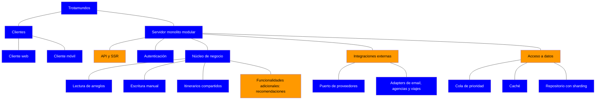
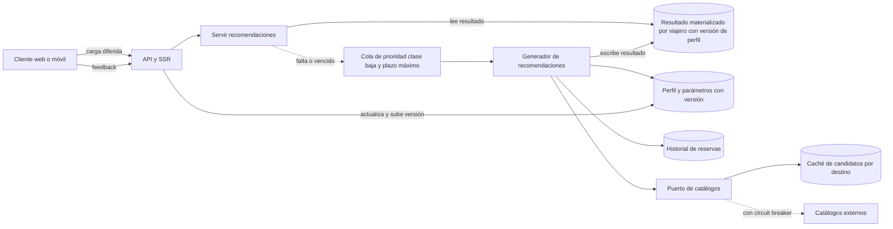
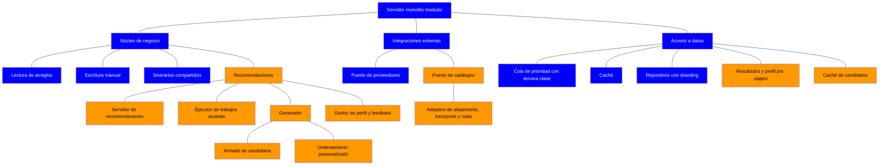
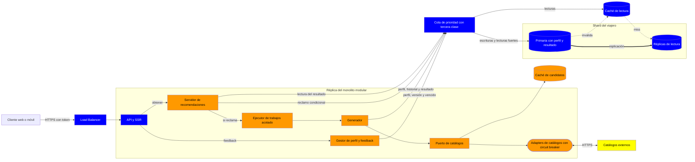
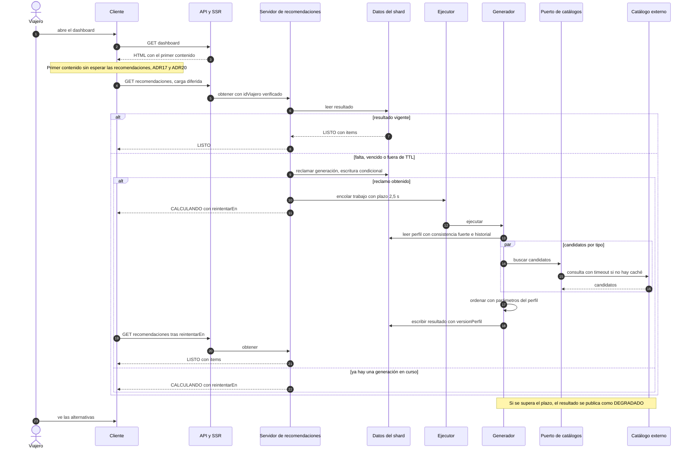
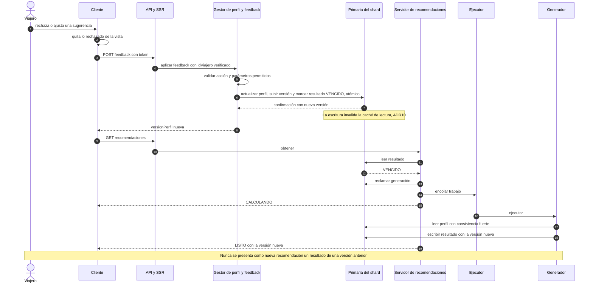

# Iteración 7 - Sistema de recomendación

## PASO 2 - Objetivo de la iteración

### Punto de partida

Tras las iteraciones 1 a 6, el sistema tiene estructura, integraciones, escalabilidad, seguridad, presentación y disponibilidad. US08 es la única historia con peso funcional sin diseño que además depende del resto del sistema: usa el historial de reservas, pasa por la API y el dashboard, y es un consumidor nuevo de la capa de datos. En `Architecture.md` solo aparece como "Funcionalidades adicionales", una caja sin descomposición.

### Drivers seleccionados

| Driver | Atributo | Medida de respuesta | Prioridad (Imp., Dif.) | Estado previo |
| --- | --- | --- | --- | --- |
| US08 Sistema de recomendación | Funcional | Sugerir alternativas de alojamiento, transporte y rutas según historial y preferencias, con human-in-the-loop | Secundaria, prevista para la 2ª entrega | Solo en el modelo de dominio |
| QA17 Generación de recomendaciones | Performance | Máximo 3 s de generación al cargar el dashboard | M, M (hipótesis) | Nuevo, definido en el Paso 1 |
| QA18 Retroalimentación del usuario | Evolvability | El feedback se usa en la próxima recomendación | M, M (hipótesis) | Nuevo, definido en el Paso 1 |

Las prioridades de QA17 y QA18 no están en la tabla de priorización original. Las propongo como M/M porque US08 está marcada para la segunda entrega y el valor es diferencial pero no bloquea el prototipo. Hay que confirmarlas.

### Drivers y decisiones a no degradar

| Driver o decisión | Por qué importa en esta iteración |
| --- | --- |
| QA02 y QA03 (800 ms web, 1.4 s primer contenido móvil) | QA17 se dispara "al cargar el dashboard" y permite 3 s, mucho más que el primer contenido. Si la recomendación bloquea la carga, rompe QA02 y QA03 (ver observación 1). |
| QA06 y QA07 (500 y 2500 req/s) | Cada carga de dashboard podría generar una recomendación. Bajo picos, esa carga adicional no puede degradar el camino crítico. |
| QA04 (ADR21 y ADR22) | El módulo no debe volverse una dependencia de la cual dependa la disponibilidad del dashboard. |
| QA09 y datos personales | Historial y preferencias son datos sensibles. El perfil de preferencias debe respetar la autenticación (ADR14, ADR16). |
| ADR11 (sharding por `idViajero`) | Las recomendaciones por viajero encajan con la partición. Cualquier señal que cruce viajeros choca con ella. |
| ADR19 (preferencias visuales en LocalStorage) | Esas preferencias son estéticas. Las preferencias de recomendación son de otra naturaleza y tienen otro destino. Se decide en el Paso 4. |
| CN1 y C2 | Sin dependencia de un servicio de ML o catálogo específico. Decisiones en MADR. |

### Meta de la iteración

> **Diseñar la estructura del módulo de recomendaciones y sus puntos de integración con datos, integraciones y presentación, de modo que el dashboard muestre alternativas personalizadas en menos de 3 s sin degradar el camino crítico (QA02, QA03, QA06, QA07), y que el feedback del viajero se refleje en la siguiente recomendación.**

### Justificación de la selección

- **Cohesión:** QA17 y QA18 empujan en direcciones opuestas sobre el mismo módulo. QA17 pide respuesta rápida y probablemente cómputo previo o cacheado. QA18 pide que el feedback se refleje de inmediato, lo que obliga a invalidar o recalcular. Hay que decidirlos juntos.
- **Una sola historia:** US08 es la última funcionalidad sin diseño con relevancia de negocio razonable (US05 y US06 reutilizan puertos y datos existentes, según el README).
- **Costo de postergarlo:** la decisión de dónde vive el módulo (dentro del monolito o aislado) y de dónde salen los datos afecta el despliegue y la partición de datos. Conviene tomarla antes del prototipo.

### Observaciones sobre los inputs (Paso 1)

| # | Observación | Efecto sobre el diseño |
| --- | --- | --- |
| 1 | **Tensión QA17 con QA02 y QA03.** El estímulo es "al cargar el dashboard", pero QA02 y QA03 miden 800 ms y 1.4 s. Los 3 s de QA17 no pueden sumarse a esos tiempos. | Hipótesis de trabajo: las recomendaciones **no bloquean** el primer contenido y se entregan después, en una sección propia del dashboard. Hay que confirmar que la medida de QA17 corre en paralelo a QA02 y QA03, y no antes. |
| 2 | **QA17 sin percentil ni carga.** No dice qué porcentaje de casos, ni cuántas solicitudes simultáneas. | Asumo 95% y que la carga sigue el perfil de QA06 y QA07. Se valida en el prototipo. |
| 3 | **QA18 es binaria.** "Usarse para la próxima recomendación" no indica cuánto debe cambiar ni en cuánto tiempo. | Asumo que el feedback queda visible para la siguiente solicitud del mismo viajero, no para cualquier otro. Esto permite consistencia por viajero en vez de global. |
| 4 | **Origen de las alternativas sin definir.** US08 habla de "alternativas de alojamiento, transporte o rutas", pero no dice si salen de catálogos externos o de datos propios. | Es la mayor incertidumbre del módulo. Ver pregunta 1 al final. |

---

## PASO 3 - Descomposición: elegir los elementos a refinar

### Enfoque

El sistema no es greenfield, así que los candidatos son los elementos de las iteraciones 1 a 6. Se usa **top-down**: se descompone "Funcionalidades adicionales" (vista 5.1 de `Architecture.md`) y se refinan de forma acotada los elementos con los que interactúa.

### Camino de una recomendación

| Tramo | Elemento involucrado | Decisiones previas | ¿Candidato? |
| --- | --- | --- | --- |
| Solicitud al cargar el dashboard | Cliente web y móvil, API y SSR | ADR20 (SSR), ADR17 y ADR18 (payload reducido, optimista) | **Sí, acotado.** Define cómo y cuándo se piden y muestran sin bloquear |
| Armado de las alternativas | Funcionalidades adicionales | Ninguna. Es una caja sin diseño | **Sí, principal** |
| Lectura del historial de reservas | Acceso a datos: lectura de arreglos, caché, réplicas, shard | ADR09, ADR10, ADR11 | **Sí, acotado.** Nuevo consumidor de lecturas |
| Persistencia de perfil y feedback | Acceso a datos: escritura | ADR09, ADR11, ADR19 | **Sí, acotado.** Nuevo tipo de dato sin definir |
| Obtención de alternativas externas | Integraciones externas | ADR05, ADR06, ADR07 | **Sí, acotado a definir.** Depende de la pregunta 1 |
| Autenticación de la solicitud | Autenticación | ADR14, ADR16 | No. Se reutiliza tal cual |
| Despliegue y disponibilidad | Nodos, balanceador, monitores | ADR21 y ADR22 | No ahora. Se revisa el impacto en el Paso 7 |

### Elementos seleccionados

| # | Elemento | Prioridad | Qué se refinará | Drivers |
| --- | --- | --- | --- | --- |
| E1 | **Funcionalidades adicionales, módulo de recomendaciones** | Alta | Descomposición interna: generación, perfil y preferencias, feedback. Dónde corre y cómo se aísla del camino crítico | QA17, QA18, US08 |
| E2 | **Acceso a datos, lectura y escritura de perfil** | Media | Cómo se lee el historial y dónde se guardan perfil y feedback, respetando el shard por viajero | QA17, QA18, QA05, ADR11 |
| E3 | **Integraciones externas, fuente de alternativas** | Media | Si se necesita un puerto y adapters de catálogos, o si las alternativas se derivan de datos propios | QA17, CN1 |
| E4 | **API y presentación del dashboard** | Media | Cómo se solicita y se entrega la recomendación sin sumar a QA02 y QA03, y cómo se captura el feedback | QA17, QA18, QA02, QA03 |



- Naranja: elementos a refinar en esta iteración (E1 a E4)
- Azul: elementos existentes sin cambios

### Qué implica esta selección

- **E1 es el eje.** Hoy es una caja vacía. Su descomposición define dónde se separa la generación (QA17) de la absorción del feedback (QA18).
- **Se evalúa la ubicación de E1.** El monolito modular (ADR02) es el punto de partida, pero un módulo de cómputo intensivo puede competir con el camino crítico en QA06 y QA07. Si E1 queda dentro del monolito, o se aísla, se decide en el Paso 4 con base en la tensión entre costo operativo y protección del camino crítico.
- **E2 hereda ADR11.** El historial y el perfil son por viajero, así que encajan en el shard. Lo que no encaja son las señales entre viajeros, que dependen de la pregunta 2.
- **E3 es condicional.** Si las alternativas salen de proveedores externos, se reutiliza Ports and Adapters (ADR05) con un puerto nuevo, sin rediseñar el módulo. Si no, E3 sale de la iteración.
- **No se refinan** Autenticación, clientes móviles en detalle ni el despliegue. Se anota su impacto para el Paso 7.

### Riesgos y supuestos que entran a la iteración

| ID | Tipo | Descripción |
| --- | --- | --- |
| R1 | Riesgo | QA17 y QA02 o QA03 pueden entrar en conflicto si la recomendación se calcula en línea y bloquea la carga |
| R2 | Riesgo | Cada carga de dashboard puede disparar cómputo, lo que multiplica la carga en picos de 2500 req/s (QA07) |
| R3 | Riesgo | Las señales entre viajeros chocan con el sharding por `idViajero` (ADR11, riesgo ya listado en el README) |
| R4 | Riesgo | Historial y perfil son datos personales sensibles. Su almacenamiento y su uso por el módulo deben respetar QA09 |
| H1 | Hipótesis | Las recomendaciones no bloquean el primer contenido y se entregan de forma diferida |
| H2 | Hipótesis | El feedback es consistente por viajero, no global |
| H3 | Hipótesis | La medida de QA17 es p95 con el perfil de carga de QA06 y QA07 |

# Paso 4: Elegir conceptos de diseño

## 1. Qué problema resuelve cada concepto

| Tensión | Drivers | Consecuencia de diseño |
| --- | --- | --- |
| Generar toma segundos y depende de terceros, pero el dashboard debe cargar en 800 ms y 1.4 s | QA17 con QA02 y QA03 | Desacoplar la generación de la carga del dashboard |
| Cada carga de dashboard podría disparar cómputo, y en picos son 2500 req/s | QA17 con QA06 y QA07 | No calcular por request y acotar el cómputo |
| El feedback debe verse en la siguiente recomendación, pero lo precalculado queda viejo | QA18 con QA17 | Un criterio explícito de vigencia del resultado |
| Los parámetros de personalización cambian con el uso y el algoritmo aún no está decidido | QA18 con CN1 | Que los parámetros sean datos y no código |

## 2. Alternativas para el momento de generación (D1)

Esta es la decisión central. Evalúo las opciones contra los drivers de la iteración y los que no se pueden degradar.

| Propiedad | Síncrona en línea con el dashboard | Precalculada para todos | Bajo demanda desacoplada con resultado materializado |
| --- | --- | --- | --- |
| QA17: 3 s en el p95 | - Depende del catálogo externo dentro del request | + Lectura directa | + La lectura es directa. La generación corre aparte |
| QA02 y QA03: no sumar al primer contenido | -- Bloquea la carga | ++ | ++ Carga diferida |
| QA06 y QA07: no multiplicar carga en picos | -- Un cómputo por carga | - Se calcula para quien no entra | + Se calcula si falta o está vencido |
| QA18: feedback en la siguiente recomendación | ++ Siempre usa el perfil actual | - Hay que recalcular a todos ante cambios | + Se resuelve con vigencia por versión |
| Costo de cómputo y de llamadas a catálogos | + | -- 2 M de usuarios activos por semana | + |
| Complejidad para el prototipo | ++ | - Planificador y lotes | 0 Una cola y un almacén de resultados |

La síncrona se descarta por R1 y R2. La precalculada masiva se descarta por costo y porque no resuelve QA18. La opción restante conserva la ventaja de la síncrona (el perfil siempre está vigente) sin su costo en el camino crítico.

## 3. Conceptos de diseño seleccionados

Selecciono **2 estilos** y **3 tácticas**. No aplica ninguna arquitectura de referencia, porque ninguna cubre este módulo sin sumar infraestructura que el prototipo no necesita. Los componentes externos se mantienen como categorías genéricas (CN1). Los patrones de diseño quedan fuera por granularidad.

### Estilos

| # | Estilo | Elementos | Drivers | Rol en la iteración |
| --- | --- | --- | --- | --- |
| S1 | **Generación asíncrona desacoplada de la entrega**, con cola de trabajos y resultado materializado por viajero. Es un overlay sobre el monolito modular (ADR02) | E1, E2, E4 | QA17, QA06, QA07 | La entrega solo lee un resultado ya armado. La generación corre como trabajo de fondo |
| S2 | **Ports and Adapters**, extensión del ADR05: un puerto de catálogos con un adapter por proveedor | E3 | QA17, CN1 | Aísla al módulo del formato y de la latencia de cada catálogo |

### Tácticas

| # | Táctica | Categoría | Elementos | Drivers |
| --- | --- | --- | --- | --- |
| T1 | **Maintain multiple copies of data con vigencia por versión de perfil.** El resultado materializado lleva la versión del perfil con que se calculó. Si hay feedback posterior, el resultado se considera vencido | Performance | E1, E2 | QA17, QA18 |
| T2 | **Prioritize events, bound queue sizes y bound execution times, con degradación controlada.** Los trabajos de recomendación entran como la clase de menor prioridad de la cola (ADR09), con cola acotada y plazo máximo. Si vence el plazo, se sirve el último resultado válido o uno no personalizado | Performance y Availability | E1, E2, E4 | QA17, QA06, QA07, QA04 |
| T3 | **Defer binding: los parámetros de personalización son datos del perfil, no lógica.** El feedback modifica parámetros persistidos. El algoritmo los lee en cada generación | Modifiability (Evolvability) | E1, E2 | QA18, CN1 |

## 4. Registro de decisiones

| ID | Concepto elegido | Tipo | Alternativas descartadas | Justificación | Trade-off |
| --- | --- | --- | --- | --- | --- |
| **D1** | **S1** con **T1**: generación bajo demanda, desacoplada, con resultado materializado y vigencia por versión de perfil. La sección se carga de forma diferida, con el mecanismo de detalle bajo demanda y recarga parcial ya vigente (ADR17, ADR20) | Estilo y táctica | Generación síncrona en línea. Precalculada para todos los viajeros (ver sección 2) | El primer contenido no depende de la recomendación (QA02, QA03). Se calcula solo cuando falta o está vencida, lo que acota R2. La vigencia por versión hace verificable QA18: nunca se sirve un resultado calculado con un perfil anterior al último feedback | Consistencia eventual en la primera carga: aparece un estado "calculando" hasta que el resultado está listo. Hay que decidir qué ve el viajero mientras tanto |
| **D2** | **Módulo de recomendaciones dentro del monolito modular** (ADR02), con trabajadores de fondo del mismo artefacto y datos de perfil, feedback y resultados particionados por `idViajero` (ADR11) | Decisión sobre el estilo jerárquico existente | **Servicio separado:** aísla el cómputo pero rompe ADR02, suma otro despliegue con failover (ADR21, ADR22) y otra frontera de datos. **Dentro del monolito, ejecución en el request:** sin aislamiento del camino crítico | Con D1 y T2 el cómputo ya queda fuera del camino crítico y en la clase de menor prioridad. El costo operativo de un servicio nuevo no se justifica en un prototipo. Los datos por viajero encajan en el shard sin consultas cruzadas (A2) | Si el cómputo crece, compite por CPU con el monolito. Se mitiga con el límite de la cola (T2) y se reevalúa si los trabajos degradan QA06 o QA07 |
| **D3** | **S2**: puerto de catálogos con adapters por proveedor. Los candidatos externos se consultan al generar, nunca en la carga del dashboard, y se cachean por destino y fechas con vencimiento corto. Reutiliza el circuit breaker por proveedor (ADR07) | Estilo | **Llamadas directas del módulo a cada catálogo:** lo acopla a cada formato, contra CN1. **Derivar alternativas solo de reservas propias:** no propone nada nuevo (US08) | Es lo ya validado en ADR05 y ADR07. El caché de candidatos es dato de referencia compartido, no dato personal. No cruza viajeros ni choca con ADR11 | Más adapters que mantener. Precios y disponibilidad vencen rápido y el vencimiento corto sube la carga sobre los proveedores |
| **D4** | **T2**: recomendación como clase de menor prioridad en la cola de ADR09, con cola acotada y plazo máximo. Al vencer el plazo se sirve el último resultado válido o uno no personalizado por destino | Táctica | Cola propia sin relación con ADR09: dos mecanismos de prioridad. Sin plazo: un catálogo lento retiene trabajadores | Reutiliza el mecanismo existente. Con un plazo bien por debajo de los 3 s, QA17 se cumple degradando en vez de fallar. Bajo picos (QA07) la recomendación cede capacidad a lecturas y escrituras de usuario | Agrava el starvation ya identificado en ADR09, ahora con una tercera clase. Un resultado degradado no es personalizado, lo que afecta el valor percibido |
| **D5** | **T3**: los parámetros y preferencias de recomendación son datos persistidos en el perfil, con versión. Aceptar, rechazar o ajustar escribe en el perfil e incrementa la versión | Táctica | Recalcular parámetros solo en lotes periódicos: el feedback no llega a la próxima recomendación (QA18). Preferencias en LocalStorage: ver nota | El algoritmo concreto queda diferido y reemplazable sin tocar el flujo de feedback. Una versión de perfil explícita es la base de la vigencia de T1 | El feedback es una escritura más y entra a la cola como escritura. Hay que garantizar que la siguiente lectura la vea (R5) |

**Nota sobre ADR19.** Descarto LocalStorage para este perfil, aunque sea una preferencia del viajero. ADR19 aplica a preferencias estéticas, cuya pérdida es inocua. El perfil de recomendación es el historial de decisiones del viajero, y el grupo ya rechazó cachear datos del usuario en el cliente por seguridad (contraste de la iteración 5). Además QA18 exige que el servidor use el feedback, y una copia en el cliente no lo garantiza.

## 5. Vista de los conceptos



- Línea punteada hacia la cola: dispara una generación solo si el resultado falta o su versión es anterior a la del perfil.
- Se mantiene el estilo base. Todo vive dentro del monolito modular y reutiliza la cola de prioridad, el shard y los adapters existentes.

## 6. Cobertura de los drivers

| Driver | Conceptos | Cobertura esperada |
| --- | --- | --- |
| US08 | S1, S2, T3 | Alta. Alternativas externas, personalizadas y con feedback |
| QA17 | S1, T1, T2, S2 | Media. Cumple si el plazo de generación y los timeouts de catálogos caben en 3 s. Se valida con medición |
| QA18 | T1, T3 | Alta. La vigencia por versión lo hace verificable. Depende de que la lectura posterior vea la versión nueva (R5) |
| QA02 y QA03 (no degradar) | S1, carga diferida | Alta, bajo H1 |
| QA06 y QA07 (no degradar) | T2, D2 | Media. Depende de calibrar los límites de la cola |
| QA04 (no degradar) | T2 | Media. El dashboard no depende del módulo, porque falla y se degrada |

---

# PASO 5 - Instanciar elementos, asignar responsabilidades y definir interfaces

## 5.1 Instanciación

| Concepto (Paso 4) | Elemento instanciado | Padre | Estado |
| --- | --- | --- | --- |
| S1, T1 | **Servidor de recomendaciones**: entrega el resultado materializado y decide si hay que generar | Recomendaciones | Nuevo |
| S1 | **Ejecutor de trabajos acotado**: pool local con cola limitada y plazo máximo | Recomendaciones | Nuevo |
| S1 | **Generador**: arma candidatos, ordena según el perfil y escribe el resultado | Recomendaciones | Nuevo |
| T3 | **Gestor de perfil y feedback**: persiste parámetros y feedback, y sube la versión | Recomendaciones | Nuevo |
| S2 | **Puerto de catálogos** con un adapter por tipo de proveedor: alojamiento, transporte y rutas | Integraciones externas | Nuevo, extiende ADR05 |
| T1 | **Resultado materializado**: tabla por viajero con el resultado y la versión de perfil usada | Acceso a datos | Nuevo, en el shard del viajero |
| T3 | **Perfil de recomendación**: parámetros, aceptados, descartados y versión | Acceso a datos | Nuevo, en el shard del viajero |
| S2 | **Caché de candidatos** por destino y fechas, con vencimiento corto | Acceso a datos | Nuevo, dato de referencia sin datos personales |
| T2 | **Tercera clase de prioridad** en la cola de prioridad | Acceso a datos | Modificado, ADR09 |
| D1 | **Sección de recomendaciones** con carga diferida y captura de feedback | Clientes y presentación | Modificado, ADR17 y ADR20 |

Todo vive dentro del monolito modular (D2). No hay unidades desplegables nuevas. El despliegue de ADR21 y ADR22 no cambia.

## 5.2 Asignación de responsabilidades

| Elemento | Responsabilidades | Fuera de su alcance |
| --- | --- | --- |
| **Servidor de recomendaciones** | Leer el resultado del viajero (por caché y réplica, como toda lectura). Responder `LISTO`, `CALCULANDO` o `DEGRADADO`. Si el resultado falta, está `VENCIDO` o superó su TTL, **reclamar la generación** con una escritura condicional (claim con vencimiento) y encolarla en el ejecutor | Generar. Leer el perfil |
| **Ejecutor de trabajos** | Mantener una cola local acotada. Rechazar con `CapacidadAgotada` si se llena. Cortar todo trabajo que supere el plazo máximo. Priorizar los trabajos más antiguos | Decidir qué se genera |
| **Generador** | Leer el perfil **con consistencia fuerte** (primaria). Leer el historial de reservas. Pedir candidatos al puerto, en paralelo por tipo. Ordenar y filtrar por parámetros, descartados y aceptados. Escribir el resultado con la `versionPerfil` usada. Al vencer el plazo, publicar `DEGRADADO` | Persistir feedback |
| **Gestor de perfil y feedback** | Validar el feedback contra el conjunto de parámetros permitidos. Aplicar aceptar, rechazar o ajustar sobre el perfil. **Subir la versión y marcar el resultado como `VENCIDO` en la misma escritura**, dentro del shard del viajero | Generar |
| **Puerto de catálogos** | Contrato único y neutral para pedir candidatos. Normalizar al modelo `Candidato`. Aplicar circuit breaker, timeout y cuota por proveedor. Cachear por destino y fechas | Conocer al viajero |
| **Caché de candidatos** | Guardar candidatos con vencimiento corto. No almacena datos personales | Ser fuente de verdad |
| **Cola de prioridad** (ADR09) | Procesar las operaciones de datos del módulo como clase baja, con envejecimiento para evitar starvation | Ejecutar generaciones |
| **Sección de recomendaciones** (cliente) | Pedir de forma diferida, después del primer contenido. Reintentar con espera si recibe `CALCULANDO`. Enviar feedback. Quitar de la vista lo rechazado de inmediato (patrón de ADR18) | Calcular o filtrar con datos propios |

Tres reglas de reparto resuelven los riesgos del Paso 4:

- **R5, lectura del propio feedback.** El Gestor de perfil escribe el perfil y marca `VENCIDO` en la misma escritura. La invalidación de caché de ADR10 hace que el siguiente `obtener` lea ese estado. El Generador lee el perfil de la primaria, no de réplicas. Es un volumen bajo, porque solo ocurre en segundo plano.
- **R2, una generación por viajero.** El claim condicional sobre el resultado garantiza que, con N réplicas y varias cargas simultáneas, **solo una** ejecute la generación de esa versión. Si la réplica cae, el claim vence y la próxima carga lo retoma. No hace falta broker ni coordinador.
- **R4, datos personales.** Al catálogo nunca viajan `idViajero` ni historial, solo destino, fechas y criterios genéricos. Perfil y resultados quedan en el shard del viajero, cifrados en reposo (ADR12). Se acceden solo con la identidad verificada del token (ADR14, ADR16).

## 5.3 Interfaces

| ID | Interfaz | Productor | Consumidor | Contrato |
| --- | --- | --- | --- | --- |
| REC-1 | **API de recomendaciones** (HTTPS, JSON, token firmado) | API del servidor | Clientes | `GET /recomendaciones` devuelve `estado`, `items[]`, `generadoEn`, `versionPerfil` y `reintentarEn` si está calculando. `POST /recomendaciones/{id}/feedback` recibe `accion` (`ACEPTA`, `RECHAZA`, `AJUSTA`) y `parametros` opcionales. Devuelve la nueva `versionPerfil` |
| REC-2 | **Reclamo de generación** (interna) | Servidor de recomendaciones | Ejecutor | `reclamar(idViajero, versionPerfil)` es una escritura condicional que devuelve `RECLAMADO` o `YA_EN_CURSO`. El reclamo vence a los 5 s. Una clave por viajero y versión evita duplicados |
| REC-3 | **Almacén de recomendaciones** (interna, partición por `idViajero`) | Acceso a datos | Servidor, Generador, Gestor | `leerResultado`, `escribirResultado(versionPerfil)`, `leerPerfil(consistencia fuerte)`, `aplicarFeedback`, que es atómico: actualiza perfil, sube versión y marca resultado `VENCIDO` |
| REC-4 | **Puerto de catálogos** (interna) | Adapters | Generador | `buscarCandidatos(tipo, destino, fechas, criterios, timeout)` devuelve `Candidato[]` o `ProveedorNoDisponible`. Tipos: `ALOJAMIENTO`, `TRANSPORTE`, `RUTA` |
| REC-5 | **Catálogos externos** | Proveedores | Adapter | HTTPS con APIs estándar. Circuit breaker y reintentos acotados por proveedor (ADR07) |

### Contratos de datos

**Recomendación** (ítem de `items[]`):

| Campo | Descripción |
| --- | --- |
| `idRecomendacion` | Identificador estable, base del feedback |
| `tipo` | Alojamiento, transporte o ruta |
| `candidato` | `idExterno`, nombre, destino, fechas, precio de referencia y enlace |
| `motivo` | Por qué se sugiere, por ejemplo "similar a tus reservas en hotel y zona" |
| `parametrosAjustables` | Parámetros que el viajero puede modificar para esa sugerencia |

**Estado del resultado** (resuelve R8, el estado de espera):

| Estado | Cuándo | Qué ve el viajero |
| --- | --- | --- |
| `LISTO` | Resultado vigente, con `versionPerfil` igual a la actual y dentro del TTL | Las alternativas |
| `CALCULANDO` | Falta resultado o está vencido, hay una generación en curso | Un estado de carga en la sección, sin bloquear el resto del dashboard |
| `DEGRADADO` | Se superó el plazo o un catálogo falló | Sugerencias no personalizadas por destino, o el último resultado válido con aviso |

**Perfil de recomendación:** `idViajero`, `version`, `parametros` (por ejemplo presupuesto, tipo de alojamiento, medios preferidos), `aceptados[]` y `descartados[]`.

**Resultado materializado:** `idViajero`, `versionPerfil`, `estado`, `generadoEn`, `venceEn` (TTL) e `items[]`.

Las entidades `PerfilPreferencias` y `Recomendacion` del modelo de dominio ya existen. Se les agrega `version` y el estado del resultado.

### Valores iniciales (hipótesis, a calibrar en el prototipo)

| Parámetro | Valor | Justificación |
| --- | --- | --- |
| Plazo máximo de generación | 2,5 s | Deja 0,5 s de margen sobre los 3 s de QA17 |
| TTL del resultado | 24 h | Los precios vencen, pero no hace falta recalcular en cada carga |
| Vencimiento de candidatos en caché | 15 min | Precio y disponibilidad se mueven rápido |
| Vencimiento del claim | 5 s | Un claim huérfano se recupera en la próxima carga |
| Cola local del ejecutor | Acotada por réplica, rechaza al llenarse | T2, bound queue sizes |
| Reintento del cliente ante `CALCULANDO` | Hasta 3 intentos, espaciados por `reintentarEn` | Acota las lecturas extra por carga |

### Presupuesto de QA17 (peor caso, camino frío)

| Tramo | Presupuesto |
| --- | --- |
| Espera en el ejecutor y la cola de prioridad | ≤ 0,5 s |
| Lectura de perfil (primaria) e historial | ≤ 0,2 s |
| Candidatos: timeout por catálogo, en paralelo, con caché | ≤ 1,2 s |
| Ordenamiento | ≤ 0,3 s |
| Escritura del resultado | ≤ 0,2 s |
| **Total** | **≤ 2,4 s, con 0,6 s de margen** |

El tramo de candidatos domina. Con la caché de candidatos caliente baja a decenas de ms.

### Carga estimada (hipótesis)

| Escenario | Cálculo | Generaciones por segundo |
| --- | --- | --- |
| Régimen | 450 lecturas por segundo, 5 % con resultado faltante o vencido | ~22 |
| Pico | 2250 lecturas por segundo, 5 % | ~112 |

La cifra del 5 % es una hipótesis (H4). El claim por viajero y el TTL de 24 h la acotan. El cálculo muestra por qué el ejecutor debe tener cola limitada y ceder ante la carga de usuario.

## 5.4 Justificación

| Aspecto | Justificación |
| --- | --- |
| **Instanciación** | Cada elemento responde a un concepto del Paso 4. Se separa Servir de Generar porque tienen perfiles de carga opuestos: lectura barata y frecuente contra cómputo caro y raro |
| **Responsabilidades** | La marca `VENCIDO` junto con la versión de perfil hace que QA18 se pueda verificar sin leer réplicas. El claim evita el cómputo duplicado entre réplicas sin infraestructura nueva (QA06, QA07) |
| **Interfaces** | El puerto de catálogos no conoce al viajero (R4). `CALCULANDO` y `DEGRADADO` son estados del contrato y no errores, para que la sección degrade sin afectar el dashboard (QA04) |

---

# PASO 6 - Esbozar vistas y registrar decisiones

## 6.1 Vistas

| Vista | Tipo | Qué ayuda a razonar | Drivers |
| --- | --- | --- | --- |
| 5.10 Descomposición de recomendaciones | Módulos | Dónde vive cada responsabilidad nueva | US08, QA17, QA18 |
| 5.11 Recomendaciones en ejecución | C&C | Aislamiento del camino crítico, claim, cola y puerto de catálogos | QA17, QA06, QA07 |
| 5.12 Carga del dashboard y generación | Secuencia | Camino diferido, claim, plazo y degradación | QA17, QA02, QA03 |
| 5.13 Feedback del viajero | Secuencia | Cómo el feedback invalida el resultado y llega a la próxima recomendación | QA18 |

No se agrega vista de despliegue. El módulo corre en las réplicas existentes (ADR21), y el impacto sobre la disponibilidad se analiza en el Paso 7.

### 5.10 Vista de descomposición

Reemplaza "Funcionalidades adicionales" de la vista 5.1.



- Naranja: nuevo en la iteración 7.
- Azul: existente.

### 5.11 Vista C&C



- Naranja: nuevo. Azul: existente. Amarillo: sistemas externos.

Lectura de la vista:

- El camino de lectura del dashboard no pasa por el Generador. Solo pasa por Servir, que lee un resultado ya armado.
- Todo acceso a datos del módulo pasa por la cola de ADR09, como clase baja. El feedback es la excepción: como escritura de usuario, entra con la prioridad de una escritura manual.

### 5.12 Secuencia: carga del dashboard y generación



### 5.13 Secuencia: feedback del viajero



## 6.2 Registro de decisiones MADR

Estado: **Propuesta**, fuente: LLM. Continúan la numeración vigente (ADR23 a ADR27).

### ADR23 - Generación asíncrona con resultado materializado por viajero

```markdown
---
estado: propuesta
fecha: 2026-11-20
fuente: LLM
---

# Generación de recomendaciones asíncrona con resultado materializado

## Contexto y Problema
QA17 pide generar recomendaciones en 3 s y se dispara al cargar el dashboard, pero QA02 y QA03 piden 800 ms y 1.4 s. Calcular en línea bloquea la carga y multiplica el cómputo en picos de 2500 req/s (QA07).

## Decision Drivers
- QA17, QA18
- QA02, QA03 (no degradar)
- QA06, QA07 (no degradar)

## Opciones Consideradas
- Generación síncrona en línea con el dashboard
- Precalculada para todos los viajeros
- Bajo demanda, desacoplada, con resultado materializado

## Resultado de la decisión
Opción elegida: bajo demanda desacoplada. El dashboard carga primero y la sección de recomendaciones se pide de forma diferida. Se genera solo si el resultado falta, está vencido o superó su TTL.

### Consecuencias
- Bueno, porque el primer contenido no depende de la recomendación.
- Bueno, porque solo se calcula lo necesario.
- Malo, porque la primera carga muestra un estado "calculando".
- Malo, porque agrega consistencia eventual en la sección.

### Confirmación
Con la sección bloqueada artificialmente, el dashboard sigue cumpliendo QA02 y QA03. Una carga con resultado vigente no genera cómputo.

## Pros y Cons de las opciones
### Síncrona en línea
- Bueno, porque siempre usa el perfil actual.
- Malo, porque bloquea la carga y depende de catálogos externos dentro del request.
### Precalculada para todos
- Bueno, porque la lectura es directa.
- Malo, porque calcula para quien no entra (2 M de usuarios semanales) y obliga a recalcular a todos ante cambios de perfil.
```

### ADR24 - Módulo de recomendaciones dentro del monolito con ejecutor acotado

```markdown
---
estado: propuesta
fecha: 2026-11-20
fuente: LLM
---

# Módulo de recomendaciones dentro del monolito modular

## Contexto y Problema
Hay que decidir dónde corre el cómputo de recomendaciones sin comprometer el camino crítico ni el costo operativo de un prototipo.

## Decision Drivers
- QA17, QA06, QA07, QA04
- ADR02 (monolito modular), ADR11 (sharding)

## Opciones Consideradas
- Dentro del monolito, con ejecutor local acotado y claim por viajero
- Servicio separado
- Dentro del monolito, ejecutado en el request

## Resultado de la decisión
Opción elegida: dentro del monolito con ejecutor local de cola acotada. Una escritura condicional (claim) con vencimiento de 5 s garantiza una sola generación por viajero y versión entre réplicas.

### Consecuencias
- Bueno, porque no se agrega un despliegue ni otro failover (ADR21, ADR22).
- Bueno, porque perfil y resultado quedan en el shard del viajero.
- Malo, porque el cómputo compite por CPU con el monolito.
- Malo, porque un claim huérfano retrasa hasta 5 s la próxima generación.

### Confirmación
En prueba de carga a 2500 req/s con generaciones activas, el p95 de lectura y escritura de usuario se mantiene. Con N réplicas, dos cargas simultáneas del mismo viajero producen una sola generación.

## Pros y Cons de las opciones
### Servicio separado
- Bueno, porque aísla el cómputo.
- Malo, porque rompe ADR02, suma otro despliegue con failover y otra frontera de datos.
### Ejecución en el request
- Malo, porque no aísla el camino crítico.
```

### ADR25 - Puerto de catálogos con adapters y caché de candidatos

```markdown
---
estado: propuesta
fecha: 2026-11-20
fuente: LLM
---

# Puerto de catálogos para obtener alternativas externas

## Contexto y Problema
US08 pide proponer alternativas nuevas de alojamiento, transporte y rutas. Los catálogos tienen formatos y latencias distintos, y no hay que depender de ninguno (CN1).

## Decision Drivers
- US08, QA17
- CN1, QA14

## Opciones Consideradas
- Puerto de catálogos con un adapter por proveedor y caché de candidatos
- Llamadas directas del módulo a cada catálogo
- Derivar alternativas solo de las reservas propias

## Resultado de la decisión
Opción elegida: puerto y adapters, extendiendo ADR05 con circuit breaker por proveedor (ADR07). Los candidatos se consultan solo al generar y se cachean por destino y fechas con vencimiento de 15 min. Al catálogo no viaja ningún dato del viajero.

### Consecuencias
- Bueno, porque agregar un catálogo es agregar un adapter.
- Bueno, porque la caché es dato de referencia y no personal, y no choca con ADR11.
- Malo, porque hay más adapters que mantener.
- Malo, porque un vencimiento corto sube la carga sobre los proveedores.

### Confirmación
Un catálogo caído o lento no supera el plazo de 2,5 s. Ninguna solicitud saliente contiene `idViajero` ni historial.

## Pros y Cons de las opciones
### Llamadas directas
- Malo, porque acopla el módulo a cada formato y contradice CN1.
### Solo reservas propias
- Malo, porque no propone nada nuevo.
```

### ADR26 - Recomendación como clase de menor prioridad con plazo máximo y degradación

```markdown
---
estado: propuesta
fecha: 2026-11-20
fuente: LLM
---

# Prioridad baja, plazo máximo y degradación para las recomendaciones

## Contexto y Problema
Bajo picos de tráfico (QA07), el trabajo de recomendación no debe quitar capacidad a lecturas y escrituras de usuario, y un catálogo lento no debe retener recursos.

## Decision Drivers
- QA17, QA06, QA07, QA04
- ADR09 (cola de prioridad)

## Opciones Consideradas
- Operaciones de datos del módulo como tercera clase de ADR09, con cola local acotada y plazo máximo
- Mecanismo de prioridad propio e independiente
- Sin plazo ni límite

## Resultado de la decisión
Opción elegida: tercera clase en ADR09 con envejecimiento, cola local acotada que rechaza al llenarse y plazo de 2,5 s. Al vencer se publica `DEGRADADO`: último resultado válido o sugerencias no personalizadas por destino.

### Consecuencias
- Bueno, porque reutiliza un mecanismo existente.
- Bueno, porque QA17 se cumple degradando en vez de fallando.
- Malo, porque agrava el starvation ya señalado en ADR09.
- Malo, porque un resultado degradado pierde personalización.

### Confirmación
A 2500 req/s las recomendaciones cumplen la medida o devuelven `DEGRADADO` sin degradar el p95 de lecturas y escrituras. Ningún trabajo supera el plazo.

## Pros y Cons de las opciones
### Mecanismo propio
- Malo, porque duplica la lógica de prioridad.
### Sin plazo ni límite
- Malo, porque un catálogo lento retiene trabajadores y memoria.
```

### ADR27 - Perfil de recomendación versionado en el servidor y vigencia por versión

```markdown
---
estado: propuesta
fecha: 2026-11-20
fuente: LLM
---

# Perfil de recomendación versionado y vigencia del resultado por versión

## Contexto y Problema
QA18 exige que el feedback se use en la próxima recomendación. Con resultados materializados y lecturas desde caché y réplicas, un resultado viejo podría servirse después del feedback sin que nadie lo note.

## Decision Drivers
- QA18, QA17
- ADR10, ADR11, CN1

## Opciones Consideradas
- Perfil con parámetros como datos, versión explícita y resultado marcado VENCIDO en la misma escritura
- Recalcular parámetros en lotes periódicos
- Preferencias en LocalStorage

## Resultado de la decisión
Opción elegida: perfil versionado en el shard del viajero. Aceptar, rechazar o ajustar sube la versión y marca el resultado `VENCIDO` en una sola escritura atómica. El Generador lee el perfil de la primaria. Los parámetros son datos, por lo que el algoritmo se puede reemplazar sin tocar el flujo de feedback.

### Consecuencias
- Bueno, porque QA18 es verificable: ningún resultado de una versión anterior se presenta como nuevo.
- Bueno, porque el algoritmo queda diferido y reemplazable.
- Malo, porque el feedback es una escritura más en la cola.
- Malo, porque tras una conmutación de datos (ADR21) un feedback reciente puede perderse.

### Confirmación
Tras un feedback, la siguiente lectura devuelve `CALCULANDO` o `LISTO` con `versionPerfil` mayor o igual a la del feedback. Nunca `LISTO` con una versión anterior.

## Pros y Cons de las opciones
### Lotes periódicos
- Malo, porque el feedback no llega a la próxima recomendación.
### LocalStorage
- Malo, porque QA18 exige que el servidor use el feedback, y el grupo ya descartó guardar datos del usuario en el cliente (contraste de la iteración 5). ADR19 aplica a preferencias estéticas.
```

## 6.3 Actualización de `Architecture.md`

| Sección | Cambio |
| --- | --- |
| 1 | "6 iteraciones y 22 ADRs" pasa a 7 iteraciones y 27 ADRs |
| 3.1 y 3.2 | Agregar QA17 y QA18 con sus medidas, prioridad M/M, pendiente de confirmar |
| 5.1 | Reemplazar "Funcionalidades adicionales" por la vista 5.10 |
| 5 | Agregar las vistas 5.11, 5.12 y 5.13 |
| 6.1 | Filas para REC-1 a REC-5 |
| 6.2 | `GET /recomendaciones` y `POST /recomendaciones/{id}/feedback` |
| 7.1 | ADR23 a ADR27, iteración 7 |
| 7.2 | US08 y QA17 pasan a Parcial. QA18 pasa a Completa, con la validación de R5 pendiente |

---

# PASO 7 - Analizar el diseño y revisar la meta

## 7.1 Análisis por decisión

| ADR | Qué aporta | Debilidad | Veredicto |
| --- | --- | --- | --- |
| ADR23 Generación asíncrona | Saca el cómputo del camino crítico. QA02 y QA03 quedan intactos bajo H1 | Estado "calculando" en la primera carga y lecturas extra por reintentos | Sólida |
| ADR24 Dentro del monolito | Cero componentes de despliegue nuevos. Un solo cómputo por viajero | CPU compartida. Reabre ADR02 si el cómputo crece | Sólida, con costo de cambio conocido |
| ADR25 Puerto de catálogos | Reutiliza ADR05 y ADR07. La caché no contiene datos personales | Cuota y latencia de terceros fuera de nuestro control | Sólida, con riesgo R7 |
| ADR26 Prioridad baja y plazo | QA17 se cumple por degradación. El pico no afecta al usuario | Starvation y pérdida de personalización | Adecuada, es el punto más sensible a calibración |
| ADR27 Perfil versionado | QA18 verificable y algoritmo reemplazable | Feedback expuesto a pérdida en conmutación de datos | Sólida |

## 7.2 Análisis del conjunto

| Interacción | Efecto | Estado |
| --- | --- | --- |
| ADR23 con ADR17 y ADR20 | La sección se pide con el mecanismo de detalle bajo demanda y recarga parcial ya vigente. No hay un mecanismo nuevo en el cliente | Positivo |
| ADR24 con ADR21 | Las réplicas activas absorben el cómputo y un claim vencido tolera la caída de una réplica. La recomendación no es un nodo crítico | Positivo |
| ADR26 con ADR09 | Se agrega una tercera clase. El starvation de escrituras ya era un riesgo y ahora afecta también a la recomendación | Riesgo, con envejecimiento y plazo como mitigación |
| ADR27 con ADR10 | La invalidación de caché por escritura ya existe. La marca `VENCIDO` aprovecha ese mecanismo sin diseño nuevo | Positivo |
| ADR27 con ADR21 | La sincronización periódica a la pasiva puede perder un feedback reciente. Es de bajo valor y el viajero lo repite, pero rompe QA18 en silencio | Riesgo menor, aceptado |
| ADR25 con ADR07 | La cuota de proveedores es independiente de la ingesta de reservas (QA01), porque los catálogos son otros proveedores | Positivo, hay que mantenerlos separados |
| ADR23 y QA06 | Cada carga con resultado `CALCULANDO` suma hasta 3 lecturas | A medir (R9) |

No encuentro contradicciones entre decisiones.

### Cuestionario de tácticas de performance (Bass)

| Táctica | ¿Soportada? | Dónde |
| --- | --- | --- |
| Manage event arrival | Sí | Claim por viajero y TTL de 24 h |
| Limit event response | Sí | Cola local del ejecutor que rechaza al llenarse |
| Prioritize events | Sí | Tercera clase en ADR09 |
| Bound execution times | **Sí, y cierra una brecha del Paso 7 de la iteración 2** | Plazo de 2,5 s y timeouts por catálogo |
| Maintain multiple copies of data | Sí | Resultado materializado y caché de candidatos |
| Introduce concurrency | Sí | Candidatos en paralelo por tipo |
| Increase resources | Parcial | Escala con las réplicas existentes, sin señal propia |

## 7.3 Cumplimiento de los drivers

| Driver | Estado | Qué lo respalda | Qué falta |
| --- | --- | --- | --- |
| **US08** | **Parcial** | Alternativas externas, personalización por perfil y feedback humano en el bucle (ADR23 a ADR27) | El algoritmo de ordenamiento está diferido. Sin señales entre viajeros (A2). No hay diseño visual |
| **QA17** | **Parcial, abordado a nivel estructural** | Presupuesto de 2,4 s en el peor caso, plazo de 2,5 s y degradación | Medir con catálogos reales y con caché fría. La medida del p95 es una hipótesis (H3) |
| **QA18** | **Abordado a nivel estructural** | Versión de perfil y marca `VENCIDO` atómica. Verificable | Probar la secuencia "feedback seguido de lectura" bajo replicación asíncrona |
| QA02, QA03 | **No degradados, bajo H1** | La carga es diferida | Confirmar con el negocio que QA17 corre en paralelo y no antes de QA02 y QA03 |
| QA06, QA07 | **No degradados en el diseño** | Clase baja, claim, TTL y cola acotada | Prueba de carga con generaciones activas |
| QA04 | **No degradado** | `DEGRADADO` y claim con vencimiento | Ninguna |

## 7.4 Riesgos y puntos abiertos que deja el diseño

| ID | Tipo | Descripción | Mitigación y dónde se cierra |
| --- | --- | --- | --- |
| R5 | Riesgo | Lectura del propio feedback | **Resuelto por diseño** con la marca `VENCIDO` y la lectura del perfil en la primaria. Validar en el prototipo |
| R6 | Riesgo | Starvation con tres clases | Envejecimiento y plazo. Calibrar en el prototipo |
| R7 | Riesgo | Catálogos lentos o con límite de uso | Timeout, caché de 15 min y circuit breaker. Se podría calentar la caché para destinos de viajes próximos, a decidir al prototipar |
| R8 | Riesgo | Estado de espera en la primera carga | `CALCULANDO` es parte del contrato. Falta el diseño visual y medir el impacto en QA11 |
| R9 | Riesgo | **Lecturas extra por reintentos del cliente**, hasta 3 por carga con resultado faltante | `reintentarEn` y tope de reintentos. Medir el tráfico adicional a 2500 req/s |
| R10 | Riesgo | **La cola de prioridad es un nodo único** (ADR21, riesgo ya abierto). Ahora suma tráfico del módulo | Mantener la clase baja y acotada. El riesgo de fondo sigue abierto y es el candidato más importante a una próxima iteración |
| R11 | Riesgo | **Feedback perdido en una conmutación** de datos (ADR21) | Aceptado. Impacto bajo, pero hay que documentarlo |
| R12 | Riesgo | **Calidad de la recomendación sin medir.** Las medidas de QA17 y QA18 son de rendimiento y de uso del feedback, no de acierto. Un módulo rápido y obediente puede recomendar mal | Fuera de alcance arquitectónico. Definir una métrica de aceptación en el prototipo |
| R3, R4 | Riesgo | Sharding contra señales entre viajeros y datos personales | R3 queda cerrado por A2. R4 queda cubierto por el almacenamiento en el shard, el cifrado y la ausencia de datos personales en catálogos |
| H1 a H4 | Hipótesis | Sin cambios | Prototipo |

## 7.5 Respuestas a las preguntas del paso

| Pregunta | Respuesta |
| --- | --- |
| **¿Cuánto diseño llevamos hecho?** | La estructura del módulo está completa: descomposición, flujos, interfaces, estados y decisiones. Faltan valores medidos y el algoritmo concreto, que se difirió a propósito |
| **¿Se cumplió el objetivo de la iteración?** | **Sí, a nivel de diseño.** El módulo queda fuera del camino crítico y el feedback llega a la siguiente recomendación por construcción. Las medidas de QA17 y QA18 se confirman solo con el prototipo |
| **¿Hace falta otra iteración?** | No para US08. Lo que queda se resuelve con prototipo y medición |

## 7.6 Estado del backlog tras la iteración 7

| Estado | Drivers |
| --- | --- |
| **Abordados** | QA05 a QA09, QA14, QA15, QA18, US01 a US04, US07 |
| **Parciales** | QA01, QA02, QA03, QA04, QA10, QA11, QA13, QA17, US08 |
| **Pendientes** | QA12, QA16, US05, US06 |
